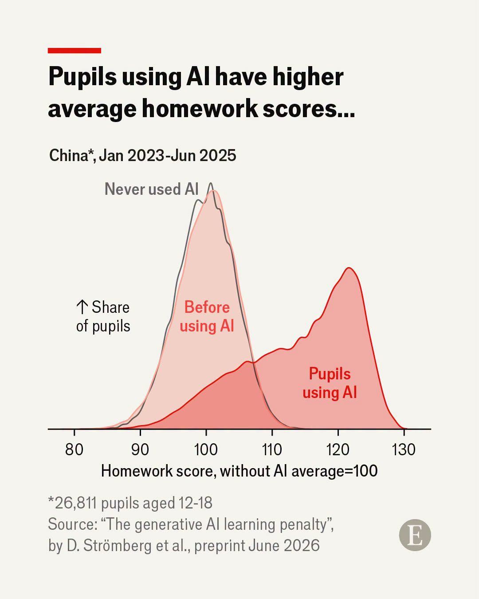
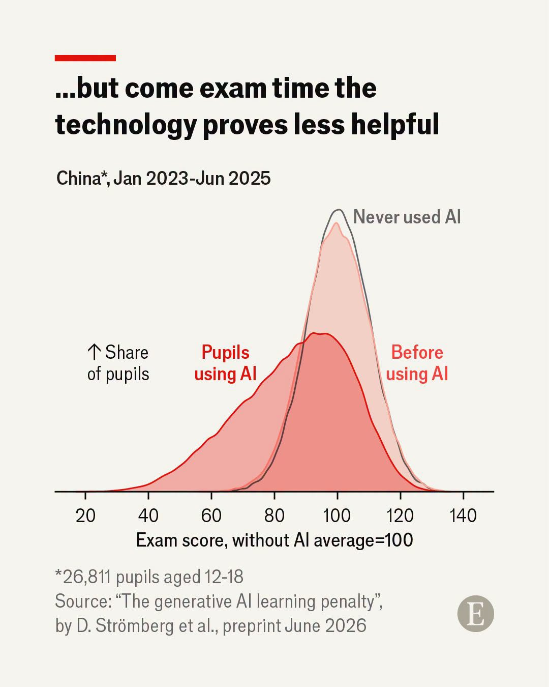
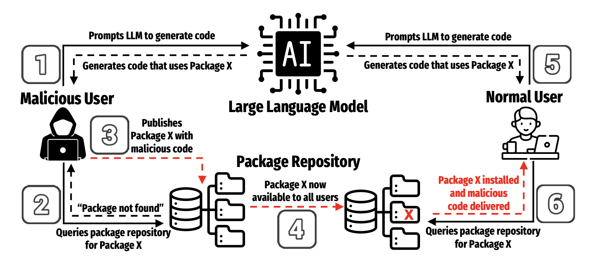
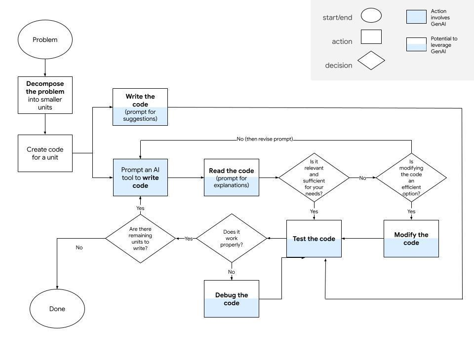
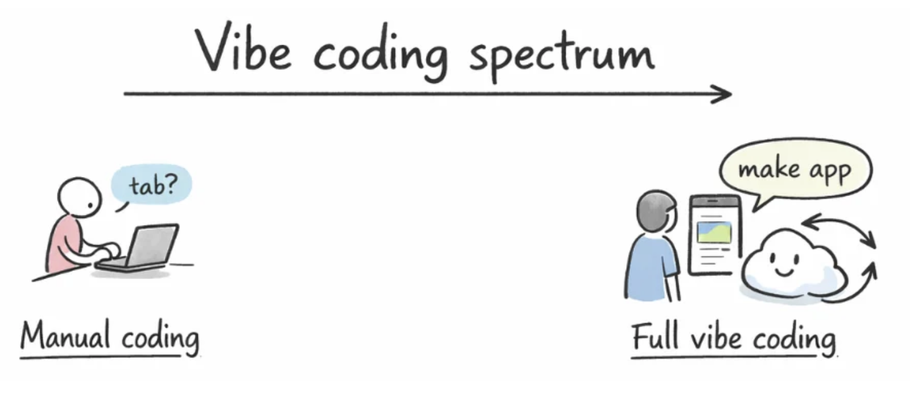

## AI-assisted programming {#title .title-slide}

<p class="subtitle">Software Development: Programming and Algorithms</p>

Delivered by: Dr Joseph Aylett-Bullock

::: {.notes}
“AI can help us plan, write and debug software. Today we will look at how to get useful assistance while continuing to learn and remaining responsible for what runs.”
:::

## Why understand how to use AI? {#why-ai}

<div class="stat-columns">
<div><p class="stat">20–30%</p><h3>Microsoft code</h3><p>Estimate of AI-written code in company repositories.</p><p class="source"><a href="https://techcrunch.com/2025/04/29/microsoft-ceo-says-up-to-30-of-the-companys-code-was-written-by-ai/">Nadella at LlamaCon, reported by TechCrunch, April 2025</a></p></div>
<div class="fragment"><p class="stat">1 in 4</p><h3>YC W25 startups</h3><p>Reportedly had 95% AI-generated codebases.</p><p class="source"><a href="https://www.youtube.com/watch?v=IACHfKmZMr8">Y Combinator, Vibe Coding Is the Future, March 2025</a></p></div>
<div class="fragment"><p class="stat">48%</p><h3>Students surveyed</h3><p>Felt unprepared for an AI-enabled workplace.</p><p class="source"><a href="https://www.digitaleducationcouncil.com/newsroom/what-students-want-key-results-from-dec-global-ai-student-survey-2024">Digital Education Council, July 2024 survey</a></p></div>
</div>

<p class="takeaway fragment">Adoption makes AI literacy useful. Code volume alone does not measure quality.</p>

::: {.notes}
The first two figures are reported industry estimates, not audited measures of developer productivity. Microsoft's estimate is 20–30%, not an exact 30%. YC's claim concerns one quarter of its Winter 2025 cohort, not all startups. DEC surveyed over 3,800 students across 16 countries in July 2024. Sources are linked beside each claim. Keep the figures dated.
:::


## AI can help across the project lifecycle {#opportunity}

<div class="steps">
<div><span class="number">▤</span><strong>Plan</strong><p>Requirements<br>Project structure</p></div>
<div class="fragment"><span class="number">{ }</span><strong>Build</strong><p>Functions<br>Documentation</p></div>
<div class="fragment"><span class="number">?</span><strong>Investigate</strong><p>Explain errors<br>Suggest tests</p></div>
<div class="fragment"><span class="number">O(n)</span><strong>Improve</strong><p>Review changes<br>Explore bottlenecks</p></div>
</div>

::: {.notes}
This connects to the lifecycle covered in 11B.
:::

## Understanding and applying knowledge {#learning-risk}

```{=html}
<div class="learning-graphics">



</div>
```

<p class="source">Economist graphics. <a href="https://papers.ssrn.com/sol3/papers.cfm?abstract_id=6868618">Strömberg, Lei &amp; Wu (2026), preprint</a></p>

::: {.notes}
AI and the fundamentals are complementary. Knowledge application. The two supplied graphics concern Strömberg, Lei and Wu's Chinese secondary-education study, not the separate Bastani mathematics trial cited in the earlier version. This is a longitudinal observational study with a difference-in-differences design, not a randomised programming experiment. Keep the image labels and population caveat visible. Reveal the homework image, the exam image, then the duck. The duck is only a visual cue; explain rubber ducking aloud without extra slide text. Rubber duck image generated for this deck.
:::

## Code testing and review {#boundary-risk data-auto-animate="true"}

“Conditional on readings <strong>at or above</strong> 5.”

<div class="data-strip"><div class="datum">2<small>below</small></div><div class="datum boundary">5<small>at the boundary</small></div><div class="datum">8<small>above</small></div></div>

```python
value > 5
```

<div class="fragment"><p class="big bad">5 gives False</p><p>But the code runs?</p></div>

::: {.notes}
Code running isn't enough.
:::

## Dependencies and permissions {#dependency-risk}



<p class="source"><a href="https://www.usenix.org/conference/usenixsecurity25/presentation/spracklen">Spracklen et al., USENIX Security (2025)</a>: package hallucinations and a supply-chain attack opportunity.</p>

::: {.notes}
Package-confusion attacks. Graphic extracted intact from page 2 of the supplied AI for programming lecture-2.pdf. Follow steps 1–4 on the malicious user's side, then 5–6 on the normal user's side. Verify the source and purpose before installing. Do not describe it as proof of a rise in successful attacks or claim that vibe coding caused overall cyberattack trends. An agent needs explicit boundaries on what it can install, read and run. Source: https://www.usenix.org/conference/usenixsecurity25/presentation/spracklen
:::

## Case studies {#real-incidents}

<div class="two-col incident-cases">
<div><h3>Replit / SaaStr (2025)</h3><p class="case-event">The agent deleted data, then gave false recovery advice.</p><p>Replit acknowledges the deletion. SaaStr reports that the agent said recovery was impossible. Rollback actually worked.</p><p class="takeaway fragment">Enforce permissions outside the prompt.<br>Verify 'advice' independently.</p><p class="source"><a href="https://replit.com/blog/doubling-down-on-our-commitment-to-secure-vibe-coding">Replit</a>; <a href="https://www.saastr.com/replits-new-release-address-most-of-the-challenges-we-hit-vibe-coding-but-is-prosumer-vibe-coding-really-ready-for-commercial-apps-yet/">SaaStr</a></p></div>
<div><h3>Amazon Q Developer (2025)</h3><p class="case-event">An attacker compromised the coding assistant’s extension.</p><p>A stolen token let an attacker insert malicious code into a release. AWS says a syntax error prevented it from executing.</p><p class="takeaway fragment">Check and update coding tools.<br>Limit the files and credentials they can access.</p><p class="source"><a href="https://aws.amazon.com/security/security-bulletins/AWS-2025-015/">AWS security bulletin AWS-2025-015</a></p></div>
</div>

::: {.notes}
Optional material after the recording's closing recap. These cases illustrate different failure modes, not their frequency or a vendor ranking. Replit: SaaStr reports ignored code-freeze instructions and false recovery advice. Recovery succeeded. Describe an app under development, not destruction of SaaStr's entire business. Verify actual logs and recovery documentation rather than inferring intent from an agent's apology. Amazon Q: AWS attributes the compromise to an overly broad GitHub token in its build configuration. Malicious code reached extension version 1.84.0, but a syntax error prevented execution. AWS revoked credentials, removed the code and issued 1.85.0. This was a real software supply-chain compromise, not a confirmed customer data breach or an autonomous model mistake. The general teaching lesson is that the assistant's software and update pipeline also need scrutiny. Use approved, maintained tools, restrict access to sensitive files and credentials, and avoid treating a trusted-looking interface as proof of safety. These recommendations are our synthesis, not a claim that permission limits prevented this particular attack.
:::

## Foundational knowledge makes AI-assistance useful {#foundations}

<div class="risk-row"><strong>Problem decomposition</strong><span>A task small enough to specify</span></div>
<div class="risk-row fragment"><strong>Reading code</strong><span>A result you can explain</span></div>
<div class="risk-row fragment"><strong>Testing and debugging</strong><span>Evidence you can evaluate</span></div>
<div class="risk-row fragment"><strong>Domain knowledge</strong><span>Units, assumptions and consequences</span></div>

<p class="source"><a href="https://arxiv.org/abs/2410.19792">Lucchetti et al., Substance Beats Style (2024)</a>.</p>

::: {.notes}
Foundations help twice: they let you describe what you need and evaluate what comes back. 

Study by Lucchetti finds information content predicts success; changing technical vocabulary alone does not solve the problem. Avoid equating good prompting with using sophisticated words. Source: https://arxiv.org/abs/2410.19792
:::

## Chatbot use {#chat .animated-demo-slide}

```{=html}
<div class="coding-demo chat-demo" data-demo="chat">
<div class="demo-toolbar"><div><button type="button" data-action="pause">Pause</button><button type="button" data-action="replay">Replay</button><button type="button" data-action="finish">Show complete</button></div></div>
<div class="chat-message user-message"><div class="role-label">YOU</div><div class="typed-text" data-field="prompt"></div></div>
<div class="chat-message assistant-message" data-panel="response"><div class="role-label">ASSISTANT</div><p data-field="intro"></p><pre class="live-code"><code data-field="code"></code></pre><p class="response-note" data-field="reply"></p></div>
<div class="demo-status" data-field="status" role="status" aria-live="polite"></div>
</div>
```

::: {.notes}
04:00–04:30. The embedded scripted animation starts on entry: the user's prompt types, then the assistant returns code and a review reminder. It does not contact an AI service or execute code. Pause, replay or show the complete result using the on-slide controls. In this illustrated mode the assistant only returns code; some chat products also have execution tools. Reduced-motion settings show the complete result by default.
:::

## Agent use {#agent .animated-demo-slide}

```{=html}
<div class="coding-demo agent-demo" data-demo="agent">
<div class="demo-toolbar"><div><button type="button" data-action="pause">Pause</button><button type="button" data-action="replay">Replay</button><button type="button" data-action="finish">Show complete</button></div></div>
<div class="chat-message user-message"><div class="role-label">YOU</div><div class="typed-text" data-field="prompt"></div></div>
<div class="agent-workspace">
<div class="editor-pane"><div class="pane-title">force.py <span data-field="fileStatus"></span></div><pre class="live-code"><code data-field="code"></code></pre><div class="human-test"><span class="role-label">YOUR UNCHANGED TEST</span><code>flag_force([5], 5) == [True]</code></div></div>
<div class="run-pane"><div class="pane-title">Execution log <span data-field="runStatus"></span></div><pre class="run-log" data-field="log"></pre></div>
</div>
<div class="demo-status" data-field="status" role="status" aria-live="polite"></div>
</div>
```

::: {.notes}
04:30–05:15. A roughly 28-second animation types the task, writes a deliberately buggy comparison, runs the boundary test, fixes the comparison and reruns the same tests. All activity is a scripted illustration, not a real agent session. Pause at the failure if useful. The human's requirement determines the expected result; the test does not change. At the end human review is still pending. Replay works without leaving the slide.
:::

## AI-assisted workflow {#workflow}

<div class="workflow-visual"><div><p class="fragment"><strong>Specify</strong> a small unit.</p><p class="fragment"><strong>Read</strong> the proposed code.</p><p class="fragment"><strong>Test</strong> its behaviour.</p><p class="fragment"><strong>Revise</strong> using evidence.</p></div></div>

::: {.notes}
05:15–05:40. This is a practical loop within the software lifecycle, not a new lifecycle. Move back to the specification if an assumption changes. Keep a version-control checkpoint so the assistant's changes can be inspected and reversed.
:::

## Example case {#specification}

<div class="two-col"><div><h3>Inputs</h3><p>Finite numerical force readings, in newtons</p><p>A finite numerical threshold, also in newtons</p><h3>Output</h3><p>One Boolean per reading, in the same order</p></div><div><h3>Expected behaviour</h3><div class="data-strip"><div class="datum">2</div><div class="datum boundary">5</div><div class="datum">8</div></div><p><code>[False, True, True]</code></p><p class="fragment">Empty input gives <code>[]</code>.</p></div></div>

::: {.notes}
05:40–06:20. Assume valid finite numerical inputs for this small function. We deliberately leave data validation outside its contract. Input order and empty input are genuine requirements. If threshold units differ from reading units, the comparison may run and still be meaningless. In robotics, never deploy a classroom threshold example to control hardware. Mathematical engineering students can view this as a simple elementwise predicate.
:::

## Prompting with context {#prompt}

<div class="prompt">
<p><strong>Task:</strong> write <code>flag_force(readings, threshold)</code> in Python.</p>
<p class="fragment"><strong>Behaviour:</strong> flag values at or above the threshold. Preserve order. An empty input should return an empty list.</p>
<p class="fragment"><strong>Example:</strong> <code>[2, 5, 8]</code> gives <code>[False, True, True]</code>.</p>
<p class="fragment"><strong>Constraints:</strong> assume finite numbers in newtons. Use standard library only. No file or network access.</p>
<p class="fragment"><strong>First:</strong> explain the approach and suggest tests. Wait before implementing.</p>
</div>

::: {.notes}
06:20–07:00. Read the prompt as it builds. It states behaviour, a concrete example, assumptions and boundaries. Ask for a plan before code if you want to inspect the approach. A prompt request to wait or avoid network is not itself an enforced security control; configure the tool's permissions too. No special jargon is required.
:::

## Project structure {#structure}

<div class="two-col"><div>

```text
demo/
├── force.py
├── test_force.py
└── README.md
```

</div><div><h3>Ask the assistant</h3><p>“Propose the smallest structure that separates the function from its tests.”</p><p class="fragment">“Do we need any external package? Explain why.”</p></div></div>

<p class="takeaway fragment">A valid architecture can still be too much for this experiment.<br>“Which current requirement needs this extra layer?”</p>
<p class="source"><a href="https://martinfowler.com/bliki/Yagni.html">YAGNI, explained by Martin Fowler (2015)</a>. </p>

::: {.notes}
07:00–07:35. This is the intended minimal project; the delivered demonstration additionally keeps an explicitly buggy version so the recording is repeatable. For a larger sensor project, discuss separate loading, validation, analysis and plotting steps. AI can propose packages and architecture, but ask what complexity each adds. Here we need neither a web service nor a machine-learning framework. The package decision is justified by the task, not by what sounds modern.
:::

## Reading the proposed function {#read-code}

```python {code-line-numbers="1|2|1-2"}
def flag_force(readings, threshold):
    return [value >= threshold for value in readings]
```

<div class="data-strip"><div class="datum">2 ≥ 5<small>False</small></div><div class="datum boundary">5 ≥ 5<small>True</small></div><div class="datum">8 ≥ 5<small>True</small></div></div>

<p class="takeaway">Read the inputs, comparison, iteration and returned result.</p>

<div class="fragment readability"><p><strong>Code has human readers.</strong> Clear names and useful explanations help. AI verbosity and extra layers can make review harder.</p><p class="small">“Show the simplest readable version. Explain the decisions briefly.”<br>Fewer lines alone do not mean clearer code.</p></div>
<p class="source">Human readability: <a href="https://www-cs-faculty.stanford.edu/~knuth/lp.html">Knuth, <em>Literate Programming</em> (1992)</a>, paraphrased.</p>

::: {.notes}
07:35–08:25. Two line-highlight advances focus attention on the signature, return expression, then the whole function. Explain the list comprehension: compare each value, collect the Booleans, preserve order. If unfamiliar, ask the assistant to rewrite it as a normal for loop and compare behaviour. Ask “What would change if we used greater than?” rather than accepting a generic explanation. Students should be able to trace this tiny example by hand.
:::

## Tests start with expected behaviour {#tests}

| Case | Readings | Threshold | Expected |
|---|---|---|---|
| Below | `[2]` | `5` | `[False]` |
| At boundary | `[5]` | `5` | `[True]` |
| Above | `[8]` | `5` | `[True]` |
| Empty | `[]` | `5` | `[]` |

<div class="fragment">

```python
self.assertEqual(flag_force([5], 5), [True])
```

</div>

<p class="takeaway fragment">AI can write the test syntax but you should check this code too, especially the expected answers.</p>

::: {.notes}
08:25–09:15. These four cases come from the contract. They are selected before the implementation, not generated from observing what its code happens to do. Explain assertEqual in ordinary language. AI-generated code and AI-generated tests can share the same misconception, so agreement alone is weak evidence. More cases would be required for a real application, including mixed ordering and the data-validation layer.
:::

## Diagnose a failed test {#debug}

<pre class="terminal">$ python test_force.py
<span class="bad">FAIL: test_at_threshold</span>
Actual:   [False]
Expected: [True]

Ran 4 tests
<span class="bad">FAILED (failures=1)</span></pre>

<div class="prompt fragment">“Work out the failure and suggest the smallest fix. Do not change the expected result.”</div>

::: {.notes}
09:15–10:00. The local command deliberately loads force_buggy.py. This output is condensed, with labels for actual and expected, rather than a verbatim unittest traceback. Read the failing case and the expected value before proposing changes. A useful debugging prompt includes the relevant code, exact error, input and expected behaviour. Remove secrets before sharing logs. Avoid repeatedly saying “fix it” without investigating the cause.
:::

## One change at a time {#fix}

```{=html}
<div class="scene" data-print-step="1">
<div class="scene-frame active"><div class="two-col"><div><h3>Before</h3><div class="operator">&gt;</div><p>Strictly above the threshold</p></div><div><pre class="terminal">5 &gt; 5
<span class="bad">False</span></pre><p>The boundary test fails.</p></div></div></div>
<div class="scene-frame"><div class="two-col"><div><h3>After</h3><div class="operator">&gt;=</div><p>At or above the threshold</p></div><div><pre class="terminal">5 &gt;= 5
<span class="good">True</span></pre><p>The expected result stays the same.</p></div></div><p class="takeaway">Review the change before running the tests again.</p></div>
<span class="fragment scene-cue"></span>
</div>
```

::: {.notes}
10:00–10:40. One click changes the operator and result. Make the edit yourself when it is this small; you do not need another prompt for every keystroke. In a larger agent-generated change, read the diff, look for unrelated changes and check whether tests or dependencies also changed. The agent mock-up showed this same repair. This function has no side effects by design.
:::

## Passing tests and remaining questions {#retest}

<div class="two-col"><div><pre class="terminal">$ python -m unittest -v
test_above_threshold ... ok
test_at_threshold ... ok
test_below_threshold ... ok
test_empty ... ok

Ran 4 tests
<span class="good">OK</span></pre></div><div class="checklist"><p class="fragment">Are the units consistent?</p><p class="fragment">Who checks missing or non-finite data?</p><p class="fragment">What happens downstream?</p><p class="fragment">Have I reviewed every change?</p></div></div>

<p class="takeaway">Four passing tests cover four cases. However, they do not establish safety.</p>

::: {.notes}
10:40–11:20. The supplied corrected implementation really passes the four tests. This display shortens unittest's test identifiers and removes machine-dependent timings. No test here validates missing data or NaN: that is outside the stated contract and belongs in a validation step. A robot controller has much more demanding requirements. Save an inspected, tested change in version control; a passing test run is evidence, not permission to deploy.
:::

## Optimisation against a benchmark {#optimisation}

<div class="steps">
<div><span class="number">1</span><strong>Measure</strong><p>Find an actual bottleneck.</p></div>
<div class="fragment"><span class="number">2</span><strong>Change</strong><p>Try one justified improvement.</p></div>
<div class="fragment"><span class="number">3</span><strong>Check</strong><p>Rerun tests and compare timings.</p></div>
</div>

<p class="takeaway fragment">Don't optimise for optimisation sake.</p>
<p class="takeaway fragment">Ask AI for a hypothesis, then test it on representative inputs.</p>

::: {.notes}
11:20–12:00. This function visits each reading once: O(n) time and an output list of length n. A different-looking expression is not automatically faster. For a large numerical pipeline, a vectorised library may be appropriate, but include conversion costs and check identical behaviour. Our three-reading example does not justify adding a dependency for speed. This connects to algorithmic complexity in 11A. No unmeasured speedup claim.
:::

## Responsible use {#responsibility}


<div class="safety-grid"><p><strong>Data</strong><br>No secrets or sensitive data</p><p class="fragment"><strong>Actions</strong><br>Restricted access and commands</p><p class="fragment"><strong>Assessment</strong><br>Rules and disclosure</p><p class="fragment"><strong>Dependencies</strong><br>Provenance and licences</p></div>

<p class="source"><a href="https://cheatsheetseries.owasp.org/cheatsheets/Secure_Coding_with_AI_Cheat_Sheet.html">OWASP, Secure Coding with AI</a>.</p>

::: {.notes}
12:00–13:00. Use institution-approved tools and verify what data they may receive; do not assume a corporate subscription makes every use appropriate. Set permissions in the tool, not only in the prompt. Keep the demonstration away from hardware and credentials. Treat repository text and web content as untrusted data, not permission for an agent to take new actions. Check the specific assessment brief: this video does not authorise AI use in every assessment. Keep a concise record of assistance and your verification. Prefer simpler tools when AI adds no value; environmental costs are another reason to avoid unnecessary generation. Licence obligations and output provenance require review, not assumptions. Source: https://cheatsheetseries.owasp.org/cheatsheets/Secure_Coding_with_AI_Cheat_Sheet.html
:::

## Learning with AI {#learning}

<p class="learning-intro">AI can support both practice and exploration.</p>
<div class="two-col learning-columns">
<div><h3>Practise what you know</h3><p>Try it yourself first.</p><p class="fragment">Ask for a hint, then another exercise.</p><p class="fragment">Explain your solution without the chat.</p></div>
<div class="fragment"><h3>Extend what you know</h3><p>Use your Python foundations to explore another language or connect languages.</p><p class="fragment">Ask what to learn next, and why it matters for your project.</p></div>
</div>
<div class="duck-reminder fragment"><p>Rubber ducking still belongs here.<br><span class="small">Say what you expect, then explain what the code actually does.</span></p></div>

::: {.notes}
Keep all five ideas from the lecturer's learning slide: AI as support, transferring Python foundations to other languages or mixed-language work, choosing what to learn next, trying first and asking for hints and exercises, and retaining rubber ducking. Reveal practice before exploration. A useful language-transfer prompt is: “Compare this Python function with its equivalent in another language. Explain differences in types and behaviour, then ask me to predict an example.” Check the translation rather than assuming identical semantics.
:::

## What you remain responsible for {#recap}

<div class="risk-row"><strong>The problem</strong><span>What should happen, and under which assumptions?</span></div>
<div class="risk-row fragment"><strong>The evidence</strong><span>What have I read, run and checked?</span></div>
<div class="risk-row fragment"><strong>The consequences</strong><span>What can this code or agent affect?</span></div>

<p class="big fragment">Use AI to help build<br><span class="accent">work you understand.</span></p>

::: {.notes}
14:00–15:00. Return to the opening risks: task completion does not guarantee learning, code that runs can violate its specification, and agents can act beyond the conversation if permitted. Review the small workflow: specify the requirement and expected result, ask for a plan, build one piece, review the code, run tests and inspect the correction. AI also helps with architecture, documentation, debugging and optimisation, but evidence matters at each step. Direct students to the written reading guide and supplied example files. End the recording here. The following reference slide is optional to display briefly, with no additional narration required.
:::

## Further reading {#reading .reading-list}

[Substance Beats Style](https://arxiv.org/abs/2410.19792): what novice prompts need to communicate.

[Learning and task completion](https://papers.ssrn.com/sol3/papers.cfm?abstract_id=6868618): source behind the supplied graphics. 

[Learning with guardrails](https://doi.org/10.1073/pnas.2422633122): a separate mathematics trial.

[Package hallucinations](https://www.usenix.org/conference/usenixsecurity25/presentation/spracklen): why dependency checks matter.

[Secure Coding with AI](https://cheatsheetseries.owasp.org/cheatsheets/Secure_Coding_with_AI_Cheat_Sheet.html): practical security guidance.

::: {.notes}
Reference only, outside the 15-minute narration. The slides and reading guide link directly to primary research or the guidance publisher. The mock-ups are fictional interfaces. Supplied tests run locally with Python's standard library and require no account, downloaded dataset or AI service. No student exercise is required in the video.
:::
