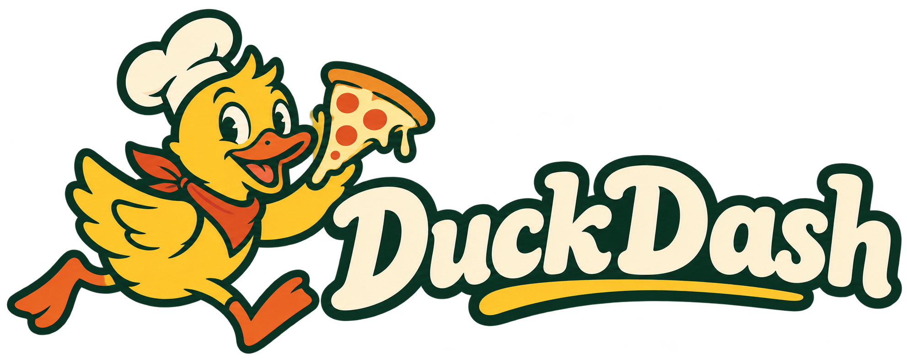

## Week 4: Functions {#title .duck-title}

{.duck-logo alt="DuckDash: a duck holding a pizza slice"}

Software Development: Programming and Algorithms

Delivered by: Dr Joseph Aylett-Bullock

::: {.notes}
**Timing: minute 0–1 from the start (1 minute). Move on by minute 1.**

You work at the front desk. Student volunteers are customers throughout the takeaway scenes. Have rubber ducks, a permanent marker and printed menus/coupons ready. App stage 1 open in a second tab; start kitchen speed at 1×. No real payment or food. This is a two-hour plan including a 10-minute break. Sources: original 4A, 4B and 4C; 4D stays backup.
:::

## Questions from last week {#faqs}

<a class="demo-link" data-faq-link>FAQ link to be added</a> 

::: {.notes}
**Timing: minute 1–3 from the start (2 minutes). Move on by minute 3.**

Set WEEK4_FAQ_URL in config.js when the link is available. Keep FAQs to these two minutes. Collect longer questions for the final clinic.
:::

## One order, several collections {#recap .keep-code}

```python
size = (12, "regular")
toppings = ["olives", "mushrooms", "olives"]
prices = {"classic": 800, "pepperoni": 1000}
available = {"olives", "mushrooms", "sweetcorn"}
```

Which collection records order? Which looks up a value by a key?

Which records distinct choices?

::: {.answer}
Lists and tuples retain order. 

Dictionaries map keys to values. 

Sets contain distinct, hashable elements and are not ordered. 
:::

::: {.notes}
**Timing: minute 3–5 from the start (2 minutes). Move on by minute 5.**

Recall before introducing new terminology. The repeated olive makes multiplicity versus membership visible. Do not count toppings via a set if duplicate portions matter.
:::

## Sets: pizza toppings {#sets .keep-code}

```python
requested = {"olives", "mushrooms"}
available = {"olives", "sweetcorn"}

print(requested & available)
print(requested - available)
print(requested | available)
```

::: {.fragment}
`&` gives the overlap. `-` gives what is missing. `|` combines the choices.
:::

::: {.notes}
**Timing: minute 5–8 from the start (3 minutes). Move on by minute 8.**
:::

## Sets: membership and editing {#set-methods .keep-code}

```python
available = {"olives", "sweetcorn"}
available.add("mushrooms")
available.add("olives")
print(len(available))

print("mushrooms" in available)

available.discard("pineapple")
print({"olives"} <= available)
```

`set()` creates an empty set. `{}` creates an empty dictionary.

::: {.answer}
`3`, `True`, then `True`. 

Adding an existing element adds no duplicate in a set. 

`discard` tolerates a missing element but `remove` would raise `KeyError`. 

`<=` tests whether every requested element is present.
:::

::: {.notes}
**Timing: minute 8–10 from the start (2 minutes). Move on by minute 10.**
:::

## Enumerating a queue {#enumerate .keep-code}

```python
customers = ["Sam", "Alex", "Jo"]
for position, customer in enumerate(customers, start=1):
    print(position, customer)
```

::: {.fragment}
Each iteration supplies a pair: an index and an element.
:::

::: {.fragment}
Queue positions can change. An order number stays with its order.
:::

::: {.notes}
**Timing: minute 10–12 from the start (2 minutes). Move on by minute 12.**
:::

## Welcome to DuckDash {#opening .demo-slide}

{.duck-logo-small alt="DuckDash"}

<a class="demo-link duckdash-link" data-stage="1" href="https://josephpb.github.io/2026-sdpa/additional_materials/duckdash/?stage=1">Open DuckDash · the first order</a>

::: {.notes}
**Timing: minute 12–15 from the start (3 minutes). Move on by minute 15.**

Choose Load starter: at this point there are no user-defined functions. It declares menu_prices and order, looks up the price, and prints it. Take two volunteer customer orders, changing the counter inputs and running the lookup each time. Alternatively use live/00_counter.py in the IDE. Enter each calculated pound amount using 'Send a price calculated in your IDE' to put it on the board; write the accepted number on the duck. Prices in Python are pence. Ask what was repeated. This motivates functions; introduce the idea on the next slide, then the syntax and call flow. Do not load Worked example until Function flow (minute 19–21). Volunteers remain customers throughout.
:::

## The code executed each time is the same {#why-functions}

```{=html}
<div class="flow-row"><div>Customer chooses a pizza</div><span>→</span><div class="fragment" data-fragment-index="0">Find its price</div><span class="fragment" data-fragment-index="1">→</span><div class="fragment" data-fragment-index="1">Return the price</div></div>
```

::: {.fragment}
A function gives this job a name and a reusable interface.
:::

::: {.fragment}
The caller can use the result without repeating the implementation.
:::

::: {.notes}
**Timing: minute 15–16 from the start (1 minute). Move on by minute 16.**

Abstraction, reuse, DRY and decomposition from 4A 5–13. One slide replaces the repeated motivation. Built-ins such as len, max and type already have this pattern. Decomposition means choosing smaller jobs with clear responsibilities, not merely fewer lines.
:::

## Parts of a function {#function-anatomy .anatomy-slide}

```{=html}
<div class="anatomy">
<div class="function-code"><div>menu_prices = {"classic": 800,</div><div>               "pepperoni": 1000}</div><div>&nbsp;</div><div><span class="fragment highlight-current-blue" data-fragment-index="0">def</span> <span class="fragment highlight-current-blue" data-fragment-index="1">pizza_price</span>(<span class="fragment highlight-current-blue" data-fragment-index="2">pizza</span>):</div><div>    <span class="fragment highlight-current-blue" data-fragment-index="3">"""Return the regular price in pence."""</span></div><div>    <span class="fragment highlight-current-blue" data-fragment-index="4">price = menu_prices[pizza]</span></div><div>    <span class="fragment highlight-current-blue" data-fragment-index="5">return price</span></div></div>
<div class="anatomy-labels"><p class="fragment" data-fragment-index="0"><b>def</b> tells us that we're defining a function</p><p class="fragment" data-fragment-index="1"><b>pizza_price</b> names the function</p><p class="fragment" data-fragment-index="2"><b>pizza</b> is a parameter</p><p class="fragment" data-fragment-index="3">The <b>docstring</b> explains what it does</p><p class="fragment" data-fragment-index="4">The indented <b>body</b> does what we specify</p><p class="fragment" data-fragment-index="5"><b>return</b> gives the value back</p></div>
</div>
```

::: {.notes}
**Timing: minute 16–19 from the start (3 minutes). Move on by minute 19.**

Reveal one label per click. The full code stays visible while each component is highlighted. Preserve the original 4A component breakdown. Zero parameters are also possible; calling with empty parentheses is still a call.
:::

## Function flow {#call-flow .keep-code}

```python
menu_prices = {"classic": 800, "pepperoni": 1000}

def pizza_price(pizza):
    return menu_prices[pizza]

total = pizza_price("classic")
print(total)
```

```{=html}
<div class="flow-row compact"><div class="fragment">Call with <code>"classic"</code></div><span class="fragment">→</span><div class="fragment">Bind <code>pizza</code></div><span class="fragment">→</span><div class="fragment">Return <code>800</code></div><span class="fragment">→</span><div class="fragment">Assign <code>total</code></div></div>
```

::: {.notes}
**Timing: minute 19–21 from the start (2 minutes). Move on by minute 21.**

Definition creates the function; the body runs when called. Now return to DuckDash stage 1 and select Worked example. Point out the visible menu_prices and order declarations. Treat the import line as the supplied simulator connection; modules are explained later. Trace pizza_price returning a number to make_order, make_order returning a dictionary to the caller, then send_to_kitchen receiving that dictionary. Keep this short and use the visible returned-order panel. The call expression evaluates to its return value, then execution resumes in the caller. Run a second call with pepperoni. Use live/01_functions.py.
:::

## Assigning prints {#print-return .keep-code}

```python
def pizza_price():
    print(800)

total = pizza_price()
print(total)
```

What are the two printed lines? What happens to `total + 100`?

::: {.answer}
The console shows `800`, then `None`. The function printed a number and implicitly returned `None`. `None + 100` raises `TypeError`. Replace `print(800)` with `return 800` to return a usable price.
:::

::: {.notes}
**Timing: minute 21–24 from the start (3 minutes). Move on by minute 24.**

You make this mistake at the desk. Customers vote on what went wrong. In DuckDash, make_order calls the pricing function and returns an order dictionary. details stores that return value; send_to_kitchen(details) explicitly sends it. The kitchen panel shows the required fields and received dictionary. Printing never sends an order. This avoids the Robot Lab's special printed-command behaviour.
:::

## Returning ends this call {#return-ends .keep-code}

```{.python}
def quote(student):

    if student:
        return 640

    return 800

    print("Does this run?")

print(quote(True))
```

::: {.fragment}
One call executes one return. It can print several times before returning.
:::

::: {.fragment}
Bare `return`, or reaching the end, returns `None`.
:::

::: {.notes}
**Timing: minute 24–25 from the start (1 minute). Move on by minute 25.**
:::

## Parameters and arguments {#binding}

```{=html}
<div class="binding-grid"><div><span class="small">DEFINITION</span><pre>def pizza_price(pizza, size):</pre><div class="fragment">Parameters: <code>pizza</code>, <code>size</code></div></div><div><span class="small">CALL</span><pre>pizza_price("classic", "large")</pre><div class="fragment">Arguments: <code>"classic"</code>, <code>"large"</code></div></div></div>
```

```{=html}
<div class="flow-row fragment"><div><code>pizza → "classic"</code></div><div><code>size → "large"</code></div></div>
```

::: {.notes}
**Timing: minute 25–28 from the start (3 minutes). Move on by minute 28.**

Point to the fields on a customer's order. Different names in caller and function are fine. A parameter name is local to that invocation.
:::

## Defaults and named choices {#defaults .keep-code}

```python
def pizza_price(pizza, size="regular"):
    price = {"classic": 800, "pepperoni": 1000}[pizza]
    if size == "large":
        price += 200
    return price

print(pizza_price("classic"))
print(pizza_price(size="large", pizza="classic"))
```

<a class="demo-link duckdash-link" data-stage="2" href="https://josephpb.github.io/2026-sdpa/additional_materials/duckdash/?stage=2">Open DuckDash · make it yours</a>

::: {.notes}
**Timing: minute 28–31 from the start (3 minutes). Move on by minute 31.**

Regular is the default. Keywords bind by name and can appear in a different order. Parameters can receive lists, tuples or dictionaries too. Run live/02_arguments.py.
:::

## Which order is valid? {#arguments-quiz .keep-code}

For `pizza_price(pizza, size="regular")`:

```python
# A
pizza_price("classic", size="large")
# B
pizza_price(size="large", pizza="classic")
# C
pizza_price(pizza="classic", "large")
```

::: {.answer}
A and B are valid. C raises `SyntaxError`: this positional argument follows a keyword argument. Each parameter must also receive at most one value.
:::

::: {.notes}
**Timing: minute 31–32 from the start (1 minute). Move on by minute 32.**
:::

## As many toppings as you like {#args .keep-code}

```python
def make_pizza(size, *toppings):
    return size, toppings

print(make_pizza(12, "olives", "mushrooms"))
```

```{=html}
<div class="flow-row"><div class="fragment"><code>size → 12</code></div><div class="fragment"><code>toppings → ("olives", "mushrooms")</code></div></div>
```

Extra positional arguments collect into a tuple.

::: {.notes}
**Timing: minute 32–34 from the start (2 minutes). Move on by minute 34.**

A customer supplies two toppings, then three. Returned comma-separated values are packed into one tuple. Keep this as recognition rather than a long exercise.
:::

## Extra named details {#kwargs .keep-code}

```python
def ticket(pizza, **details):
    return pizza, details

print(ticket("classic", customer="Sam", student=True))
```

::: {.fragment}
`details` is `{"customer": "Sam", "student": True}`.
:::

Extra keyword arguments collect into a dictionary.

::: {.notes}
**Timing: minute 34–36 from the start (2 minutes). Move on by minute 36.**

The words args and kwargs are conventions; the stars collect the arguments. Distinguish this from passing one list or one dictionary as an ordinary argument.
:::

## A discount can be treated separately {#discounts .keep-code}

```python
def student_price(price, student=False):
    if student:
        return price * 80 // 100
    return price

total = student_price(1000, student=True)
print(total)
```

<a class="demo-link duckdash-link" data-stage="3" href="https://josephpb.github.io/2026-sdpa/additional_materials/duckdash/?stage=3">Open DuckDash · student specials</a>

::: {.notes}
**Timing: minute 36–39 from the start (3 minutes). Move on by minute 39.**

Give a customer a student card and another DUCK10. The simple snippet covers 20% on the £1-step menu. Simulator worked code rounds the discount half up to a penny and chooses the best single eligible discount. FLOCK5 is £5 off a subtotal of at least £20. Do not stack. See live/03_discounts.py for the full implementation. Let your first mistaken implementation apply both, then ask the class to diagnose it.
:::

## Local names and returned values {#scope .activity-slide}

<iframe class="scope-frame" src="activities/scope.html" title="Step through local variables and shared list objects"></iframe>

[Open the scope board](activities/scope.html){target="scope-board"}

::: {.notes}
**Timing: minute 39–44 from the start (5 minutes). Move on by minute 44.**

Use scalar mode first. Each call has local names; the caller's price does not change when the function rebinds its own price. Returned result survives because caller stores it. Then switch to shared list: caller and parameter refer to the same list. Append mutates it. Rebinding the local name to a new list leaves the caller's reference in place. This directly extends Week 3's object board. Objects can outlive a call; scope belongs to names.
:::

## Predict the two prices {#scope-quiz .keep-code}

```python
def discounted(price):
    price = price - 100
    return price

price = 800
quote = discounted(price)
print(price, quote)
```

::: {.answer}
`800 700`. The local parameter is rebound inside the function. The caller's name still refers to `800`. `quote` stores the returned `700`.
:::

::: {.notes}
**Timing: minute 44–45 from the start (1 minute). Move on by minute 45.**
:::

## Reading vs assigning a name {#scope-errors .keep-code}

```python
price = 800
def show_price():
    print(price)

def change_price():
    price += 100

show_price()
# change_price()  # UnboundLocalError
```

Pass inputs and return results when you want the caller to update its state.

::: {.notes}
**Timing: minute 45–47 from the start (2 minutes). Move on by minute 47.**

4A slide 32. The assignment makes price local throughout change_price, but it has no local value yet. global can explicitly rebind a module-level name, but isn't needed for our pricing functions. Avoid saying functions cannot modify objects outside them: shared mutable objects can change.
:::

## A duck with a permanent number {#order-numbers .keep-code}

```python
def next_order_number(previous):
    return previous + 1

last_number = 10
last_number = next_order_number(last_number)
print(last_number)
```

<a class="demo-link duckdash-link" data-stage="4" href="https://josephpb.github.io/2026-sdpa/additional_materials/duckdash/?stage=4">Open DuckDash · a duck with a number</a>

::: {.notes}
**Timing: minute 47–50 from the start (3 minutes). Move on by minute 50.**

Give a customer a rubber duck and write the ACCEPTED ticket number beneath it. The editor explicitly declares last_order_number in the Counter inputs block (10 in a fresh kitchen). Accepted orders update that visible counter. Reset orders clears the board and restarts at 11; use it before a new demonstration, before handing out ducks. make_ticket returns a tuple, make_order includes the number in its returned dictionary, and send_to_kitchen(details) returns the accepted number and rejects duplicates. Queue enumerate indices are not persistent IDs. Change return previous+1 to return previous to demonstrate a rejected duplicate without giving two students the same duck number.
:::

## Returning a ticket and a price {#tuple-return .keep-code}

```python
def make_ticket(previous, price):
    number = previous + 1
    return number, price

number, total = make_ticket(10, 800)
print(number, total)
```

::: {.fragment}
The function returns one tuple. The caller unpacks its two elements.
:::

::: {.notes}
**Timing: minute 50–51 from the start (1 minute). Move on by minute 51.**
:::

## A recursive function {#recursive-function .keep-code}

```python
def basket_total(prices):
    if prices == []:
        return 0
    return prices[0] + basket_total(prices[1:])

print(basket_total([800, 1000, 900]))
```

::: {.fragment}
**Base case:** the empty basket is easy to solve.
:::

::: {.fragment}
**Recursive step:** solve the same problem for a smaller basket.
:::

::: {.notes}
**Timing: minute 65–68 from the start (3 minutes). Move on by minute 68.**

A recursive function calls itself. Input must make progress toward a base case. Slicing here creates a new outer list; chosen for clarity, not efficiency. We do not recurse through all route permutations.
:::

## A recursive function {#recursion-board .activity-slide}

<iframe class="scope-frame" src="activities/recursion.html" title="Recursive basket total with separate call frames and returning answers"></iframe>

[Open the call stack](activities/recursion.html){target="recursion-board"}

::: {.notes}
**Timing: minute 68–73 from the start (5 minutes). Move on by minute 73.**

Pause at the empty list. Four calls exist, three waiting. Each has its own prices binding. Resume slowly: return 0, then 900, 1900, 2700. Existing frames resume; their inputs do not mysteriously grow. Optional volunteers hold each call sheet, but keep them customers in the main storyline.
:::

## The base case has been reached {#recursion-quiz}

At `basket_total([])`:

1. How many calls are active or waiting?
2. Which call receives `0`?
3. What does that call return?

::: {.answer}
Four calls. The call for `[900]` receives `0`, then returns `900`. The calls for `[1000, 900]` and `[800, 1000, 900]` are still waiting.
:::

<a class="demo-link duckdash-link" data-stage="5" href="https://josephpb.github.io/2026-sdpa/additional_materials/duckdash/?stage=5">Open DuckDash · the group order</a>

::: {.notes}
**Timing: minute 73–75 from the start (2 minutes). Move on by minute 75.**
:::

## Iteration and recursion {#iteration-recursion .keep-code}

:::: {.columns}
::: {.column width="49%"}
```python
def total_loop(prices):
    total = 0
    for price in prices:
        total += price
    return total
```
:::
::: {.column width="49%"}
```python
def total_rec(prices):
    if prices == []:
        return 0
    rest = total_rec(prices[1:])
    return prices[0] + rest
```
:::
::::

Both return the same total. Recursive calls retain separate frames.

::: {.notes}
**Timing: minute 75–77 from the start (2 minutes). Move on by minute 77.**

A loop is simpler and more efficient for this flat list. Recursion teaches the decomposition pattern and becomes natural for nested problems. Repeated-addition multiplication is in live/05_recursion.py and the reference slides. Avoid claiming recursion is inherently faster.
:::

## Factorials {#factorial .keep-code}

```python
def factorial(n):
    if n == 0:
        return 1
    return n * factorial(n - 1)

print(factorial(4))
```

For non-negative integers: `4 × 3 × 2 × 1 = 24`.

Where is the base case? Which input gets smaller?

::: {.notes}
**Timing: minute 77–79 from the start (2 minutes). Move on by minute 79.**

Original 4B factorial with n=0 supported explicitly. Negative values are outside this teaching example's domain. One prediction, no second full stack trace.
:::

## Palindromes shrink from both ends {#palindrome .keep-code}

```python
def is_palindrome(text):
    if len(text) <= 1:
        return True
    if text[0] != text[-1]:
        return False
    return is_palindrome(text[1:-1])

print(is_palindrome("radar"))
```

```{=html}
<div class="flow-row compact"><div>radar</div><span class="fragment">→</span><div class="fragment">ada</div><span class="fragment">→</span><div class="fragment">d</div></div>
```

::: {.notes}
**Timing: minute 79–82 from the start (3 minutes). Move on by minute 82.**

Direct transfer from 4B 10–11. Return False at the first mismatch, True for length zero or one. This compares exact characters; case and spaces are not normalised. Ask about civic, duck and the empty string.
:::

## Put reusable functions in a module {#modules .keep-code .no-run}

:::: {.columns}
::: {.column width="48%"}
**pricing.py**
```python
def student_price(price):
    return price * 80 // 100
```
:::
::: {.column width="50%"}
**counter.py**
```python
import pricing
print(pricing.student_price(1000))

from pricing import student_price
print(student_price(1000))
```
:::
::::

::: {.notes}
**Timing: minute 82–85 from the start (3 minutes). Move on by minute 85.**

Run the actual files in live/modules in the IDE. Python imports a module and binds names; it does not copy all function code into the caller. Show `import pricing as p` verbally. Avoid wildcard imports because names can collide. The in-browser teaching interpreter cannot import arbitrary local files; use terminal for this demonstration.
:::

## A function can be passed as a value {#function-values .keep-code}

```python
def student_price(price):
    return price * 80 // 100

rule = student_price
print(rule(1000))
```

::: {.fragment}
`student_price` refers to the function.
:::

::: {.fragment}
`student_price(1000)` calls it and produces a result.
:::

::: {.notes}
**Timing: minute 85–86 from the start (1 minute). Move on by minute 86.**
:::

## A small function with lambda {#lambda .keep-code}

:::: {.columns}
::: {.column width="48%"}
```python
def student_price(price):
    return price * 80 // 100
```
:::
::: {.column width="50%"}
```python
lambda price: price * 80 // 100
```
:::
::::

One expression supplies the returned value. No `return` keyword inside a lambda.

::: {.notes}
**Timing: minute 86–88 from the start (2 minutes). Move on by minute 88.**

Prefer def for a function you want to name and reuse. Lambda is useful as a short argument, which the next slides demonstrate. It can have several parameters, as in lambda x, y: x * y.
:::

## Apply a function to each price {#map .keep-code}

```python
def student_price(price):
    return price * 80 // 100

prices = [800, 1000, 900]
discounted = map(student_price, prices)
print(list(discounted))
```

```{=html}
<div class="flow-row compact"><div>800 · 1000 · 900</div><span class="fragment">→ student_price →</span><div class="fragment">640 · 800 · 720</div></div>
```

::: {.notes}
**Timing: minute 88–90 from the start (2 minutes). Move on by minute 90.**

Customers hold original price cards; you apply the same rule once per request. Python 3 map returns an iterator, and list consumes it here. It is not a stored list of results until consumed. Use lambda in place of the named function once, without changing the data.
:::

## Two input queues {#multiple-map .keep-code}

```python
prices = [800, 1000, 900]
quantities = [2, 1]

totals = map(lambda p, q: p * q, prices, quantities)
print(list(totals))
```

Does the third price produce a result?

::: {.answer}
`[1600, 1000]`. Ordinary `map` stops when its shortest input is exhausted. The transformation accepts one argument for each input iterable. This matches the shortest-input behaviour of ordinary `zip` from Week 3.
:::

::: {.notes}
**Timing: minute 90–91 from the start (1 minute). Move on by minute 91.**
:::

## Keep the orders that qualify {#filter .keep-code}

```python
prices = [800, 1000, 900, 1200]
affordable = filter(lambda price: price <= 900, prices)
print(list(affordable))
```

::: {.fragment}
The predicate returns a truth value. The filter yields the original qualifying elements.
:::

::: {.notes}
**Timing: minute 91–93 from the start (2 minutes). Move on by minute 93.**

Output is [800,900], not [True,False,True,False]. Give one short map-versus-filter vote. filter also returns an iterator in Python 3. Named predicate is equally valid.
:::

## Choose a sorting rule {#keys .keep-code}

```python
orders = [(13, 900), (11, 1200), (12, 800)]
by_price = sorted(orders, key=lambda order: order[1])
highest = max(orders, key=lambda order: order[1])
print(by_price)
print(highest)
```

The key function supplies the comparison value. The result contains orders.

::: {.notes}
**Timing: minute 93–95 from the start (2 minutes). Move on by minute 95.**

Original 4C 12. Each tuple is (number, price). Sorted order 12,13,11; max returns (11,1200). No need to teach a sorting algorithm here.
:::

## The same transformation {#comprehension .keep-code}

```python
prices = [800, 1000, 900]

discounted = []
for price in prices:
    discounted.append(price * 80 // 100)

affordable = []
for price in prices:
    if price <= 900:
        affordable.append(price)

print(discounted)
print(affordable)
```

```{=html}
<div class="flow-row compact"><div class="fragment">Expression</div><div class="fragment">for element in iterable</div><div class="fragment">Optional if condition</div></div>
```

::: {.notes}
**Timing: minute 95–97 from the start (2 minutes). Move on by minute 97.**

Reconnect Week 3 list-building loop. Compare loop, map and comprehension without claiming shortest is always best. A list comprehension constructs a list immediately. Avoid complicated nested expressions in the main task.
:::

## A dictionary of discounted prices {#dict-comprehension .keep-code}

```python
menu = {"classic": 800, "pepperoni": 1000}
student_menu = {
    pizza: price * 80 // 100
    for pizza, price in menu.items()
}
print(student_menu)
```

The expression produces a key and a value for each entry.

<a class="demo-link duckdash-link" data-stage="6" href="https://josephpb.github.io/2026-sdpa/additional_materials/duckdash/?stage=6">Open DuckDash · the lunch rush</a>

::: {.notes}
**Timing: minute 97–99 from the start (2 minutes). Move on by minute 99.**

All new core syntax has now appeared. Run prepared batch once; preserve the remaining 21 minutes for reading, repair and retrieval. Nested comprehension appears in a reference slide for recognition, not a new late puzzle.
:::

## The front desk made a mistake {#clinic .keep-code}

```python
def student_price(price):
    print(price * 80 // 100)

total = student_price(1000)
print(total + 100)
```

Which one line change works?

::: {.notes}
**Timing: minute 99–104 from the start (5 minutes). Move on by minute 104.**

Reuse the familiar code rather than introduce another feature. Take a customer's order in the app and make this print/return mistake. The bridge rejects a None total without consuming an order number. No automatic correction conceals the misconception.
:::

## The toppings changed outside the function {#mutation-quiz .keep-code}

```python
def add_cheese(toppings):
    toppings.append("extra cheese")

chosen = ["olives"]
result = add_cheese(chosen)
print(chosen)
print(result)
```

::: {.answer}
`['olives', 'extra cheese']`, then `None`. The function mutates the shared list but has no explicit returned value. A local parameter name does not imply a copied object.
:::

::: {.notes}
**Timing: minute 104–107 from the start (3 minutes). Move on by minute 107.**
:::

## One group order, two implementations {#transfer}

Use the loop and recursive versions of `basket_total`.

- What does each return for `[]`?
- What does each return for `[800]`?
- Where does the recursive version store work that remains unfinished?
- Which would you choose for a flat basket, and why?

::: {.answer}
Both return `0` and `800`. Recursive call frames retain the pending additions. A loop is usually simpler for this flat list; recursion expresses the smaller-subproblem idea.
:::

::: {.notes}
**Timing: minute 107–112 from the start (5 minutes). Move on by minute 112.**

Give pairs two minutes before revealing. If time is tight, use the empty basket and pending-work questions only. Do not skip the recap to rush another new example.
:::

## Explain it to your duck {#exit}

1. What is the difference between a parameter and an argument?
2. What does a call with no explicit return produce?
3. What makes a recursive call move toward finishing?
4. When would you choose `filter` rather than `map`?

::: {.answer}
Parameters are names in a definition; arguments are supplied at a call. An implicit return produces `None`. Recursive steps must move toward a base case. filter retains qualifying original elements; map transforms each input into an output.
:::

::: {.notes}
**Timing: minute 112–117 from the start (5 minutes). Move on by minute 117.**

Individual vote, then ask for reasoning. Use wrong answers as your final feedback rather than starting another feature. Confirm the customers have the right order number written under their ducks.
:::

## After the lecture {#finish}

Practise defining, calling and tracing small functions.

Keep the input, returned value and any side effects separate.

Next week: objects, classes, testing and debugging.

::: {.notes}
**Timing: minute 117–120 from the start (3 minutes). Move on by minute 120.**

Original reading: 4A essential Python Crash Course Ch. 8; 4C Introduction to Computation and Programming §4.3, Think Python §6.5, according to the supplied deck editions. Original 4B last slide previews OOP rather than teaching it. Remaining slides are reference, not a second ending to deliver at speed.
:::

## Reference: sum to n and multiplication {#reference-recursion .reference-slide .keep-code}

:::: {.columns}
::: {.column width="48%"}
```python
def sum_to(n):
    if n == 0:
        return 0
    return n + sum_to(n - 1)
```
:::
::: {.column width="50%"}
```python
def multiply(a, b):
    if b == 0:
        return 0
    return a + multiply(a, b - 1)
```
:::
::::

Here `n` and `b` must be non-negative integers.

::: {.notes}
**Timing: reference only, outside the planned 120 minutes. Use if a question needs it or direct students here afterwards.**

Original 4B 4–8. Both recursive reductions and their iterative equivalents are in live/05_recursion.py. These examples deliberately support zero, unlike the original positive-only base cases. Do not run negative inputs. A missing or unreachable base case eventually produces a recursion error, not a usable answer.
:::

## Reference: concise comprehensions {#reference-comprehensions .reference-slide .keep-code}

```python
names = ["SAM", "ALEX", "JO"]
print([name.lower() for name in names])
print([(x, x**2, x**3) for x in [1, 2, 3]])
print([(pizza, size)
       for pizza in ["classic", "garden"]
       for size in ["regular", "large"]])
```

Read nested `for` clauses in the same order as nested loops.

::: {.notes}
**Timing: reference only, outside the planned 120 minutes. Use if a question needs it or direct students here afterwards.**

4C 15. Four combinations result. Prefer a loop when a comprehension becomes difficult to read. Empty-string-safe version of the original filter example: lambda word: word.lower().startswith('a').
:::

## Reference: imports and aliases {#reference-imports .reference-slide .keep-code .no-run}

```python
import pricing
import pricing as p
from pricing import student_price
from pricing import student_price as discount
```

Prefer explicit names to `from pricing import *`.

The module demonstration belongs in your IDE, using the provided files.

::: {.notes}
**Timing: reference only, outside the planned 120 minutes. Use if a question needs it or direct students here afterwards.**
:::

## Reference: DuckDash bridge {#reference-api .reference-slide .keep-code .no-run}

```python
from duckdash import send_to_kitchen
menu_prices = {"classic": 800, "pepperoni": 1000}

def pizza_price(pizza):
    return menu_prices[pizza]

def make_order(pizza, customer):
    return {"customer": customer, "items": [pizza],
            "total": pizza_price(pizza)}

details = make_order("classic", "Sam")
number = send_to_kitchen(details)
```

`make_order` calls your pricing function and returns a dictionary. The kitchen expects `customer`, `items`, `total` and optionally `order_number`.

The supplied `send_to_kitchen` function receives that dictionary and returns the accepted ticket number.

::: {.notes}
**Timing: reference only, outside the planned 120 minutes. Use if a question needs it or direct students here afterwards.**

Every example declares its own menu_prices and input values in the editor. Counter controls update only the marked Counter inputs block; Run executes the visible code without injecting data variables. The ticket exercise also declares last_order_number, initially 10. A fresh Python execution starts per Run; the kitchen persists separately. The import explicitly brings in the supplied simulator connection. make_order constructs the order without submitting anything. send_to_kitchen receives exactly its returned dictionary and returns after acceptance, while a background timer prepares the order. The kitchen panel displays the received dictionary, including a rejected value when validation fails. No concurrency syntax is needed in student code. See app README for the full API and local/browser persistence limitations.
:::

## References {#references .reference-slide}

- Supplied Week 4 decks: Functions, Recursion, Smaller Functions
- [Python tutorial: defining functions](https://docs.python.org/3/tutorial/controlflow.html#defining-functions)
- [Python tutorial: data structures](https://docs.python.org/3/tutorial/datastructures.html)
- [Python built-ins: enumerate, map, filter, sorted](https://docs.python.org/3/library/functions.html)
- [CS50: physical sorting and recursion examples](https://cs50.harvard.edu/x/2020/notes/3/)

DuckDash is a fictional teaching brand. Its menu, prices and preparation times are invented.

::: {.notes}
**Timing: reference only, outside the planned 120 minutes. Use if a question needs it or direct students here afterwards.**
:::

