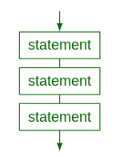
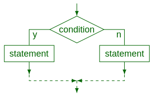
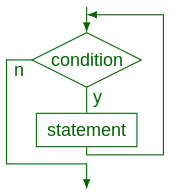
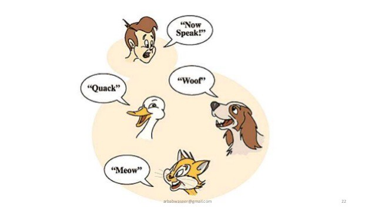
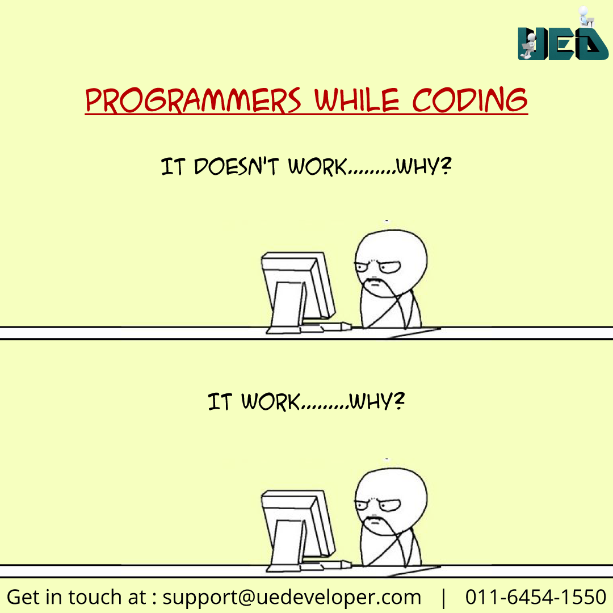
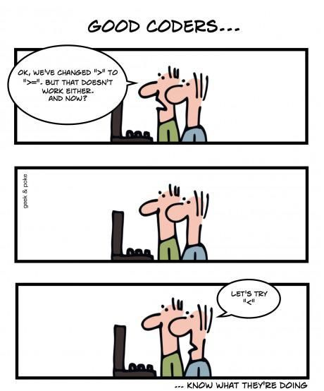
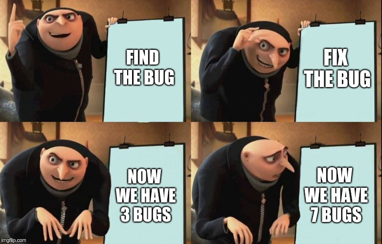
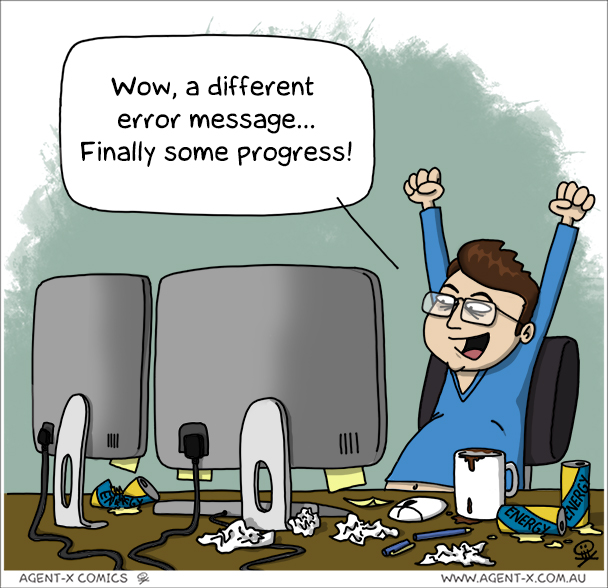
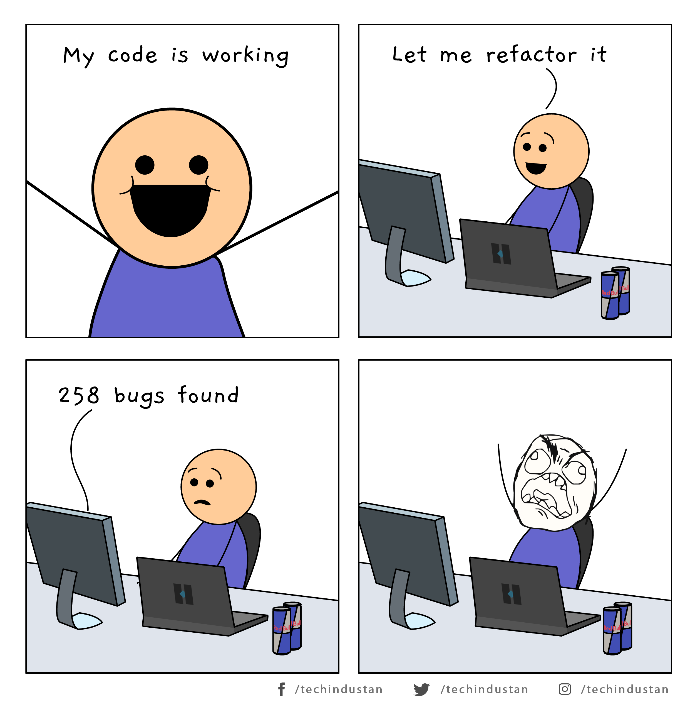
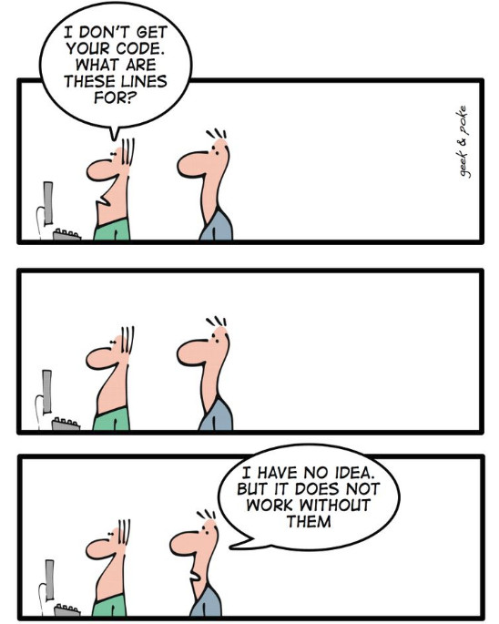

## Week 5: Objects, testing and debugging {#title .duck-title}

Software Development: Programming and Algorithms

Delivered by: Dr Joseph Aylett-Bullock

## Last week: an order passed between functions {#recap .no-run}

```python
def make_order(pizza, customer):
    return {"customer": customer,
            "items": [pizza],
            "total": pizza_price(pizza)}
```

`pizza_price` returns a number. `make_order` returns a dictionary.

<a class="demo-link duckdash-link" href="https://josephpb.github.io/2026-sdpa/additional_materials/duckdash/?stage=1">Reopen DuckDash</a>

::: {.fragment}
Now we need to remember **which order** is ready to collect.
:::

## Today’s session {#agenda}

- Objects, classes, attributes and methods
- Instances, `self`, inheritance and polymorphism
- Testing: what should happen?
- Debugging: why did something else happen?
- Exceptions, assertions and a small refactoring

## The building blocks still apply {#control-structures}

```{=html}
<div class="photo-row"></div>
```

**Sequence | Selection | Iteration**

Classes give us another way to organise programs built from these pieces.

## Objects combine state and behaviour {#oop}

:::: {.columns}
::: {.column width="56%"}
**State:** what an object currently knows.

**Behaviour:** operations it can perform.

A light has a state. A switch gives us a way to change it.

::: {.fragment}
An order has a status. A method can mark it ready.
:::
:::
::: {.column width="42%"}
{.original-graphic alt="A hanging lightbulb"}
:::
::::

## One class, several dogs {#dogs}

```{=html}
<div class="photo-row"></div>
```

**Class:** `Dog` — a definition shared by these objects.

**Instances:** individual dogs, each with its own name and age.

## You already use objects {#familiar-objects .keep-code}

```python
print(type(10))
print(type("alpaca"))
print(type([1, 2, 3]))

queue = [11, 12]
queue.append(13)
print(queue)
```

`append` is a method on this particular list.

## Why organise code into classes? {#why-oop}

- **Encapsulation:** keep an order’s data and operations together.
- **Abstraction:** call `mark_ready()` without repeating its implementation.
- **Decomposition:** give each part of the program a clear responsibility.
- **Reuse:** share behaviour when a relationship makes sense.

::: {.fragment}
A pricing calculation can still be a function. Choose the organisation that helps.
:::

## What belongs to one order? {#attributes-quiz}

`number`,  `customer`,  `status`,  `mark_ready()`, `collect()`

Vote: which are **attributes**, and which are **methods**?

::: {.answer}
Attributes store `number`, `customer` and `status`.

Methods perform `mark_ready()` and `collect()`.

Two orders can have different values while supporting the same methods.
:::

## Parts of a class {#class-anatomy}

```{=html}
<div class="anatomy class-anatomy">
<div class="function-code"><div><span class="fragment highlight-current-blue" data-fragment-index="0">class</span> <span class="fragment highlight-current-blue" data-fragment-index="1">Order</span><span class="fragment highlight-current-blue" data-fragment-index="2">:</span></div><div>    """One customer's order."""</div><div>&nbsp;</div><div>    def <span class="fragment highlight-current-blue" data-fragment-index="3">__init__</span>(<span class="fragment highlight-current-blue" data-fragment-index="4">self</span>, <span class="fragment highlight-current-blue" data-fragment-index="5">number, customer</span>):</div><div>        <span class="fragment highlight-current-blue" data-fragment-index="6">self.number = number</span></div><div>        self.customer = customer</div><div>        self.status = "Preparing"</div></div>
<div class="anatomy-labels"><p class="fragment" data-fragment-index="0"><b>class</b> begins a class definition</p><p class="fragment" data-fragment-index="1"><b>Order</b> names the new type</p><p class="fragment" data-fragment-index="2"><b>Colon + indentation</b> organise the class body</p><p class="fragment" data-fragment-index="3"><b>__init__</b> initialises an instance</p><p class="fragment" data-fragment-index="4"><b>self</b> refers to that instance</p><p class="fragment" data-fragment-index="5"><b>Parameters</b> receive the supplied values</p><p class="fragment" data-fragment-index="6"><b>Attributes</b> store values on the instance</p></div>
</div>
```

## Creating two instances {#instances .compact-code .keep-code}

```python
class Order:
    def __init__(self, number, customer):
        self.number = number
        self.customer = customer
        self.status = "Preparing"

order_11 = Order(11, "Sam")
order_12 = Order(12, "Alex")
print(order_11.customer, order_12.customer)
```

We supply `number` and `customer`. Python supplies the new instance as `self`.

## A method is a function inside the class {#method-anatomy}

```{=html}
<div class="anatomy class-anatomy">
<div class="function-code"><div>class Order:</div><div>    def __init__(self, number, customer):</div><div>        self.number = number</div><div>        self.customer = customer</div><div>        self.status = "Preparing"</div><div>&nbsp;</div><div>    <span class="fragment highlight-current-blue" data-fragment-index="0">def</span> <span class="fragment highlight-current-blue" data-fragment-index="1">mark_ready</span>(<span class="fragment highlight-current-blue" data-fragment-index="2">self</span>):</div><div>        <span class="fragment highlight-current-blue" data-fragment-index="3">self.status = "Ready"</span></div><div>&nbsp;</div><div><span class="fragment highlight-current-blue" data-fragment-index="4">order_11.mark_ready()</span></div></div>
<div class="anatomy-labels"><p class="fragment" data-fragment-index="0"><b>def</b> still defines a function</p><p class="fragment" data-fragment-index="1"><b>mark_ready</b> names the method</p><p class="fragment" data-fragment-index="2"><b>self</b> receives the instance</p><p class="fragment" data-fragment-index="3">The body changes <b>that instance’s</b> status</p><p class="fragment" data-fragment-index="4"><b>Dot + parentheses</b> call its method</p></div>
</div>
```

## Two orders in the IDE {#two-orders .ide-demo .compact-code .no-run}

```python
class Order:
    def __init__(self, number, customer):
        self.number = number
        self.customer = customer
        self.status = "Preparing"

    def mark_ready(self):
        self.status = "Ready"

order_11 = Order(11, "Sam")
order_12 = Order(12, "Alex")
order_11.mark_ready()
print(order_11.status, order_12.status)
```

[Run this example in VS Code](live/two_orders.py). Predict the two statuses first.

::: {.answer}
`Ready Preparing`. `self` refers to order 11 in this call; order 12 is a separate object.
:::

## What does self refer to? {#self-quiz .no-run}

```python
order_12.mark_ready()
```

Inside `mark_ready`, which object does `self` refer to?

A. The class `Order`  
B. Order 11  
C. Order 12  
D. Both orders

::: {.answer}
**C. Order 12.** For this ordinary instance method, the call can also be written `Order.mark_ready(order_12)`.
:::

## A second name is not a second order {#alias .no-run}

```python
another_name = order_11
another_name.mark_ready()
print(order_11.status)
```

::: {.answer}
`Ready`. Both names refer to the **same object**.

`Order(13, "Jo")` would create a new instance.
:::

## Give an object a readable description {#str .no-run}

Without our own description, printing an object is not very informative.

Add this method inside `Order`:

```python
def __str__(self):
    return "Order " + str(self.number) + ": " + self.status
```

Then `print(order_11)` can show:

```text
Order 11: Ready
```

## Defaults still work {#defaults .no-run}

```python
class Order:
    def __init__(self, number, customer="Guest"):
        self.number = number
        self.customer = customer
        self.status = "Preparing"

order_13 = Order(13)
```

What is `order_13.customer`?

::: {.answer}
`"Guest"`. Function parameter rules also apply to methods.
:::

## Methods can enforce a rule {#collect .no-run}

Should a customer collect an order that is still preparing?

```python
def collect(self):
    if self.status != "Ready":
        raise ValueError("Order is not ready")
    self.status = "Collected"
```

::: {.fragment}
`order_11.collect()` checks the rule before changing the status.
:::

## Inheritance: related types {#inheritance}

:::: {.columns}
::: {.column width="56%"}
`Animal` describes shared attributes and behaviour.

`Cat` and `Alpaca` can inherit from `Animal`.

A child class can add or override methods.

::: {.fragment}
A cat **is an** animal. An order **has a** customer.
:::
:::
::: {.column width="42%"}
{.original-graphic alt="Original cartoon family illustration"}
:::
::::

## Inherit, then add a method {#child .compact-code .keep-code}

```python
class Animal:
    def __init__(self, name):
        self.name = name

class Cat(Animal):
    def sleep(self):
        return self.name + " is sleeping"

kitty = Cat("Kitty")
print(kitty.name)
print(kitty.sleep())
```

## Extend initialisation with super {#super .compact-code .keep-code}

```python
class Animal:
    def __init__(self, name):
        self.name = name

class Cat(Animal):
    def __init__(self, name, breed):
        super().__init__(name)  # Animal sets self.name
        self.breed = breed       # Cat adds self.breed

kitty = Cat("Kitty", "Siamese")
print(kitty.name, kitty.breed)
```

`Cat.__init__` replaces the inherited initialiser. `super().__init__(name)` runs the `Animal` setup before Cat adds `breed`. Without it, `kitty.name` would be missing.


## Same method name, different behaviour {#polymorphism .compact-code .keep-code}

:::: {.columns}
::: {.column width="65%"}
```python
class Animal:
    def roll_over(self):
        return "No trick defined"

class Cat(Animal):
    def roll_over(self):
        return "Rolled over!"

class Alpaca(Animal):
    def roll_over(self):
        return "Absolutely not."

for animal in [Cat(), Alpaca()]:
    print(animal.roll_over())
```
:::
::: {.column width="33%"}
{.original-graphic alt="Original cartoon showing animals responding differently to Speak"}
:::
::::

## Classes can live in modules {#modules .no-run}

Put the definition in `orders.py`.

Use it from another file:

```python
from orders import Order

order = Order(11, "Sam")
order.mark_ready()
print(order)
```

## Testing and debugging {#testing}

:::: {.columns}
::: {.column width="55%"}
**Testing:** compare actual behaviour with what should happen.

**Debugging:** investigate and fix a known failure.

::: {.fragment}
“It ran” does not tell us whether the answer is correct.
:::
:::
::: {.column width="43%"}
{.original-graphic alt="Programmers while coding: it does not work, why; it works, why"}
:::
::::

## Break the till: one rule {#till-rule}

::: {.rule}
£5 off a basket of £20 or more.
:::

One input: the basket subtotal. One output: the amount to pay.

Use **whole pence**: £20 is `2000`, and £5 is `500`.

## Choose a test before seeing the code {#test-design}

In pairs, choose **one subtotal** and write down:

1. The input in pence.
2. The expected output in pence.
3. Why this test might expose a mistake.

::: {.fragment}
Would you test below £20, exactly £20, or above £20?
:::

## Three small test cases {#test-cases}

| Input subtotal | Expected amount to pay | Why this case? |
|---|---|---|
| `1900` (£19) | ? | Below the threshold |
| `2000` (£20) | ? | Exactly on the threshold |
| `2100` (£21) | ? | Above the threshold |

::: {.answer}
`1900`, `1500`, `1600` pence respectively.

At **exactly £20**, the discount applies.
:::

## Run the tests against this till {#buggy .keep-code}

```python
def amount_to_pay(subtotal):
    if subtotal > 2000:
        return subtotal - 500
    return subtotal

for subtotal, expected in [(1900, 1900),
                           (2000, 1500),
                           (2100, 1600)]:
    actual = amount_to_pay(subtotal)
    print(subtotal, expected, actual, actual == expected)
```

Output columns: **input · expected · actual · matches?**

## Debugging is a search for an explanation {#hypothesis}

:::: {.columns}
::: {.column width="57%"}
1. Reproduce the failure.
2. Describe expected and actual behaviour.
3. Form a hypothesis.
4. Gather evidence that could disprove it.
5. Make one change, then rerun tests.
:::
::: {.column width="41%"}
{.original-graphic alt="Original Good Coders comic about understanding a bug"}
:::
::::

## Print the values and the path {#print-debug .compact-code .keep-code}

```python
def amount_to_pay(subtotal):
    print("entered:", subtotal)
    print("eligible:", subtotal > 2000)
    if subtotal > 2000:
        print("discount branch")
        return subtotal - 500
    print("no-discount branch")
    return subtotal

print("result:", amount_to_pay(2000))
```

Which message appears? Which message is missing?

## Place checkpoints between blocks {#checkpoints .no-run}

```python
subtotal = 2000
print("A: subtotal", subtotal)

total = amount_to_pay(subtotal)
print("B: calculated total", total)

print("C: receipt", total)
```

If A is correct but B is wrong, inspect the calculation between them.

::: {.fragment}
Add more detail **inside that block**. Keep narrowing the search.
:::

## Pause the same code in VS Code {#vscode .no-run}

1. Open `live/till_buggy.py`.
2. Set a breakpoint on `if subtotal > 2000:`.
3. Start **Run and Debug** using the supplied till configuration.
4. Inspect `subtotal` in **Variables**; watch `subtotal > 2000`.
5. Use **Step Over** to follow the branch.

**At `2000`, why is the watch expression `False`?**

::: {.small}
Step Into enters a called function. Continue runs to the next breakpoint.
:::

## One small fix {#fix .keep-code}

```python
def amount_to_pay(subtotal):
    if subtotal >= 2000:
        return subtotal - 500
    return subtotal

print(amount_to_pay(2000))
```

`>=` includes the boundary. The result is `1500` pence.

## Found the bug. Finished? {#found-bug}

{.original-graphic .wide-graphic alt="Gru meme: find the bug, fix the bug, now there are three bugs, now there are seven bugs"}

::: {.fragment}
Rerun **all** the checks, including the ones that already passed.
:::

## Keep the boundary case as a regression test {#regression .keep-code}

```python
def amount_to_pay(subtotal):
    if subtotal >= 2000:
        return subtotal - 500
    return subtotal

assert amount_to_pay(1900) == 1900
assert amount_to_pay(2000) == 1500
assert amount_to_pay(2100) == 1600
print("3 tests passed")
```

A regression test checks that a previously fixed failure stays fixed.

## Test the parts, then the connections {#test-levels}

**Unit test:** call `amount_to_pay(2000)` and check for `1500`.

**Integration test:** check that the checkout passes its subtotal into pricing and uses the returned amount on the receipt.

::: {.fragment}
A correct pricing function is no help if the receipt uses the original subtotal.
:::

## A crash is not the only kind of failure {#bug-types}

:::: {.columns}
::: {.column width="60%"}
| What you observe | Example |
|---|---|
| An obvious failure | A traceback or a program that does not finish |
| A silent wrong result | Charging £20 when the total should be £15 |

A bug may happen every time, or only for certain inputs or circumstances.
:::
::: {.column width="38%"}
{.original-graphic alt="Original cartoon: a different error message, finally some progress"}
:::
::::

## Use the error message as evidence {#traceback}

```text
ValueError: Order is not ready
```

Read the exception type and message, then locate the relevant line in the traceback.

{.original-graphic alt="Original cartoon: Well, now we know what not to do" style="max-height:330px"}

## What should happen to an invalid request? {#exceptions}

:::: {.columns}
::: {.column width="57%"}
A customer tries to collect an order that is still preparing.

Should we:

- silently pretend it succeeded?
- return a special result the caller must check?
- raise an exception explaining the failure?
:::
::: {.column width="41%"}
{.original-graphic alt="Original photograph of toy stormtroopers"}
:::
::::

## Raise an exception before changing state {#raise .no-run}

```python
def collect(self):
    if self.status != "Ready":
        raise ValueError("Order is not ready")
    self.status = "Collected"
```

If `raise` runs, the assignment below it is skipped.

::: {.answer}
An order still preparing remains **Preparing**. The failed operation does not mark it collected.
:::

## Handle an exception where you can respond {#handle .no-run}

```python
order = Order(11, "Sam")

try:
    order.collect()
    print("Enjoy your pizza!")
    
except ValueError as error:
    print(error)

print("Next customer")
```

::: {.answer}
`Order is not ready`, then `Next customer`.

The success message is skipped.
:::

## Assertions check assumptions {#assertions .keep-code}

```python
status = "Ready"
assert status in ("Preparing", "Ready", "Collected")
print("Known status")
```

A false condition raises `AssertionError`.

**External input or invalid operations:** use explicit checks and exceptions.

**Internal assumptions and test expectations:** assertions can help.

## Which check belongs here? {#checks-quiz}

1. A customer enters a negative quantity.
2. An internal status unexpectedly becomes `"Toasting forever"`.
3. You want to check that a £20 basket costs £15.

::: {.answer}
1. Explicit validation; raise or handle a suitable exception.
2. An assertion can expose a broken internal assumption.
3. A test comparing the actual and expected results.
:::

## Refactoring: change the structure, keep the behaviour {#refactor .compact-code .no-run}

:::: {.columns}
::: {.column width="54%"}
Before:

```python
def amount_to_pay(subtotal):
    if subtotal >= 2000:
        total = subtotal - 500
    else:
        total = subtotal
    return total
```

After:

```python
def amount_to_pay(subtotal):
    if subtotal >= 2000:
        return subtotal - 500
    return subtotal
```
:::
::: {.column width="44%"}
{.original-graphic alt="Original refactoring meme: working code, let me refactor it, bugs found"}

Run the same tests before and after.
:::
::::

## A unit test for the £20 boundary {#unittest-anatomy .compact-code .no-run}

```python
import unittest
from till_fixed import amount_to_pay

class TillTests(unittest.TestCase):
    def test_exact_threshold(self):
        subtotal, expected = 2000, 1500  # Arrange
        actual = amount_to_pay(subtotal)  # Act
        self.assertEqual(actual, expected)  # Assert
```

A unit test checks one behaviour against a result specified in advance.

## Run tests and read the result {#unittest-run .no-run}

From the folder containing `live/`:

```text
cd live
python3 -m unittest discover -s . -v
python3 -m unittest test_till.TillTests.test_exact_threshold -v
```

**FAIL** means an assertion disagreed with the result. With the buggy till, `2000 != 1500`.

**ERROR** means an unexpected exception interrupted the test.

## Test an object’s state after an exception {#unittest-state .compact-code .no-run}

```python
import unittest
from orders import Order

class OrderTests(unittest.TestCase):
    def test_failed_collection_preserves_state(self):
        order = Order(11, "Sam")
        with self.assertRaises(ValueError):
            order.collect()
        self.assertEqual(order.status, "Preparing")
```

The test checks **both** the rejected action and the unchanged order. The earlier £19/£20/£21 cases test the other important boundary.

## Five questions to finish {#exit}

1. What is the difference between `Order` and `order_11`?
2. What does `self` refer to in `order_12.mark_ready()`?
3. Why is `2000` a useful test input for the till?
4. What can a print checkpoint or breakpoint tell you?
5. Should refactoring change the amount charged?

::: {.answer}
Class / instance · Order 12 · Boundary · Values and control flow · No
:::

## Takeaways {#takeaways}

:::: {.columns}
::: {.column width="62%"}
- Objects have state; methods operate on it.
- Classes define types; instances are particular objects.
- Tests compare results with a specification.
- Debugging uses evidence to explain a failure.
- Exceptions, assertions and tests serve different purposes.
- Refactoring aims to preserve behaviour.
:::
::: {.column width="36%"}
{.original-graphic alt="Original closing comic about understanding code"}
:::
::::

## Reference: complete Order {#reference-order .reference-slide .no-run}

```python
class Order:
    def __init__(self, number, customer="Guest"):
        self.number = number
        self.customer = customer
        self.status = "Preparing"

    def mark_ready(self):
        self.status = "Ready"

    def collect(self):
        if self.status != "Ready":
            raise ValueError("Order is not ready")
        self.status = "Collected"

    def __str__(self):
        return "Order " + str(self.number) + ": " + self.status
```

[Download the example](live/orders.py)

## Reference: exception control flow {#reference-exceptions .reference-slide .no-run}

```python
try:
    value = int("12")
except ValueError:
    print("Please enter a whole number")
else:
    print("Converted:", value)
finally:
    print("Finished this attempt")
```

- `except` handles a matching exception from the `try` block.
- `else` runs if that block completes without an exception.
- `finally` runs on the way out, whether or not an exception occurred.

## Reference: running the examples {#reference-files .reference-slide}

| File in `live/` | Purpose |
|---|---|
| `orders.py`, `counter.py`, `two_orders.py` | Order class, importing it and the IDE demonstration |
| `animals.py` | Inheritance, `super()` and overriding |
| `till_buggy.py`, `till_prints.py` | Same boundary bug, with and without prints |
| `checkpoints.py` | Prints before and after a calculation |
| `till_fixed.py`, `test_till.py` | Fixed function and automated tests |
| `exceptions_demo.py`, `test_orders.py` | Handling an invalid operation; instance tests |
| `refactoring.py` | Same checks before and after restructuring |

Open `week5.code-workspace` for the prepared VS Code debug configuration.

## Readings and sources {#references .reference-slide}

- Original Week 5 decks: OOP; Testing, debugging, exceptions and assertions
- Supplied *Software Testing – Test Units* handout (`Session_4D_Testunits.pdf`), pages 2–6
- Guttag, *Introduction to Computation and Programming*: chapters 6–8
- *Think Python*: chapters 15–17 and Appendix A (course edition)
- *Python Crash Course*: chapters 9–11 (course edition)
- [Python: classes](https://docs.python.org/3/tutorial/classes.html), [errors and exceptions](https://docs.python.org/3/tutorial/errors.html), [assert](https://docs.python.org/3/reference/simple_stmts.html#the-assert-statement)
- [VS Code: Python debugging](https://code.visualstudio.com/docs/python/debugging)
- [VS Code: debugging controls](https://code.visualstudio.com/docs/debugtest/debugging)

::: {.small}
Original humour and graphics are retained from the supplied decks. Asset sources are recorded in `assets/SOURCES.md` and speaker notes.
:::

