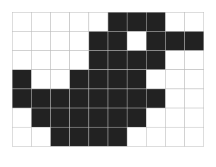
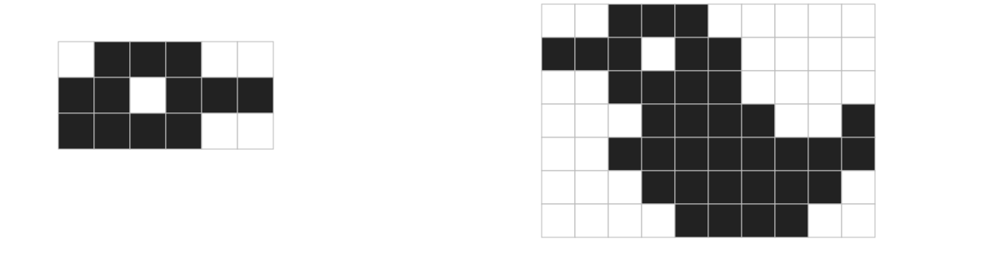
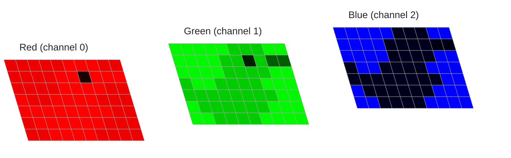
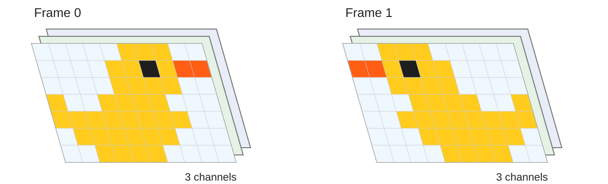
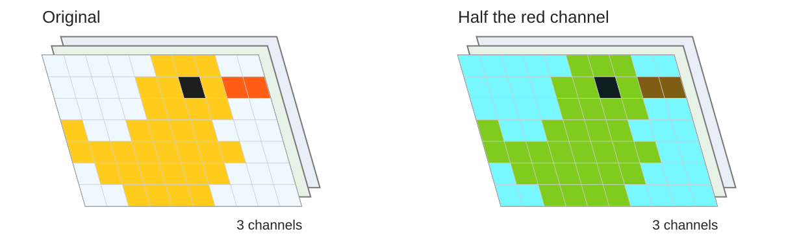
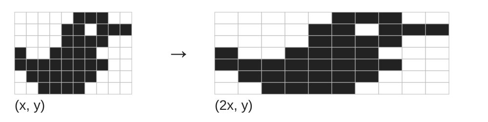

## Week 7: Introduction to Scientific Python {#s1 .title-slide}

Software Development: Programming and Algorithms

Delivered by: Dr Joseph Aylett-Bullock


## Weeks 1 to 5 {#s3 }

| | Building blocks |
|---|---|
| Week 1 | Variables, types and expressions |
| Week 2 | Strings, conditions and loops |
| Week 3 | Lists, tuples, sets and dictionaries |
| Week 4 | Functions, arguments, return values and imports |
| Week 5 | Objects, methods, testing and debugging |

Which of these will help us work with a table of measurements?


## Scientific Python libraries {#s4 }

| Library | What it gives us |
|---|---|
| NumPy | Arrays and numerical operations |
| pandas | Labelled tables |
| Matplotlib | Figures and plots |
| SciPy | Scientific algorithms |

The arrays and tables are objects. We use their attributes and methods.


## Import NumPy {#s5 }

```{.text}
import numpy as np
```


`np` is an alias for the NumPy module.

`np.array(...)` creates an array.

::: {.notes}
The Run buttons use the shared setup in live/setup.py. Each example starts afresh. Other libraries and data are available in that setup, but introduce their imports when they are first used.
:::


## A one-dimensional array {#s6 }

```python
measurements = np.array([10, 20, 30])
print(measurements)
print(measurements.shape)
print(measurements.ndim)
print(measurements.dtype)
```
<!-- output-start -->
```{=html}
<div class="run-result" data-example="1"></div>
```
<!-- output-end -->


`shape` counts values along each axis. `ndim` counts axes.

`dtype` is the stored value type.

NumPy prints array values with spaces. A Python list uses commas.


## A two-dimensional array {#s7 .binary-slide}

:::: {.columns}
::: {.column width="59%"}
```python
duck = np.array([
    [0,0,0,0,0,1,1,1,0,0],
    [0,0,0,0,1,1,0,1,1,1],
    [0,0,0,0,1,1,1,1,0,0],
    [1,0,0,1,1,1,1,0,0,0],
    [1,1,1,1,1,1,1,1,0,0],
    [0,1,1,1,1,1,1,0,0,0],
    [0,0,1,1,1,1,0,0,0,0]])
print(duck.shape)
```
<!-- output-start -->
```{=html}
<div class="run-result" data-example="2"></div>
```
<!-- output-end -->


:::
::: {.column width="39%"}


0 = white, 1 = black
:::
::::


## Reshape and transpose {#s10 }

Twelve values make four rows and three columns.

```python
values = np.arange(12)
grid = values.reshape(4, 3)
print(grid)
print(grid.T)
```
<!-- output-start -->
```{=html}
<div class="run-result" data-example="3"></div>
```
<!-- output-end -->


Reshape keeps the number and order of values. `.T` swaps the axes.


## Two-dimensional slicing {#s11 .activity-slide}

`a[rows, columns]`

<iframe class="slice-frame" src="activities/boards.html?mode=slice2&v=4a6c2ae21bc4" title="Two-dimensional slicing"></iframe>

[Open activity](activities/boards.html?mode=slice2&v=4a6c2ae21bc4)


## An index removes an axis {#s12 }

Compare a row with a one-row array.

```python
a = np.arange(20).reshape(4, 5)
print(a[1, :])
print(a[1, :].shape)
print(a[1:2, :])
print(a[1:2, :].shape)
```
<!-- output-start -->
```{=html}
<div class="run-result" data-example="4"></div>
```
<!-- output-end -->


## Crop and reverse {#s13 .duck-slices}

```python
crop = duck[0:3, 4:10]
reverse = duck[:, ::-1]
print(crop.shape)
print(reverse.shape)
```
<!-- output-start -->
```{=html}
<div class="run-result" data-example="5"></div>
```
<!-- output-end -->





## Three-dimensional arrays {#array-animation .video-slide}

<video class="array-video" controls data-autoplay muted playsinline preload="auto" poster="assets/arrays-3d-poster.png" aria-label="Animation introducing a three-dimensional array">
<source src="assets/arrays-3d-clean.webm" type="video/webm">
<source src="assets/arrays-3d-clean.mp4" type="video/mp4">
<a href="assets/arrays-3d-clean.mp4">Play the array animation</a>
</video>


## An RGB image has three axes {#s8 .rgb-slide}



```python
from PIL import Image
RGB = np.array(Image.open('assets/duck.png').convert('RGB'))
print(RGB.shape)
print(RGB[1, 8, :])
```
<!-- output-start -->
```{=html}
<div class="run-result" data-example="6"></div>
```
<!-- output-end -->


Pillow reads the image. NumPy stores its pixel values.

`RGB[row, column, channel]`: two spatial axes and a colour axis.


## Three-dimensional slicing {#s14 .activity-slide}

`a[row, column, channel]`: each channel is a layer.

Here `a.shape` is `(3, 4, 3)`. Our duck uses the same axis order: `RGB.shape` is `(7, 10, 3)`.

<iframe class="slice-frame" src="activities/boards.html?mode=slice3&v=4a6c2ae21bc4" title="Three-dimensional slicing"></iframe>

[Open activity](activities/boards.html?mode=slice3&v=4a6c2ae21bc4)


## A video adds another axis {#s9 .video-array-slide}

```python
video = np.stack([RGB, RGB[:, ::-1, :]])
print(video.shape)
```
<!-- output-start -->
```{=html}
<div class="run-result" data-example="7"></div>
```
<!-- output-end -->




Frames, rows, columns, colour channels: four axes.


## Names and objects {#memory-recap .activity-slide}

<iframe class="slice-frame" src="activities/boards.html?mode=memory&v=4a6c2ae21bc4" title="Names and objects"></iframe>

[Open activity](activities/boards.html?mode=memory&v=4a6c2ae21bc4)


## Views share a data buffer {#s15 .activity-slide}

<iframe class="slice-frame" src="activities/boards.html?mode=memory&scene=view&v=4a6c2ae21bc4" title="Array views and copies"></iframe>

[Open activity](activities/boards.html?mode=memory&scene=view&v=4a6c2ae21bc4)


## A view and a copy {#views-code }

```python
a = np.arange(6).reshape(2, 3)
view = a[:, :2]
view[:] = 99
print(a)
independent = a[:, :2].copy()
independent[:] = 0
print(independent)
print(a)
print(np.shares_memory(a, view))
print(np.shares_memory(a, independent))
```
<!-- output-start -->
```{=html}
<div class="run-result" data-example="8"></div>
```
<!-- output-end -->


## One operation, many values {#s16 }

Vectorisation expresses the calculation without a Python loop.

```python
counts = np.array([12, 25, 40])
print(counts + 5)
print(counts / counts.sum())
print(np.sqrt(counts))
```
<!-- output-start -->
```{=html}
<div class="run-result" data-example="9"></div>
```
<!-- output-end -->


## Which axis disappears? {#s17  .quiz-output}

Rows are sites; columns are hours. Predict the two output shapes.

```python
counts = np.array([[10, 20, 30], [40, 50, 60]])
print('Each hour, across sites:', counts.sum(axis=0))
print('Each site, across hours:', counts.sum(axis=1))
```
<!-- output-start -->
```{=html}
<div class="run-result" data-example="10"></div>
```
<!-- output-end -->


## Broadcasting: match the shapes {#s18 .activity-slide}

Compare the shapes from the last axis. Which values align?

<iframe class="slice-frame" src="activities/boards.html?mode=broadcast&v=4a6c2ae21bc4" title="Broadcasting: match the shapes"></iframe>

[Open activity](activities/boards.html?mode=broadcast&v=4a6c2ae21bc4)


## NumPy value types {#numpy-types }

Python's `int` uses enough storage for its value, including very large integers. The value itself is immutable.

Fixed-width types are common across programming languages. NumPy provides them for both individual values and arrays.

| NumPy type | Storage | Values |
|---|---|---|
| `np.uint8` | 8 bits (1 byte) | Whole numbers from 0 to 255 |
| `np.int64` | 64 bits (8 bytes) | Signed whole numbers |
| `np.float64` | 64 bits (8 bytes) | Floating-point approximations |

```python
pixel = np.uint8(128)
print(type(pixel).__name__)
pixels = np.array([0, 128, 255], dtype=np.uint8)
print(pixels.dtype)
print(pixels.itemsize)
```
<!-- output-start -->
```{=html}
<div class="run-result" data-example="11"></div>
```
<!-- output-end -->


`itemsize` gives the number of bytes per value.


## Broadcast across the colour channels {#s19 .tint-slide}

| Channel 0: red | Channel 1: green | Channel 2: blue |
|---|---|---|
| Every value × 0.5 | Every value × 1.0 | Every value × 1.0 |

```python
factors = np.array([0.5, 1.0, 1.0])
tinted = (RGB * factors).astype(np.uint8)
print(tinted.shape)
```
<!-- output-start -->
```{=html}
<div class="run-result" data-example="12"></div>
```
<!-- output-end -->


The factor shape `(3,)` aligns with the last axis of `(7, 10, 3)`. Each factor repeats across all 7 rows and 10 columns of its channel.



`astype(np.uint8)` stores the result as whole numbers from 0 to 255.


## Broadcasting checkpoint {#s20  .quiz-output}

Compare shapes from the right: equal, or one is 1. Predict success or failure.

```python
for shape in [(3,), (4, 1), (4,)]:
    try:
        result = np.ones((4, 3)) + np.ones(shape)
        print(shape, '→', result.shape)
    except ValueError:
        print(shape, '→ incompatible')
```
<!-- output-start -->
```{=html}
<div class="run-result" data-example="13"></div>
```
<!-- output-end -->


## Stretch the duck {#s21 .transform-slide}



$$
\begin{bmatrix}2 & 0\\0 & 1\end{bmatrix}
\begin{bmatrix}x\\y\end{bmatrix}
=\begin{bmatrix}2x\\y\end{bmatrix}
$$

```python
transform = np.array([[2, 0], [0, 1]])
point = np.array([4, 2])
print(transform @ point)
```
<!-- output-start -->
```{=html}
<div class="run-result" data-example="14"></div>
```
<!-- output-end -->


## Two multiplication operators {#multiply-operators }

$$
\begin{bmatrix}1 & 2\\3 & 4\end{bmatrix}
\begin{bmatrix}2 & 1\\0 & 3\end{bmatrix}
=\begin{bmatrix}2 & 7\\6 & 15\end{bmatrix}
$$

```python
x = np.array([[1, 2], [3, 4]])
y = np.array([[2, 1], [0, 3]])
print(x * y)
print(x @ y)
```
<!-- output-start -->
```{=html}
<div class="run-result" data-example="15"></div>
```
<!-- output-end -->


`*` multiplies corresponding values. `@` computes the matrix product.


## Sorting values and positions {#s23 .sorting-slide}

| Position | Site | Bicycles |
|---|---|---|
| 0 | A | 30 |
| 1 | B | 10 |
| 2 | C | 20 |

```python
names = np.array(['A', 'B', 'C'])
cycles = np.array([30, 10, 20])
order = np.argsort(cycles)
print(order)
print(names[order])
print(np.sort(cycles))
```
<!-- output-start -->
```{=html}
<div class="run-result" data-example="16"></div>
```
<!-- output-end -->


`argsort` gives positions, so labels can follow their values.


##  {#bristol-opening background-image="assets/bristol-map-legend.svg" background-size="contain" .map-opening}

<span class="visually-hidden">Bristol traffic and air quality</span>


## Bristol traffic counts {#s25 }

936 rows, 40 count points, 33 survey dates in 2023

One row records one site, one date, one hour and one direction.

The surveys cover hours starting at 07:00 to 18:00.


## A dictionary becomes a DataFrame {#s26 }

Keys become column names. Lists supply each column's values.

The **index** at the left labels the rows. Here pandas supplies 0, 1 and 2.

```python
import pandas as pd
small = pd.DataFrame({
    'site': ['A', 'B', 'C'],
    'bicycles': [30, 10, 20]
})
print(small)
```
<!-- output-start -->
```{=html}
<div class="run-result" data-example="17"></div>
```
<!-- output-end -->


## The DataFrame index {#dataframe-index }

```python
labelled = small.set_index('site')
print(labelled)
print(labelled.index)
```
<!-- output-start -->
```{=html}
<div class="run-result" data-example="18"></div>
```
<!-- output-end -->


`set_index('site')` uses the site values as row labels.

An index can contain numbers or strings. Labels are separate from row positions.


## Series and DataFrame {#series-dataframe }

```python
print(small['bicycles'])
print(small[['bicycles']])
```
<!-- output-start -->
```{=html}
<div class="run-result" data-example="19"></div>
```
<!-- output-end -->


One column with single brackets is a **Series**.

A list of column names keeps a two-dimensional **DataFrame**.


## Reading a type name {#type-names }

```python
column = small['bicycles']
print(type(column))
print(type(column).__name__)
```
<!-- output-start -->
```{=html}
<div class="run-result" data-example="20"></div>
```
<!-- output-end -->


`type(column)` returns its class.

`.__name__` reads the class's name as a string.

The two underscores on each side mark a special Python attribute. They are part of its name. This attribute is optional here; it just gives us a shorter display.


## Read the real CSV {#s27 }

Inspect the data before plotting it.

```python
traffic = pd.read_csv('data/bristol_traffic_2023.csv')
print(traffic[['count_point_id', 'hour', 'bicycles', 'cars']].head(4))
print('Rows, columns:', traffic.shape)
```
<!-- output-start -->
```{=html}
<div class="run-result" data-example="21"></div>
```
<!-- output-end -->


## Inspect the columns {#s28 }

```python
print(traffic[['hour', 'bicycles', 'cars']].dtypes)
print(traffic[['bicycles', 'cars']].isna().sum())
```
<!-- output-start -->
```{=html}
<div class="run-result" data-example="22"></div>
```
<!-- output-end -->


`dtypes` reports how values are stored.

`isna()` tests for missing values. `.sum()` counts them.


## Summarise the values {#describe-data }

```python
print(traffic[['bicycles', 'cars']].describe().round(1))
```
<!-- output-start -->
```{=html}
<div class="run-result" data-example="23"></div>
```
<!-- output-end -->


What do the minimum, median and maximum tell us?


## Select rows and columns {#s29 .activity-slide}

Choose positions, labels or a Boolean condition. Explain why the selected rows change.

<iframe class="slice-frame" src="activities/boards.html?mode=table&v=4a6c2ae21bc4" title="Select rows and columns"></iframe>

[Open activity](activities/boards.html?mode=table&v=4a6c2ae21bc4)


## Labels and positions are different {#s30 }

Label slicing includes the endpoint; positional slicing excludes it.

```python
sample = pd.DataFrame({'cycles': [30, 10, 20]}, index=['A', 'B', 'C'])
print(sample.loc['A':'B'])
print(sample.iloc[0:1])
print(sample.loc['B', 'cycles'])
```
<!-- output-start -->
```{=html}
<div class="run-result" data-example="24"></div>
```
<!-- output-end -->


## Boolean masks {#s31 .activity-slide}

Which rows have at least 30 bicycles and fewer than 300 cars?

<iframe class="slice-frame" src="activities/boards.html?mode=mask&v=4a6c2ae21bc4" title="Boolean masks"></iframe>

[Open activity](activities/boards.html?mode=mask&v=4a6c2ae21bc4)


## Apply the mask {#mask-code  .quiz-output}

```python
mask = (traffic['bicycles'] >= 30) & (traffic['cars'] < 300)
selected = traffic.loc[mask, ['count_point_id', 'hour', 'bicycles', 'cars']]
print(selected.head(4))
print(mask.sum())
```
<!-- output-start -->
```{=html}
<div class="run-result" data-example="25"></div>
```
<!-- output-end -->


`&` combines the conditions. Each condition needs parentheses.


## Create a useful new column {#s32 }

Here the denominator is bicycles plus all motor vehicles, not just cars.

```python
traffic['total'] = traffic['bicycles'] + traffic['motor_vehicles']
traffic['cycle_share'] = traffic['bicycles'] / traffic['total'].replace(0, np.nan)
print(traffic[['bicycles', 'total', 'cycle_share']].head(4).round(3))
```
<!-- output-start -->
```{=html}
<div class="run-result" data-example="26"></div>
```
<!-- output-end -->


## Missing does not mean zero {#s33 }

The traffic extract has no missing counts. This small example deliberately introduces one.

```python
example = pd.Series([12, np.nan, 24], name='bicycles')
print('Observed mean:', example.mean())
print('Fill with zero:', example.fillna(0).mean())
print('Keep observations:', example.dropna().tolist())
```
<!-- output-start -->
```{=html}
<div class="run-result" data-example="27"></div>
```
<!-- output-end -->


## Grouping rows {#s34 .activity-slide}

What would a dictionary of lists look like for these groups?

<iframe class="slice-frame" src="activities/boards.html?mode=group&v=4a6c2ae21bc4" title="Grouping rows"></iframe>

[Open activity](activities/boards.html?mode=group&v=4a6c2ae21bc4)


## What groupby returns {#groupby-code }

```python
readings = pd.DataFrame({
    'site': ['A', 'B', 'A', 'B'],
    'bicycles': [10, 30, 20, 50]
})
groups = readings.groupby('site')
print(groups.groups)
print(groups['bicycles'].mean())
```
<!-- output-start -->
```{=html}
<div class="run-result" data-example="28"></div>
```
<!-- output-end -->


`groups.groups` maps each site to its row labels.

`.mean()` computes one result per group.


## Several summaries for each group {#aggregation .activity-slide}

Predict the mean, maximum and number of observations.

<iframe class="slice-frame" src="activities/boards.html?mode=aggregate&v=4a6c2ae21bc4" title="Aggregation methods"></iframe>

[Open activity](activities/boards.html?mode=aggregate&v=4a6c2ae21bc4)


## Named aggregations {#aggregation-code .aggregation-code .quiz-output}

```python
readings = pd.DataFrame({
    'site': ['A', 'B', 'A', 'B'],
    'bicycles': [10, 30, 20, 50]
})
summary = readings.groupby('site', as_index=False).agg(
    mean_cycles=('bicycles', 'mean'),
    peak_cycles=('bicycles', 'max'),
    observations=('bicycles', 'size')
)
print(summary)
```
<!-- output-start -->
```{=html}
<div class="run-result" data-example="29"></div>
```
<!-- output-end -->


`output_name = (source_column, operation)`

`as_index=False` keeps `site` as a column.


## Combine directions within each hour {#s35 .site-hour-slide}

| Count point | Date | Hour | Direction | Bicycles |
|---|---|---|---|---|
| 6401 | 2023-07-13 | 7 | N | 39 |
| 6401 | 2023-07-13 | 7 | S | 12 |

39 + 12 = 51 bicycles at this site in this hour

```python
site_hour = traffic.groupby(
    ['count_point_id', 'count_date', 'hour'], as_index=False
)[['cars', 'bicycles', 'buses', 'motor_vehicles']].sum()
print(site_hour.head(3))
```
<!-- output-start -->
```{=html}
<div class="run-result" data-example="30"></div>
```
<!-- output-end -->


All three keys must match for rows to belong to the same group.


## Summarise each location {#s36}

Each count column now holds a mean per observed hour.

```python
site_mean = site_hour.groupby('count_point_id', as_index=False).agg(
    cars=('cars', 'mean'),
    bicycles=('bicycles', 'mean'),
    motor_vehicles=('motor_vehicles', 'mean'),
    observed_hours=('hour', 'size')
)
print(site_mean.head(4).round(1))
```
<!-- output-start -->
```{=html}
<div class="run-result" data-example="31"></div>
```
<!-- output-end -->


## Attach the locations {#s37}

Match the count-point key to its road name and coordinates.

```python
locations = pd.read_csv('data/count_points.csv')
mapped = site_mean.merge(locations, on='count_point_id', validate='one_to_one')
print(mapped[['count_point_id', 'road_name', 'cars', 'bicycles']].head(4).round(1))
```
<!-- output-start -->
```{=html}
<div class="run-result" data-example="32"></div>
```
<!-- output-end -->


`validate='one_to_one'` checks that each key occurs once in each table.


## Matplotlib {#matplotlib }

```{.text}
import matplotlib.pyplot as plt
```

`pyplot` provides functions for creating figures.

A **Figure** is the whole canvas. An **Axes** is one plotting area.

Like the objects in Week 5, they have methods we can call.


## Parts of a plot {#plot-anatomy }

```{=html}
<div class="anatomy plot-anatomy">
<div class="function-code"><div><span class="fragment highlight-current-blue" data-fragment-index="0">import matplotlib.pyplot as plt</span></div><div>&nbsp;</div><div><span class="fragment highlight-current-blue" data-fragment-index="1">fig, ax = plt.subplots()</span></div><div><span class="fragment highlight-current-blue" data-fragment-index="2">ax.plot([7, 8, 9], [414, 514, 438])</span></div><div><span class="fragment highlight-current-blue" data-fragment-index="3">ax.set_xlabel('Hour starting')</span></div><div><span class="fragment highlight-current-blue" data-fragment-index="3">ax.set_ylabel('Cars counted')</span></div><div><span class="fragment highlight-current-blue" data-fragment-index="4">plt.show()</span></div></div>
<div class="anatomy-labels"><p class="fragment" data-fragment-index="0">Import the module using the alias <b>plt</b></p><p class="fragment" data-fragment-index="1">Create a Figure and an Axes, then unpack the pair</p><p class="fragment" data-fragment-index="2">Call a method on the Axes with x and y data</p><p class="fragment" data-fragment-index="3">Add labels by calling more Axes methods</p><p class="fragment" data-fragment-index="4">Display the Figure when running a Python script</p></div>
</div>
```


## Create the plotting area {#plot-canvas .plot-demo}

```python
import matplotlib.pyplot as plt
fig, ax = plt.subplots()
```
<!-- output-start -->
```{=html}
<div class="run-result" data-example="33"></div>
```
<!-- output-end -->


`fig` refers to the Figure. `ax` refers to its Axes.


## Add the observations {#plot-data .plot-demo}

```python
day = site_hour.loc[site_hour['count_point_id'] == 6401].sort_values('hour')
hours = day['hour']
cars = day['cars']
fig, ax = plt.subplots()
ax.plot(hours, cars)
```
<!-- output-start -->
```{=html}
<div class="run-result" data-example="34"></div>
```
<!-- output-end -->


The first argument gives x coordinates. The second gives y coordinates.


## Style and label the plot {#s39 .plot-demo}

```python
day = site_hour.loc[site_hour['count_point_id'] == 6401].sort_values('hour')
fig, ax = plt.subplots()
ax.plot(day['hour'], day['cars'], '--o', linewidth=2)
ax.set_xlabel('Hour starting')
ax.set_ylabel('Cars counted')
plt.show()
```
<!-- output-start -->
```{=html}
<div class="run-result" data-example="35"></div>
```
<!-- output-end -->


`--o` requests a dashed line with circular markers.


## Two ways to plot {#plot-two-styles .plot-two-styles}

:::: {.columns}
::: {.column width="49%"}
**Use pyplot's current plotting area**

```python
hours = [7, 8, 9]
cars = [414, 514, 438]

plt.plot(hours, cars, '--o')
plt.xlabel('Hour starting')
plt.ylabel('Cars counted')
plt.show()
```
<!-- output-start -->
```{=html}
<div class="run-result" data-example="36"></div>
```
<!-- output-end -->


:::
::: {.column width="49%"}
**Keep an explicit Axes object**

```python
hours = [7, 8, 9]
cars = [414, 514, 438]
fig, ax = plt.subplots()
ax.plot(hours, cars, '--o')
ax.set_xlabel('Hour starting')
ax.set_ylabel('Cars counted')
plt.show()
```
<!-- output-start -->
```{=html}
<div class="run-result" data-example="37"></div>
```
<!-- output-end -->


:::
::::

Both produce the same plot. Named Axes help when a Figure contains several plots.


## Which vehicles did we count? {#s38 }

Compare categories with bars. These totals describe the downloaded survey sample.

```python
totals = traffic[['cars', 'bicycles', 'buses', 'vans', 'lorries']].sum()
fig, ax = plt.subplots()
ax.bar(totals.index, totals.values)
ax.set(ylabel='Vehicles counted')
```
<!-- output-start -->
```{=html}
<div class="run-result" data-example="38"></div>
```
<!-- output-end -->


## How variable are the bicycle counts? {#s40 }

Predict what changes when we use more bins.

```python
fig, ax = plt.subplots()
ax.hist(site_hour['bicycles'], bins=15, edgecolor='white')
ax.set(xlabel='Bicycles per observed site-hour', ylabel='Number of site-hours')
```
<!-- output-start -->
```{=html}
<div class="run-result" data-example="39"></div>
```
<!-- output-end -->


## Explore the histogram bins {#s41 .activity-slide}

Use the same observations. Changing bins changes the display, not the measurements.

<iframe class="slice-frame" src="activities/boards.html?mode=hist&v=4a6c2ae21bc4" title="Explore the histogram bins"></iframe>

[Open activity](activities/boards.html?mode=hist&v=4a6c2ae21bc4)


## Do busier sites also have more bicycles? {#s42 }

Each point is a site’s mean observed hourly count.

```python
fig, ax = plt.subplots()
ax.scatter(site_mean['cars'], site_mean['bicycles'], alpha=0.75)
ax.set(xlabel='Mean cars per observed hour',
       ylabel='Mean bicycles per observed hour')
```
<!-- output-start -->
```{=html}
<div class="run-result" data-example="40"></div>
```
<!-- output-end -->


## Which locations have the largest bicycle counts? {#s43 }

Horizontal bars leave room for labels. Sort first.

```python
top = mapped.nlargest(6, 'bicycles').sort_values('bicycles')
labels = top['road_name'] + ' (' + top['count_point_id'].astype(str) + ')'
fig, ax = plt.subplots()
ax.barh(labels, top['bicycles'])
ax.set(xlabel='Mean bicycles per observed hour')
fig.tight_layout()
```
<!-- output-start -->
```{=html}
<div class="run-result" data-example="41"></div>
```
<!-- output-end -->


## Compare two measures side by side {#s44 }

Shared site labels; different x scales. Which sites change rank?

```python
top = mapped.nlargest(5, 'bicycles').sort_values('bicycles')
fig, axes = plt.subplots(1, 2, sharey=True, figsize=(9, 4))
labels = top['count_point_id'].astype(str)
for ax, col in zip(axes, ['cars', 'bicycles']):
    ax.barh(labels, top[col]); ax.set_xlabel(col + ' / observed hour')
fig.tight_layout()
```
<!-- output-start -->
```{=html}
<div class="run-result" data-example="42"></div>
```
<!-- output-end -->


## Put the counts on a Bristol map {#s45 .map-code-slide}

Circle area shows mean motor vehicles per observed hour.

:::: {.columns}
::: {.column width="50%"}
```python
fig, ax = plt.subplots(figsize=(7, 4.8))
base_map(ax)
ax.scatter(
    mapped['longitude'], mapped['latitude'],
    s=mapped['motor_vehicles'] / 5,
    alpha=0.5, label='Traffic sites')
ax.legend()
```
<!-- output-start -->
```{=html}
<div class="run-result" data-example="43"></div>
```
<!-- output-end -->


`base_map(ax)` draws the downloaded streets.
:::
::: {.column width="48%"}
<div class="map-output"></div>
:::
::::


## Add measured air quality {#s46 .map-code-slide}

Colour shows the 2023 annual mean NO₂. Circles show sampled traffic hours.

:::: {.columns}
::: {.column width="50%"}
```python
air = pd.read_csv(
    'data/bristol_no2_2023.csv')
fig, ax = plt.subplots(figsize=(7, 4.8))
base_map(ax)
ax.scatter(
    mapped['longitude'], mapped['latitude'],
    s=mapped['motor_vehicles'] / 5,
    facecolors='none', edgecolors='#666')
sc = ax.scatter(
    air['longitude'], air['latitude'],
    c=air['no2_ugm3'], cmap='YlOrRd',
    s=22, marker='s', vmin=10, vmax=65)
fig.colorbar(sc, ax=ax,
             label='Annual mean NO₂ (µg/m³)')
```
<!-- output-start -->
```{=html}
<div class="run-result" data-example="44"></div>
```
<!-- output-end -->


:::
::: {.column width="48%"}
<div class="map-output"></div>
:::
::::


## Explore Bristol’s two layers {#s47 .activity-slide}

Toggle traffic and air quality. Inspect a point. Where would you collect more data?

<iframe class="slice-frame" src="activities/boards.html?mode=map&v=4a6c2ae21bc4" title="Explore Bristol’s two layers"></iframe>

[Open activity](activities/boards.html?mode=map&v=4a6c2ae21bc4)


## Three questions to finish {#s49 .closing-questions}

::: {.fragment fragment-index="0"}
**1. How do `a[1, :]` and `a[1:2, :]` differ?**
:::
::: {.fragment fragment-index="1"}
An integer index removes the row axis. A slice keeps it, giving a two-dimensional result with one row.
:::

::: {.fragment fragment-index="2"}
**2. Why group directions before comparing locations?**
:::
::: {.fragment fragment-index="3"}
Summing directions gives one total per observed site-hour, so we compare the same unit at each location.
:::

::: {.fragment fragment-index="4"}
**3. Why is a missing pollution reading different from zero?**
:::
::: {.fragment fragment-index="5"}
Missing means no observation. Zero is a measured value.
:::


## Reference material {#s50 .reference-slide}

Worked examples and function families follow.

Use these to revisit syntax and explore beyond the timed lecture.

[NumPy](https://numpy.org/doc/stable/)

[pandas](https://pandas.pydata.org/docs/)

[Matplotlib](https://matplotlib.org/stable/)

The complete code and local datasets accompany this deck.


## Reference: Create, combine and split arrays {#s51 .reference-slide}

`stack` adds an axis. `concatenate` joins along an existing axis.

`split` requires equal groups. `array_split` can make uneven groups.

```python
x = np.arange(6).reshape(2, 3)
print(np.concatenate([x, x], axis=0))
print(np.stack([x, x]).shape)
print([part.shape for part in np.array_split(x, 2, axis=1)])
print(x.mean(axis=0))
print(x.mean(axis=1))
```
<!-- output-start -->
```{=html}
<div class="run-result" data-example="45"></div>
```
<!-- output-end -->


## Reference: Cumulative counts and differences {#s52 .reference-slide}

Cumulative sums answer “how many so far?”; diff answers “how much changed?”

```python
x = np.array([10, 20, 15])
print(np.cumsum(x))
print(np.cumprod(x))
print(np.diff(x))
print(np.gradient(x))
print(np.sum(x))
print(np.prod(x))
```
<!-- output-start -->
```{=html}
<div class="run-result" data-example="46"></div>
```
<!-- output-end -->


## Reference: Elementwise arithmetic {#s53 .reference-slide}

NumPy applies operations to corresponding elements.

```python
x = np.array([1., 2., 4.])
print(np.add(x, 2))
print(np.multiply(x, 2))
print(np.floor_divide(x, 3))
print(np.remainder(x, 3))
print(np.exp(np.log(x)))
print(np.modf(x / 3))
```
<!-- output-start -->
```{=html}
<div class="run-result" data-example="47"></div>
```
<!-- output-end -->


## Reference: Random samples {#s54 .reference-slide}

A seed makes this example repeatable. `Generator.integers` is the modern counterpart of `np.random.randint`; `shuffle` changes its array.

```python
rng = np.random.default_rng(7)
print(rng.integers(0, 10, size=5))
print(rng.binomial(10, 0.5, size=5))
x = np.arange(5); rng.shuffle(x); print(x)
```
<!-- output-start -->
```{=html}
<div class="run-result" data-example="48"></div>
```
<!-- output-end -->


## Reference: Searching and counting {#s55 .reference-slide}

A Boolean mask links values to their positions.

```python
x = np.array([30, 10, 20, 0])
print(np.where(x >= 20, 'high', 'low'))
print(np.flatnonzero(x >= 20))
print(np.count_nonzero(x))
print(np.argmax(x))
print(np.searchsorted(np.sort(x), 15))
```
<!-- output-start -->
```{=html}
<div class="run-result" data-example="49"></div>
```
<!-- output-end -->


## Reference: Solve a linear system {#s56 .reference-slide}

Solve Ax=b directly. Inversion is a separate operation.

```python
A = np.array([[2., 1.], [1., 3.]])
b = np.array([5., 7.])
x = np.linalg.solve(A, b)
print(x)
print(np.allclose(A @ x, b))
print(np.linalg.det(A))
print(np.linalg.norm(x))
```
<!-- output-start -->
```{=html}
<div class="run-result" data-example="50"></div>
```
<!-- output-end -->


## Reference: Decomposition and eigenvectors {#s57 .reference-slide}

These are numerical tools to revisit when the mathematics is needed.

```python
A = np.array([[2., 1.], [1., 2.]])
values, vectors = np.linalg.eigh(A)
print(values)
U, singular, Vt = np.linalg.svd(A)
print(singular)
print(np.allclose(U @ np.diag(singular) @ Vt, A))
```
<!-- output-start -->
```{=html}
<div class="run-result" data-example="51"></div>
```
<!-- output-end -->


## Reference: Construct labelled tables {#s58 .reference-slide}

Columns can come from lists, arrays or Series. Series align by label.

```python
x = pd.Series([1, 2], index=['A', 'B'])
y = pd.Series([9, 8], index=['B', 'A'])
print(pd.DataFrame({'x': x, 'y': y}))
print(pd.DataFrame(np.arange(6).reshape(2, 3)))
```
<!-- output-start -->
```{=html}
<div class="run-result" data-example="52"></div>
```
<!-- output-end -->


## Reference: Duplicate labels and result types {#s59 .reference-slide}

Labels need not be unique. Attribute access works only for suitable column names.

```python
df = pd.DataFrame({'cycles': [10, 20, 30]}, index=['A', 'B', 'A'])
print(df.loc['A'])
print(type(df.iloc[0]).__name__)
print(type(df.iloc[[0]]).__name__)
print(df.cycles.equals(df['cycles']))
```
<!-- output-start -->
```{=html}
<div class="run-result" data-example="53"></div>
```
<!-- output-end -->


## Reference: Change and remove data {#s60 .reference-slide}

Use a single loc assignment. Dropping returns a new table by default.

```python
df = pd.DataFrame({'cars': [10, 20], 'cycles': [2, 4]}, index=['A', 'B'])
df['checked'] = False
df.loc['A', 'cars'] = 12
df.loc['B', ['cars', 'cycles']] = [25, 5]
del df['checked']
print(df.drop(index='B'))
print(df.drop(columns='cars'))
```
<!-- output-start -->
```{=html}
<div class="run-result" data-example="54"></div>
```
<!-- output-end -->


## Reference: Inner and outer merges {#s61 .reference-slide}

Join on keys. An outer join keeps unmatched keys with missing values.

```python
left = pd.DataFrame({'site': ['A', 'B'], 'cars': [10, 20]})
right = pd.DataFrame({'site': ['B', 'C'], 'road': ['X', 'Y']})
print(left.merge(right, on='site', how='inner'))
print(left.merge(right, on='site', how='outer'))
```
<!-- output-start -->
```{=html}
<div class="run-result" data-example="55"></div>
```
<!-- output-end -->


## Reference: Missing-value choices {#s62 .reference-slide}

Filling needs a reason. Mean filling changes the distribution. `dropna(how="all")` drops wholly missing rows; `fillna(0, inplace=True)` modifies the object rather than returning a filled copy.

```python
df = pd.DataFrame({'x': [1., np.nan, 3.], 'y': [np.nan]*3})
print(df.dropna(subset=['x']))
print(df.dropna(axis=1, how='all'))
print(df.fillna(df.mean(numeric_only=True)))
```
<!-- output-start -->
```{=html}
<div class="run-result" data-example="56"></div>
```
<!-- output-end -->


## Reference: Iterate over groups {#s63 .reference-slide}

Grouping records how rows are partitioned; aggregation computes a summary.

```python
groups = traffic.groupby('direction')
print('Groups:', len(groups))
for key, group in groups:
    print(key, len(group))
print(groups['bicycles'].agg(['count', 'mean', 'max']).round(1))
```
<!-- output-start -->
```{=html}
<div class="run-result" data-example="57"></div>
```
<!-- output-end -->


## Reference: Pivots and time series {#s64 .reference-slide}

A pivot reshapes grouped results; resampling changes time frequency.

```python
print(site_hour.pivot_table(index='hour', values=['cars', 'bicycles'], aggfunc='mean').head())
df = pd.DataFrame({'x': [1,2,3,4]}, index=pd.date_range('2023-01-01', periods=4, freq='h'))
print(df.resample('2h').sum())
```
<!-- output-start -->
```{=html}
<div class="run-result" data-example="58"></div>
```
<!-- output-end -->


## Reference: Display an image {#image-plot .reference-slide}

```python
fig, ax = plt.subplots()
ax.imshow(duck, cmap='gray_r', vmin=0, vmax=1)
ax.axis('off')
```
<!-- output-start -->
```{=html}
<div class="run-result" data-example="59"></div>
```
<!-- output-end -->


`imshow` turns array values into an image. Here 0 is white and 1 is black.

[Image plotting](https://matplotlib.org/stable/api/_as_gen/matplotlib.axes.Axes.imshow.html)


## Reference: Figure, Axes and Axis {#s65 .reference-slide}

Figure = whole canvas; Axes = plotting area; Axis = coordinate ticks and labels. Spines bound the plotting area. `plt.figure()` creates a Figure; `plt.subplot()` returns one Axes; `plt.subplots()` returns both.

```python
fig, ax = plt.subplots()
ax.plot([0, 1, 2], [0, 2, 1], '--o', label='Line and markers')
ax.set(xlabel='x axis label', ylabel='y axis label', title='Axes title')
ax.grid(alpha=.3); ax.legend(); ax.minorticks_on()
fig.suptitle('Figure title'); fig.tight_layout()
```
<!-- output-start -->
```{=html}
<div class="run-result" data-example="60"></div>
```
<!-- output-end -->


## Reference: Line styles and sampling {#s66 .reference-slide}

Implicit x starts at zero. Explicit x gives coordinates their meaning.

```python
x = np.linspace(0, 2*np.pi, 60)
fig, axes = plt.subplots(2, 2, figsize=(8, 4))
axes[0,0].plot(np.sin(x))
axes[0,1].plot(x, np.sin(x), c='r', lw=3)
axes[1,0].plot(x[::5], np.sin(x[::5]), 'o')
axes[1,1].plot(x, np.sin(x), '--o')
fig.tight_layout()
```
<!-- output-start -->
```{=html}
<div class="run-result" data-example="61"></div>
```
<!-- output-end -->


## Reference: Scatter encodings {#s67 .reference-slide}

s is marker area. c can be values mapped through a colour map.

```python
x = np.arange(6); y = x**2
fig, axes = plt.subplots(1, 2, subplot_kw={'xticks': (), 'yticks': ()})
axes[0].plot(x, y, 'o'); axes[0].set_title('plot with markers')
sc = axes[1].scatter(x, y, c=y, s=30+20*x, cmap='viridis', edgecolor='black')
fig.colorbar(sc, ax=axes[1], label='y')
```
<!-- output-start -->
```{=html}
<div class="run-result" data-example="62"></div>
```
<!-- output-end -->


## Reference: Histogram options {#s68 .reference-slide}

np.histogram returns numbers; ax.hist also draws the bars.

```python
x = np.random.default_rng(4).normal(size=500)
fig, axes = plt.subplots(1, 3, figsize=(9, 3))
for ax, bins in zip(axes, [10, 50, 'auto']):
    ax.hist(x, bins=bins); ax.set_title(f'bins={bins}')
print(np.histogram(x, bins=5)[0])
fig.tight_layout()
```
<!-- output-start -->
```{=html}
<div class="run-result" data-example="63"></div>
```
<!-- output-end -->


## Reference: Bars and a pie alternative {#s69 .reference-slide}

Bars support precise comparisons. Pie slices show parts of one total.

```python
fig, axes = plt.subplots(1, 3, figsize=(9, 3))
names = ['Cars', 'Cycles', 'Buses']; values = [70, 20, 10]
axes[0].bar(names, values)
axes[1].barh(names, values)
axes[2].pie(values, labels=names, autopct='%1.0f%%')
fig.tight_layout()
```
<!-- output-start -->
```{=html}
<div class="run-result" data-example="64"></div>
```
<!-- output-end -->


## Reference: Layouts and reference lines {#s70 .reference-slide}

Use common scales only when the quantities and comparison warrant them.

```python
fig, axes = plt.subplots(2, 1, sharex=True, figsize=(7, 4))
for ax, col in zip(axes, ['cars', 'bicycles']):
    y = site_hour.groupby('hour')[col].mean()
    ax.plot(y.index, y, label=col)
    ax.axhline(y.mean(), ls='--', color='grey', label='Mean')
    ax.set_ylabel(col); ax.legend()
axes[1].set_xlabel('Hour'); fig.tight_layout()
```
<!-- output-start -->
```{=html}
<div class="run-result" data-example="65"></div>
```
<!-- output-end -->


## Reference: Arithmetic and rounding {#s71 .reference-slide}

add, subtract, multiply, divide / true_divide, floor_divide, power, reciprocal, negative, abs / absolute, floor, clip

fmod, mod / remainder and modf differ in their treatment or return of remainders/fractional parts.

[NumPy documentation](https://numpy.org/doc/stable/reference/routines.math.html)


## Reference: Logs and hyperbolic functions {#s72 .reference-slide}

exp, expm1, exp2; log, log10, log2, log1p; logaddexp, logaddexp2

sinh, cosh, tanh; arcsinh, arccosh, arctanh. These act elementwise; domain restrictions still apply.

[NumPy documentation](https://numpy.org/doc/stable/reference/routines.math.html)


## Reference: Reductions and numerical tools {#s73 .reference-slide}

sum, nansum, prod, min, max; cumsum, cumprod; diff, ediff1d, gradient, cross

histogram counts bins; transpose swaps axes; polyfit fits a polynomial; trapezoid integrates sampled values. The older name was trapz. These are not all ufuncs.

[NumPy documentation](https://numpy.org/doc/stable/reference/routines.math.html)


## Reference: Products and decompositions {#s74 .reference-slide}

np.dot, vdot, inner, outer, matmul, tensordot, einsum, kron; np.linalg.matrix_power

np.linalg.cholesky, qr, svd; eig, eigh, eigvals, eigvalsh. eigh/eigvalsh target symmetric or Hermitian matrices.

[NumPy documentation](https://numpy.org/doc/stable/reference/routines.linalg.html)


## Reference: Systems and matrix quantities {#s75 .reference-slide}

np.linalg.solve, tensorsolve, lstsq, inv, pinv, tensorinv

np.linalg.norm, cond, det, matrix_rank, slogdet; np.trace. Use solve for Ax=b; lstsq for least squares.

[NumPy documentation](https://numpy.org/doc/stable/reference/routines.linalg.html)


## Reference: Sorting and searching {#s76 .reference-slide}

np.sort, lexsort, argsort, sort_complex, partition, argpartition; ndarray.sort modifies the array

argmax, nanargmax, argmin, nanargmin, argwhere, nonzero, flatnonzero, where, searchsorted, extract, count_nonzero. Removed msort → np.sort(a, axis=0).

[NumPy documentation](https://numpy.org/doc/stable/reference/routines.sort.html)


## Reference: importing other sources {#s77 .reference-slide}

| Source | Entry point |
|---|---|
| CSV or CSV URL | `pd.read_csv(...)` |
| Excel | `pd.read_excel(...)` |
| SQL query / connection | `pd.read_sql(...)` |
| Clipboard | `pd.read_clipboard()` |

Use `header`, `names` and `index_col` deliberately. `reindex` aligns to chosen labels. External analytics services need their own API/connector.

[Input/output guide](https://pandas.pydata.org/docs/user_guide/io.html)


## Reference: further pandas analysis {#s78 .reference-slide}

**Pivot tables:** reshape summaries. **Periods and frequencies:** express time intervals. **Resampling:** aggregate or expand a time grid; upsampling does not invent measurements.

**Quantiles/deciles:** divide a distribution. **Rolling correlation/regression:** investigate moving windows; regression needs an appropriate statistical implementation.

Frontier analysis and futures rolling are financial applications rather than core pandas methods.

[Time series](https://pandas.pydata.org/docs/user_guide/timeseries.html)

[Window operations](https://pandas.pydata.org/docs/user_guide/window.html)


## Reference: Scientific libraries {#scientific-libraries .reference-slide}

| Library | Further uses |
|---|---|
| NumPy | Random sampling, Fourier transforms, array operations and compiled extensions |
| SciPy | Integration, optimisation, interpolation, statistics and numerical algorithms |
| scikit-learn | Machine learning models and evaluation |
| Pillow | Reading and writing image files |

[NumPy](https://numpy.org/doc/stable/)

[SciPy](https://docs.scipy.org/doc/scipy/)

[scikit-learn](https://scikit-learn.org/stable/)

[Pillow](https://pillow.readthedocs.io/)


## Reference: choosing a plotting library {#s79 .reference-slide}

| Need | Options |
|---|---|
| Quick plots from a table | pandas plotting |
| Statistical graphics | Seaborn |
| Browser interaction | Plotly, Bokeh, HoloViews, Altair, bqplot |
| Model diagnostics | Yellowbrick |
| Grammar-of-graphics style | plotnine |
| 3D plots / geographical work | Matplotlib mplot3d / specialist mapping tools |

[Matplotlib gallery](https://matplotlib.org/stable/gallery/index.html)

[Seaborn](https://seaborn.pydata.org/)

[Plotly](https://plotly.com/python/)

The map examples use downloaded street geometry.


## Reference: sources and interpretation {#s80 .reference-slide}

Traffic: [DfT raw counts](https://roadtraffic.dft.gov.uk/downloads), Bristol, 2023. Air: [Bristol annual NO₂ measurements](https://www.arcgis.com/home/item.html?id=925cadfd3a034df3beea8f0088a942d0), 2023. Public-sector data: Open Government Licence, subject to source notices.

Map: [Bristol City Council classified streets](https://maps2.bristol.gov.uk/server2/rest/services/ext/ll_transport/MapServer/7). See the bundled source metadata for rights information.

[Data provenance and processing](data/README.md)

[All slide examples](live/examples.py)

Further reading: *Python for Data Analysis*, NumPy/pandas/plotting chapters; check your edition’s chapter numbering.
