## Week 8: Data types and sources {#title .title-slide}

Software Development: Programming and Algorithms

Delivered by: Dr Joseph Aylett-Bullock


::: {.notes}
Illustration generated for this lecture with the built-in image-generation tool. Prompt and saved asset are recorded in visual-notes.md.
:::

## Last week {#recap}

```{=html}
<div class="comparison"><div><p>NumPy arrays</p></div><div>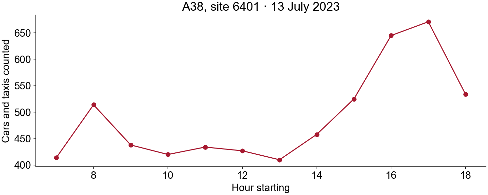<p>pandas tables and Matplotlib figures</p></div></div>
```

::: {.notes}
0–3 minutes. Use answers to judge the recap pace. First 40 minutes consolidate Week 7, including the memory reminder and tutorial window. The second half starts with where this traffic data came from. The source data are the saved 2023 Bristol DfT observations used in Week 7, downloaded 31 October 2026.
:::

## Names, objects and memory {#memory}

<div class="animation" data-animation="memory" aria-label="Slide-controlled string, list and array memory diagrams"></div>

::: {.notes}
3–6 minutes. Reuses the Week 7 examples as a slide-controlled sequence. Each normal Next advances strings, then lists, then arrays through aliasing and mutation. Strings: upper returns a new object. List and ndarray aliases refer to the same object; mutation is visible through both names. This is a names/objects diagram rather than a literal picture of physical addresses. Numeric NumPy arrays use a typed data buffer; a Python list holds references. Use the reference slide for that allocation distinction. The standalone Week 7 activity remains in activities/memory.html if useful outside the lecture route.
:::

## One-dimensional arrays as columns {#array-columns}

A 1D array can supply one column of a table.

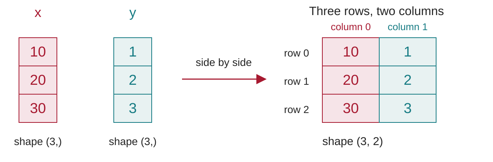

A 1D array has shape `(3,)`

::: {.notes}
6–8 minutes. New recap clarification. Show each input array vertically to illustrate its use as a column, but distinguish display from shape: x and y each have shape (3,), not (3,1). Taking corresponding values from x and y makes one row of the combined (3,2) array. Axis 0 indexes rows and axis 1 indexes columns in this table interpretation. x[:,None] explicitly turns x into a two-dimensional column of shape (3,1); x[None,:] makes a row of shape (1,3).
:::

## Arrange arrays as columns or rows {#array-stacking}

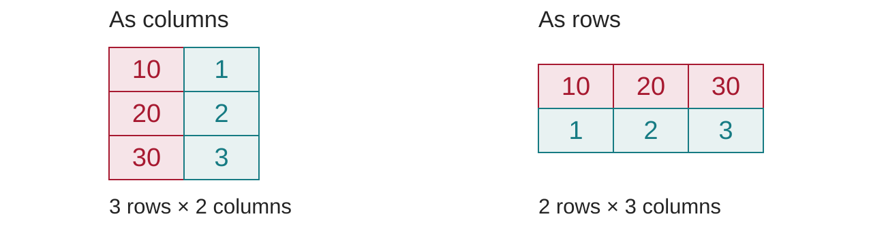

```python
x = np.array([10, 20, 30])
y = np.array([1, 2, 3])

print(np.column_stack((x, y)))  # three rows, two columns
print(np.vstack((x, y)))        # two rows, three columns
```

::: {.notes}
8–9 minutes. Concept first, code second. Introduce import numpy as np here if running this slide independently. A 1D array's transpose still has shape (3,): x.T does not create a column. In the first result each column comes from one input array; in the second, each row does. The two-dimensional shape is (number of rows, number of columns). These are illustrations of basic numeric arrays, not the full higher-dimensional axis vocabulary.
:::

## Array axes {#axes}

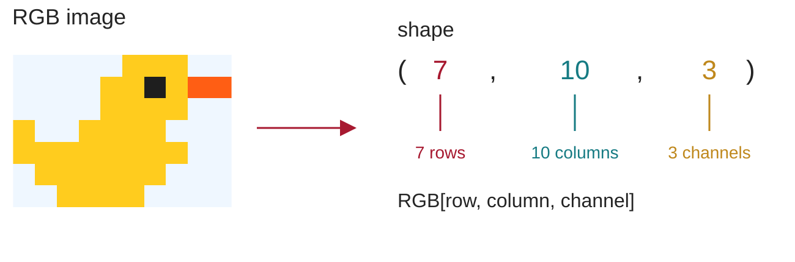

`RGB[:, :, 0]` selects the first colour channel at every pixel.

::: {.notes}
9–10 minutes. Identify row, column, channel before discussing syntax. An integer index removes an axis. RGB[1] has shape (10,3), whereas RGB[1:2] has shape (1,10,3). Reuse the duck rather than introducing a new image. Python's zero-based indexing applies to all axes.
:::

## Two-dimensional slicing {#slice}

```{=html}
<div class="slice-quiz"><div>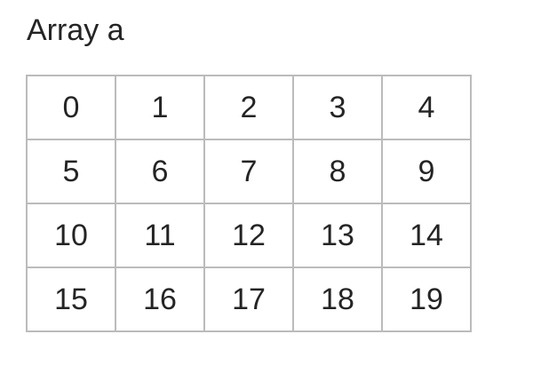</div><div><p><code>a[1:3, 1:4]</code></p><p>Which values are selected?<br>What is the result's shape?</p><div class="fragment">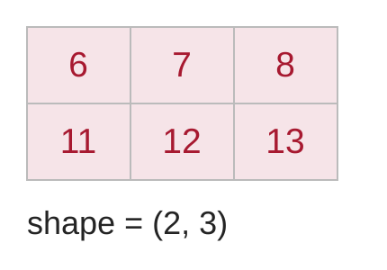</div></div></div>
```

::: {.notes}
10–11 minutes, together with the following code slide. Ask first. Normal Next reveals only the right-hand result; the following slide shows the code. The result is [[6,7,8],[11,12,13]], shape (2,3). Endpoint exclusion holds on each sliced axis. Basic slicing normally gives a view, so mutation can affect the original buffer.
:::

## Slicing in NumPy {#slice-code}

```python
import numpy as np

a = np.arange(20).reshape(4, 5)
print(a[1:3, 1:4])
print(a[1].shape)
print(a[1:2].shape)
```

<pre class="output">[[ 6  7  8]
 [11 12 13]]
(5,)
(1, 5)</pre>

An integer index removes an axis. A length-one slice keeps it.

## Matrix multiplication {#matrix}

<div class="animation" data-animation="matrix" aria-label="Step through row-by-column matrix multiplication"></div>

::: {.notes}
11–15 minutes, including next slide. Three steps per output cell: select row/column, multiply and sum, store. Ask for the second result before advancing. The inner dimensions must match: (m,n) @ (n,p) gives (m,p). Reuse the exact two matrices shown in Week 7. This is algebraic matrix multiplication, not elementwise multiplication.
:::

## Two multiplication operators {#matrix-code}

```python
A = np.array([[1, 2], [3, 4]])
B = np.array([[2, 1], [0, 3]])

print(A * B)
print(A @ B)
```

<pre class="output">[[ 2  2]
 [ 0 12]]
[[ 2  7]
 [ 6 15]]</pre>

`*` multiplies corresponding values. `@` takes row–column products.

::: {.notes}
Brief callback: the Week 7 duck stretch used transform @ point, mapping [4,2] to [8,2]. Do not spend time introducing a second matrix example unless needed. Additional shape reminder is in reference.
:::

## Tutorial 7A: Exercise 6 {#window-question}

**Compute averages using a sliding window over an array.**

Take the input `[5, 2, 4, 6, 3, 1]`. A sliding window of size 2 is applied. The current sum of the pair `[5, 2]` is 7. Continue iterating through the entire array, sliding the window by 1 for the next iteration.

What are the averages? Try different window sizes.

::: {.fragment}
Expected result: **`[3.5, 3, 5, 4.5, 2]`**
:::

::: {.notes}
Tutorial 7A – Numpy, Exercise 6. The full question is reproduced with spelling and punctuation corrected. It supplies the input, width, first pair sum, expected result and instruction to try other widths. Keep the expected result hidden until students predict it. This opening is part of the 15–25 minute window segment.
:::

## A sliding window {#window}

A window of two values moves one position at a time.

<div class="animation" data-animation="window" aria-label="A moving window averages neighbouring values"></div>

::: {.notes}
15–20 minutes. Tutorial 7A, Exercise 6. Input and width match the supplied notebook. Use the first iteration to explain the concept before showing any loop. Normal Next reveals the selected window’s mean; the next advance moves to the following window. Stop before the last result and ask for it. Ask what changes at width 3: four complete windows; the reference gives their means. This notebook contains the question, not the solution; avoid attributing any particular technique to its solution.
:::

## Going through the motions {#window-trace}

`values = np.array([5, 2, 4, 6, 3, 1])` · `width = 2` · `averages = []`

<div class="animation" data-animation="window" data-trace="true" aria-label="Trace each executed line and inspect the current variables"></div>

::: {.notes}
20–25 minutes. Use this as a quiz: show the loop and ask for the values on the right after each iteration. Normal Next reveals the answer; the next advance asks about the next iteration. The display uses range(5), whose general form is range(len(values)-width+1). The last valid start is n-width. Students can use print statements to reproduce this trace; live/recap.py includes them. This is a lecturer explanation, not a request for everyone to code now. The source array is unchanged; the current window name is rebound; the results list is mutated. The right-hand values are the state after the complete current iteration. They stay hidden during the prediction state. The code is not being executed line by line by this quiz; use the printed trace in live/recap.py to inspect each assignment if needed.
:::

## DataFrames

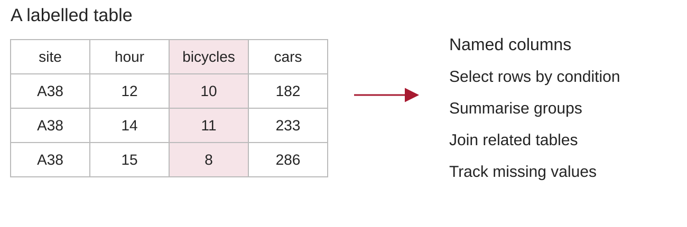

Column names describe the fields. Each column has a data type.

::: {.notes}
25–28 minutes. These three rows are selected fields from saved real traffic records, simplified to show a table. Label row/column/index and distinguish a Series from a DataFrame. Why powerful: named fields and vectorised operations; inspect, filter, group and join without separate loops over records. Different columns can have different dtypes. Link to Tutorial 7B: manual/automatic cars are two subsets selected by a condition.
:::

## Select rows and columns {#dataframe-code}

```python
import pandas as pd

traffic = pd.read_csv('data/bristol_traffic_2023.csv')

print(traffic.iloc[0:3, 0:2])      # positions; stop excluded
print(traffic.loc[0:2, ['cars']]) # labels; stop included here

busy = traffic.loc[traffic['cars'] > 300,
                   ['count_point_id', 'hour', 'cars']]
print(busy.head())
```

`busy` contains the rows that satisfy the condition.

::: {.notes}
28–32 minutes. Introduce import pandas as pd verbally or run the shared setup in live/recap.py; add import if typing from scratch. Predict each selection before running. The CSV creates a unique ascending RangeIndex, which is why loc[0:2] has these semantics here. One column in double brackets returns a DataFrame. Ask whether the condition is a single Boolean or a Boolean value for each row. Mention missing is not zero and briefly recall groupby if that was rushed in Week 7. The reference includes groupby and missing values.
:::

## Which chart? {#charts}

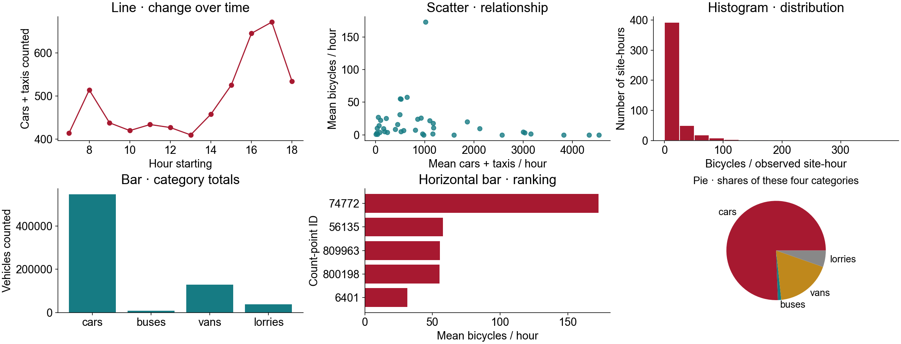


::: {.notes}
32–36 minutes. Ask for the chart before naming its method. The first five were the principal Week 7 chart families; pie is a brief comparison, not a new live demo. Pie shares cover only the four labelled categories. All charts use saved DfT records. Group directions within site/date/hour before comparing sites. The chart titles indicate the question, not a claim of causation. imshow displays images and is recalled in the file-import section.
:::

## Build a plot {#plot-code}

:::: {.columns}
::: {.column width="51%"}
```python
import matplotlib.pyplot as plt

fig, ax = plt.subplots()
ax.plot(day['hour'], day['cars'], 'o-')
ax.set_xlabel('Hour starting')
ax.set_ylabel('Cars and taxis counted')
plt.show()
```

`Figure`: whole canvas

`Axes`: plotting area
:::
::: {.column width="47%"}
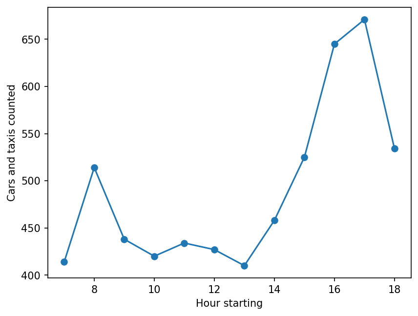
:::
::::

::: {.notes}
36–40 minutes. live/recap.py defines day from one site/date after summing directions. Keep labels visible. Type the five lines live, then change to a histogram if useful. This is a short demonstration: students have tutorials for practice. Reference gives method names for all six chart types. If time is tight, keep the prebuilt plot and explain which line adds what.
:::

## Structured and unstructured data {#structure}

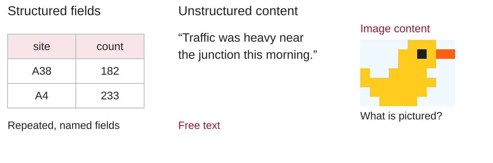

The pixels form a NumPy array. Recognising the duck extracts meaning from the image.

::: {.notes}
40–43 minutes. Unstructured does not literally mean without structure: an image has dimensions, a document has paragraphs, and email has headers. The distinction concerns whether the information of interest is already arranged in an explicit data model. Images, video, reports and free text are common examples. Relational databases and spreadsheets are common structured examples. Do not equate structured with numeric. The duck is deliberately labelled as image content: the pixel array is organised numerically, while the semantic observation “this image contains a duck” is not supplied as a field. Extracting that field requires interpretation. This is why images are commonly described as unstructured data in analysis workflows.
:::

## Semi-structured data {#semi}

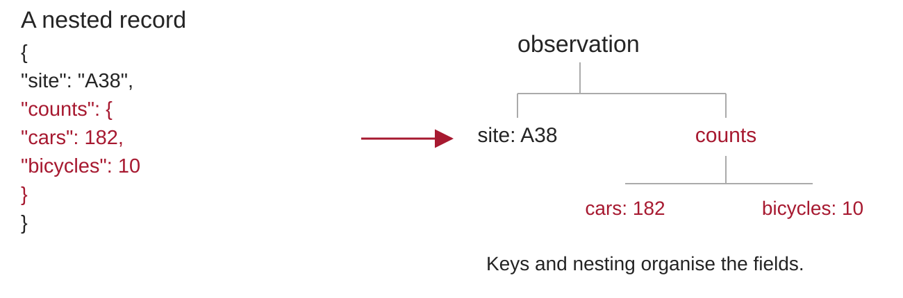

::: {.notes}
43–45 minutes. JSON and XML commonly carry semi-structured data. The same JSON can follow a strict schema; file extension alone does not determine degree of structure. Text mining, NLP and information retrieval can extract usable fields from unstructured content. Storage options include document/graph databases; names and roles are in reference. Avoid presenting Hadoop as a NoSQL database.
:::

## Quantitative or qualitative? {#qualitative}

<div class="animation" data-animation="classify" data-kind="qualitative" aria-label="Sort examples into quantitative and qualitative columns"></div>

::: {.notes}
45–47 minutes. Definitions remain below headings. One word/phrase appears; take a vote; reveal the placement. Numeric count-point ID is the trap. These examples use familiar records. The original shoes, grades, exam scores and jersey numbers remain in the reference quiz.
:::

## Discrete or continuous? {#discrete}

<div class="animation" data-animation="classify" data-kind="discrete" aria-label="Sort examples into discrete and continuous columns"></div>

::: {.notes}
47–48 minutes. Move quickly if the answers are confident. Shoe sizes show that decimal values can be discrete. Rounding a continuous measurement does not make the underlying phenomenon discrete. Original walking time, cow count and milk volume are in reference.
:::

## Discretisation {#binning}

<div class="animation" data-animation="bins" aria-label="Measurements are assigned to bins using equal widths or equal counts"></div>

::: {.notes}
48–52 minutes. Click through raw dots, equal-width boundaries, bin colours, category assignment, equal-count boundaries. Measurements are illustrative, not extracted Bristol observations. Grouping supports summaries, simpler representations and visualisation; exact information is lost. pd.cut uses intervals; pd.qcut uses sample quantiles. Equal counts can be complicated by ties. The original deck also covers replacing values with bin mean, median or nearest observed boundary: use the worked reference if asked and mention this alternative briefly. Binning alone does not guarantee smaller storage.
:::

## Scales of measurement {#scales}

| Scale | Example | What is meaningful? |
|---|---|---|
| **Nominal** | Count-point ID | Equality; category counts |
| **Ordinal** | Poor / fair / good | Order; gaps are unspecified |
| **Interval** | Calendar year | Differences; ratios are not meaningful |
| **Ratio** | Vehicle count; elapsed duration | Differences and ratios; meaningful zero |

Is averaging the numbers in this column useful?

::: {.notes}
52–55 minutes. The practical purpose is deciding which operations make sense, not memorising a hierarchy. “What is meaningful?” asks which comparisons or calculations tell us something about the underlying quantity, rather than just manipulating its written numbers.

- **Nominal:** equality means “same category or different category”. We can count how many observations belong to each category. A count-point ID identifies a site; averaging IDs gives a number with no useful interpretation as a site or measurement. Changing the arbitrary ID codes would change the average without changing the sites.
- **Ordinal:** order is meaningful: good ranks above fair, which ranks above poor. The gaps are unspecified: poor to fair need not be the same improvement as fair to good. Category frequencies, ranks and a median category can be useful; averaging codes such as 1, 2, 3 assumes something extra about the spacing.
- **Interval:** equal differences represent equal changes. The difference between 10 °C and 20 °C is 10 °C, as is the difference between 20 °C and 30 °C. Zero Celsius is a chosen reference, so 20 °C is not twice as hot as 10 °C. Converting to Fahrenheit changes that numerical ratio while preserving the temperature difference in converted units. A mean temperature can be meaningful; a ratio of Celsius readings is not a ratio of absolute temperatures.
- **Ratio:** there is a meaningful zero indicating absence of the measured quantity. Twenty cars is twice ten cars; ten minutes of elapsed duration is twice five minutes. Differences and ratios are both meaningful. Each successive scale also supports the earlier comparisons.

Return to “Is averaging the numbers in this column useful?” The answer depends on what the values mean, not simply whether Python stores them as integers or floats. Calendar year is interval; elapsed duration is ratio. Ratio data can be discrete. A label encoded as an integer remains a label. Measurement scale is different from Python dtype, storage structure or file format. Additional original test examples are in reference.
:::

## Data acquisition {#break .process-pause}

<div class="flow"><span>Source</span><b>→</b><span>Documentation</span><b>→</b><span>Retrieve + save</span><b>→</b><span>Process</span><b>→</b><span>Use</span></div>

::: {.notes}
55–65 minutes remains the scheduled pause. Show only the process diagram during this interval; do not display a break heading or duration. Resume by asking where last week's CSV came from.
:::

## Reading a file {#files}

:::: {.columns}
::: {.column width="56%"}
```python
import pandas as pd
from PIL import Image

traffic = pd.read_csv(
    'data/bristol_traffic_2023.csv')
RGB = np.array(
    Image.open('assets/duck.png')
         .convert('RGB'))
print(RGB.shape)
```
:::
::: {.column width="42%"}

:::
::::

A CSV becomes a table. An image becomes an array.

::: {.notes}
65–67 minutes. This is a recall of code students already saw, leading into the new concepts. NumPy imported in recap. imshow(RGB) displays the colour array. Ask where the CSV was obtained before it was read. The DfT raw response is bundled in data/raw/traffic-2023.json.
:::

## Data sources {#sources}

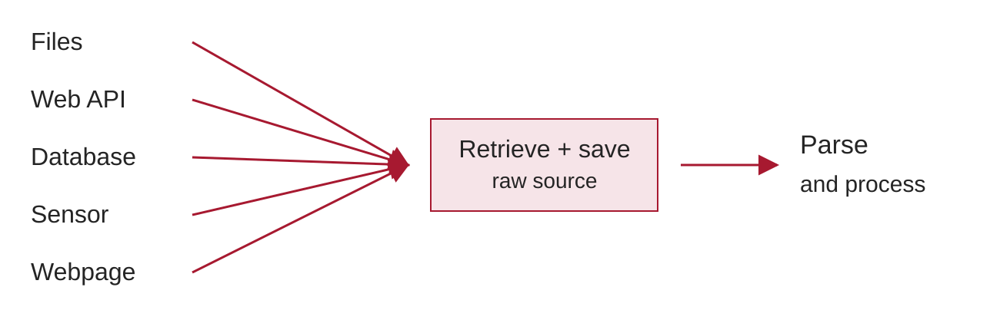

Choose an appropriate source for the questions you're trying to answer

::: {.notes}
67–69 minutes. Include CSV/Excel/text/XML files; database queries; instruments; API and webpage routes. An API is an interface, not a data format. URLs may return files or HTML as well as JSON. A wrapper library is another way to access an API. We use direct requests to see the steps.
:::

## Getting the Bristol traffic data {#workflow}

```{=html}
<div class="workflow-aligned">
<div><h3>Source</h3><div class="workflow-example"><p>DfT traffic data</p><p>2023 surveys<br>Bristol</p></div></div>
<div><h3>Documentation</h3><div class="workflow-example"><p>site, date,<br>hour, direction</p></div></div>
<div><h3>Retrieve + save</h3><div class="workflow-example"><p>Raw response</p><pre>{"data": [ … ]}</pre><p>Keep the original JSON.</p></div></div>
<div><h3>Process</h3><div class="workflow-example"><p>pandas DataFrame</p><pre>hour,cars
…,…</pre><p>Select and check fields.</p></div></div>
<div><h3>Use</h3><div class="workflow-example"><p>Matplotlib</p></div></div>
</div>
```

::: {.notes}
69–71 minutes. Each example sits directly under the stage it belongs to; there is a single connected flow. The Week 7 CSV was derived from the saved DfT API response. Raw JSON belongs under Retrieve + save; selected, checked columns under Process; the plotted analysis under Use. Source: https://roadtraffic.dft.gov.uk/api/raw-counts . Saved 31 October 2026: 936 records, last_page=1. These are sampled surveys, not continuous monitoring. Explain the difference between preserving a raw source and making a derived table.
:::

## Read the documentation {#documentation}

<div class="flow compact"><span>Source</span><b>→</b><span class="current">Documentation</span><b>→</b><span>Retrieve + save</span><b>→</b><span>Process</span><b>→</b><span>Use</span></div>

| Check | In our traffic example |
|---|---|
| What does one record represent? | A site, date, hour and direction |
| Which fields and units? | Vehicle counts; coordinates in degrees |
| Which place and period? | Bristol, 2023; sampled survey days |
| How do we request a subset? | Filters and page size |
| How do we know we have everything? | Pagination metadata |
| What can we do with it? | Check access, licence and attribution |

::: {.notes}
71–74 minutes. Use the actual source site or bundled data/source-notes.md in a live demonstration. Local authority ID 144 comes from the Week 7 source audit; do not assume IDs from another API use the same scheme. DfT download page: https://roadtraffic.dft.gov.uk/downloads . Show source documentation before writing the request. If the service is unavailable, make that visible and use the labelled cached response. More details in source-notes.md.
:::

## Anatomy of a web API {#api}

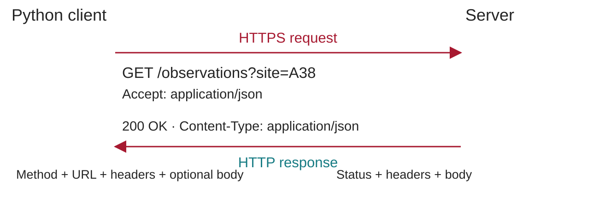

An API defines how to request an operation and interpret its result.

::: {.notes}
74–76 minutes. Application Programming Interface. Web APIs are one kind: libraries and operating systems also expose APIs. HTTP supplies request/response rules; HTTPS protects transport. Method, URL, headers and optional body form a request. Status, headers and body form the response. The resource path here is an illustrative teaching API, not the DfT endpoint. See MDN HTTP overview and Requests documentation in references.
:::

## GET and POST {#http}

<div class="animation" data-animation="http" aria-label="Animate GET retrieval and POST creation between a Python client and a teaching server"></div>

::: {.notes}
76–79 minutes, together with REST. Normal slide Next progresses through GET: outbound request, server processing, response and client receipt. Point to the server table: two existing rows contain 182 and 233 cars. GET reads these records; the stored table remains unchanged. The response label summarises the records rather than displaying their full JSON bodies.

The next advance starts POST. The request body contains site A38 and cars 286. When the server processes it, it assigns ID 3 and adds the complete row (3, A38, 286) to its stored table. This happens before the 201 Created response returns. Compare the body sent by the client with the new highlighted server row. A successful response then identifies /observations/3, and the client receives the created record. The highlight persists; receiving the response does not add another row.

This table is a schematic view of the server's records, resembling a DataFrame so students can follow the fields. An API does not require the server to use pandas; it might store records in a database or another structure. The optional local teaching server uses an in-memory list of dictionaries. POST often creates a resource; more generally it submits data for processing. This animation is a local simulation and makes no external request. Status codes and resource names illustrate a conventional design. JSON parsing happens after Python receives a Response. Distinguish request body from response body.
:::

## REST APIs {#rest}

```{=html}
<div class="url-anatomy" aria-label="The URL is divided into scheme, host, resource path and query"><div><code>https://</code><span>scheme</span></div><div><code>example.org</code><span>host</span></div><div><code>/observations</code><span>resource path</span></div><div><code>?site=A38</code><span>query</span></div></div>
```

A resource has a URL. Each request supplies the context the server needs.

| Method | Typical purpose |
|---|---|
| GET | Retrieve a representation |
| POST | Submit data; commonly create a resource |
| PUT / PATCH | Replace / partially modify a resource |
| DELETE | Remove a resource |

::: {.notes}
REST = Representational State Transfer, an architectural style. Resource URLs and consistent interface semantics matter; JSON alone does not make an API RESTful. Each request supplies its context (stateless interactions). GET is the only external method demonstrated. Further reference: client/server separation, cache constraints and layered systems. Method behaviour depends on documented endpoint semantics. Reference source: Fielding dissertation chapter 5 and MDN methods.
:::

## Three records, four representations {#formats}

```{=html}
<div class="formats">
<div><h3>CSV</h3><pre>site,cars
A38,<em>182</em>
A4,233
M32,286</pre></div>
<div><h3>JSON</h3><pre>[
  {"site": "A38", "cars": <em>182</em>},
  {"site": "A4", "cars": 233},
  {"site": "M32", "cars": 286}
]</pre></div>
<div><h3>XML</h3><pre>&lt;observations&gt;
  &lt;record site="A38" cars="<em>182</em>" /&gt;
  &lt;record site="A4" cars="233" /&gt;
  &lt;record site="M32" cars="286" /&gt;
&lt;/observations&gt;</pre></div>
<div><h3>HTML</h3><pre>&lt;table&gt;
  &lt;tr&gt;&lt;td&gt;A38&lt;/td&gt;&lt;td&gt;<em>182</em>&lt;/td&gt;&lt;/tr&gt;
  &lt;tr&gt;&lt;td&gt;A4&lt;/td&gt;&lt;td&gt;233&lt;/td&gt;&lt;/tr&gt;
  &lt;tr&gt;&lt;td&gt;M32&lt;/td&gt;&lt;td&gt;286&lt;/td&gt;&lt;/tr&gt;
&lt;/table&gt;</pre></div>
</div>
```

::: {.notes}
79–83 minutes. Follow each record across all four representations. These are illustrative records, not four publisher endpoints or a claim that the sites have these counts. JSON uses an array of objects; XML repeats elements under one root; HTML repeats table rows; CSV repeats rows under a header. Use established parsers rather than splitting markup by hand.

**Reading the HTML:** HTML means HyperText Markup Language. Angle brackets delimit tags: `<table>` opens a table and `</table>` closes it. The slash in a closing tag marks the end of that element. `<tr>` means table row; `<td>` means a data cell within that row. Read the first row aloud: open a row, open a cell, put A38 in it, close the cell; open a second cell, put 182 in it, close that cell and the row. The text between the tags is the content. Tags describe its structure so a browser can display it. These angle brackets are markup syntax, not Python comparison operators. Nesting creates the document tree we inspect when scraping. Attributes such as `class="price_color"` add information to an opening tag and help us select elements later. Indentation helps people read the source.

**Reading the XML:** XML means Extensible Markup Language. It is a text format for representing structured information as nested elements and attributes. Unlike HTML's standard vocabulary for webpage structure, XML lets a format define tags for its own domain. Here `<observations>` is the root enclosing three `<record>` elements. `site` and `cars` are attributes, with quoted values. The `/>` ending makes each record a self-closing element: it has attributes but no nested content. Other XML formats put values inside child elements instead. XML requires properly nested, matching, case-sensitive tags. These attribute values are text; a parser or a schema-aware application must interpret the car counts as numbers. JSON's unquoted counts are numeric values already. CSV and HTML text also need appropriate type conversion.

**Why use XML, and who still uses it?** Its explicit nesting suits hierarchical information and documents that mix prose with markup. Namespaces help combine vocabularies; schemas can specify and validate an agreed structure. It remains part of established exchange standards: SVG graphics use XML, modern Office files such as DOCX, XLSX and PPTX package XML with other assets, and SOAP web-service messages use XML. Our SVG diagrams are an example close to hand. XML has not stopped being used.

**Why do many newer simple web APIs choose JSON?** JSON directly represents objects, arrays and primitive values and maps naturally to familiar dictionaries and lists after parsing. For simple records it often needs less markup than opening/closing tags. This makes it convenient for web applications. That is a format tradeoff, not a rule that XML is obsolete or that REST requires JSON. XML remains useful for document markup, validation requirements and existing standards. XHTML is an XML formulation of HTML. Domain formats and custom-format documentation are in reference.

Sources: [HTML syntax (MDN)](https://developer.mozilla.org/en-US/docs/Learn_web_development/Core/Structuring_content/Basic_HTML_syntax), [XML introduction (W3C)](https://www.w3.org/XML/), [XML specification (W3C)](https://www.w3.org/TR/REC-xml/), [SVG (MDN)](https://developer.mozilla.org/en-US/docs/Web/SVG), [Office Open XML (Microsoft)](https://learn.microsoft.com/en-us/office/open-xml/open-xml-sdk), [SOAP (W3C)](https://www.w3.org/TR/soap12-part1/).
:::

## Send a request {#request-code}

<div class="flow compact"><span>Source</span><b>→</b><span>Documentation</span><b>→</b><span class="current">Retrieve + save</span><b>→</b><span>Process</span><b>→</b><span>Use</span></div>

:::::: {.request-sequence}
::::: {.request-frame .fragment .fade-out data-fragment-index="0"}
### The full URL

```python
import requests
import json

url = ('https://roadtraffic.dft.gov.uk/api/raw-counts'
       '?filter[local_authority_id]=144&filter[year]=2023'
       '&page[size]=2&fields=road_name,cars_and_taxis')
response = requests.get(url, timeout=20)
response.raise_for_status()
print(json.dumps(response.json()['data'], indent=2))
```

<pre class="output">[
  {
    "road_name": "A38",
    "cars_and_taxis": 182
  },
  {
    "road_name": "A38",
    "cars_and_taxis": 233
  }
]</pre>
:::::
::::: {.request-frame .fragment .fade-in-then-out data-fragment-index="0"}
### Put variables into the URL with an f-string

```python
base = 'https://roadtraffic.dft.gov.uk/api/raw-counts'
authority, year = 144, 2023
url = (f'{base}?filter[local_authority_id]={authority}'
       f'&filter[year]={year}&page[size]=2'
       '&fields=road_name,cars_and_taxis')
response = requests.get(url, timeout=20)
response.raise_for_status()
print(json.dumps(response.json()['data'], indent=2))
```

<pre class="output">[
  {
    "road_name": "A38",
    "cars_and_taxis": 182
  },
  {
    "road_name": "A38",
    "cars_and_taxis": 233
  }
]</pre>
:::::
::::: {.request-frame .fragment data-fragment-index="1"}
### Let Requests build the query from a dictionary

```python
base = 'https://roadtraffic.dft.gov.uk/api/raw-counts'
params = {'filter[local_authority_id]': 144,
          'filter[year]': 2023, 'page[size]': 2,
          'fields': 'road_name,cars_and_taxis'}
response = requests.get(base, params=params, timeout=20)
response.raise_for_status()
print(json.dumps(response.json()['data'], indent=2))
```

<pre class="output">[
  {
    "road_name": "A38",
    "cars_and_taxis": 182
  },
  {
    "road_name": "A38",
    "cars_and_taxis": 233
  }
]</pre>
:::::
::::::

::: {.notes}
83–86 minutes. Normal Next replaces the full literal URL with the f-string version, then the params dictionary. All three request the same two records and two fields. No URL is abbreviated. Shared setup imports requests and json. Read the URL aloud: the resource path precedes ?, & separates query parameters, and each name=value supplies a filter or option. An f-string substitutes the expressions inside braces; values containing spaces or reserved characters would need encoding. Prefer params for real requests: Requests encodes values and constructs the query string. page[size]=2 limits one page; fields selects two fields. This is a preview, not the full Bristol dataset. json.dumps formats the parsed data list as JSON for display. The response body also contains pagination metadata, omitted from this small printed preview. raise_for_status() raises an HTTPError on 4xx/5xx responses; a successful 200 continues. Timeouts and connection errors raise separately. The presenter Run buttons make real requests unless the server is explicitly started in saved mode. The complete bristol_traffic_pipeline.py downloads all records. DfT API documentation: https://roadtraffic.dft.gov.uk/api-documentation .
:::

## Inspect and save the response {#save-code}

```python
print(response.headers.get('Content-Type'))
print(response.text[:200])
```

:::: {.columns}
::: {.column width="49%"}
### With `open`

```python
with open('output/traffic-response.json',
          'w', encoding='utf-8') as file:
    file.write(response.text)
```
:::
::: {.column width="49%"}
### With `pathlib.Path`

```python
from pathlib import Path

Path('output/traffic-response.json').write_text(
    response.text, encoding='utf-8')
```
:::
::::

Save the original response before changing its contents.

::: {.notes}
86–89 minutes. Inspect first, then compare two equivalent saving options. with open(..., 'w') opens a text file for writing; file is the name for the open file object. Indentation defines the with block; leaving it closes the file, including if an error occurs. 'w' replaces an existing file; encoding='utf-8' specifies how text is stored. pathlib.Path represents a filesystem path; write_text opens, writes and closes the file in one call. Both snippets save the same unmodified response body. The shared setup creates output/; if typing from scratch, first run Path('output').mkdir(exist_ok=True). The full pipeline also saves the request URL, params, acquisition date and live/saved mode. Response has attributes and methods, connecting Week 5. response.content is bytes; response.text is decoded text. requests.get does not return a DataFrame.
:::

## Parse the response {#parse-concept}

<div class="flow compact"><span>Source</span><b>→</b><span>Documentation</span><b>→</b><span>Retrieve + save</span><b>→</b><span class="current">Process</span><b>→</b><span>Use</span></div>

JSON is a text format. `response.json()` parses that text into Python objects.

We call the parsed response body **`payload`**. It is an ordinary variable name.


A JSON **object** becomes a Python **dict**. A JSON **array** becomes a **list**.

::: {.notes}
89–91 minutes. Payload means the content carried in a message, as distinct from HTTP status and headers. Here payload is our chosen Python variable name for the parsed JSON body: payload = response.json(). It is not a Python keyword or a special Requests object. A dict here is the parsed representation of the response's JSON object. Parsing is not a cast to a DataFrame. Not all JSON becomes a dict: arrays become lists, true/false become True/False and null becomes None. Draw attention to the intermediate objects before showing code. This DfT response contains data and pagination fields; data is a list of record dictionaries. A different API may use a different schema. Do not assume every response contains data. Use keys, len and selected records to inspect it.
:::

## Inspect the parsed objects {#parse-code}

```python
payload = response.json()
print(list(payload)[:4])

records = payload['data']
print(records)
print(len(records))

df = pd.DataFrame(records)
print(df)
```

<pre class="output">['current_page', 'data', 'first_page_url', 'from']
[{'road_name': 'A38', 'cars_and_taxis': 182},
 {'road_name': 'A38', 'cars_and_taxis': 233}]
2
  road_name  cars_and_taxis
0       A38             182
1       A38             233</pre>

::: {.notes}
91–93 minutes. This uses the same two-record, two-field preview requested on slide 33. Print the records so students can recognise the list of dictionaries, then see how pandas arranges the fields into columns. response.json() parses body text into Python objects. json.loads(text) and json.load(file) are reference alternatives. Students predict dict → list → DataFrame from the preceding diagram. The full 31 October saved query contains 936 records; do not confuse that complete query with this two-record page.
:::

## Check for more pages {#pagination}

1. **Read the documentation:** look for `page`, `limit`, `offset` or `cursor` parameters.
2. **Inspect the response:** pagination may appear in JSON metadata or an HTTP `Link` header.

```python
print(payload.keys())
print(payload.get('next_page_url'))
print(response.links.get('next'))
```

Follow the documented next-page link or cursor until there are no more pages.

::: {.fragment}
Our two-record preview has more pages. The complete saved query contains<br>
**936 records** and fits on one page when `page[size] = 10000`.
:::

::: {.notes}
93–94 minutes, including the following illustration. Pagination conventions differ across APIs: first read source documentation; inspect top-level keys and nested links/meta/paging blocks, and response.headers.get('Link'). Requests exposes parsed Link headers via response.links. response.links.get('next') returns a link-info dict when present, not the URL string itself. On this DfT response pagination is in the JSON, so response.links can be empty. None for next_page_url means no next page for this result, not that the API lacks pagination. Absence of a next field does not establish completeness without knowing the documented schema. Our saved body has total=936 and last_page=1; the full demo checks totals and follows links. Sources: https://requests.readthedocs.io/en/latest/user/advanced/#link-headers and https://docs.github.com/en/rest/using-the-rest-api/using-pagination-in-the-rest-api .
:::

## Following pagination links {#pagination-demo}

<div class="animation" data-animation="pagination" aria-label="A paginated teaching response reveals six records across three pages"></div>

::: {.notes}
Illustrative teaching response, not a claim about the saved DfT query. Each Next fetches the linked page and appends its records. The last page has no next link. Six records in total are collected from three pages of two. Final advance shows the complete list. An API may instead use cursors or offsets; follow its documentation. This is a quick visual within the existing API demonstration time.
:::

## Process the records {#process-code}

```python
counts = df[['road_name', 'cars_and_taxis']].copy()
counts = counts.rename(columns={'cars_and_taxis': 'cars'})

print(counts.dtypes)
print(counts.isna().sum())
counts.to_csv('output/traffic-counts.csv', index=False)
```

Check fields, types, units and missing values before summarising.

::: {.notes}
94–98 minutes. This small example processes the same two-field preview into a CSV. Then open live/bristol_traffic_pipeline.py for the full source-to-plot walkthrough: request all fields/records, follow pagination, check types/missingness/duplicates, combine directions within site/date/hour, select site 6401 on 13 July 2023 and plot. Preview data do not include the site/date/hour fields needed for that aggregation. Keep the raw response separate from the processed CSV. Missing observations are not automatically zero; one sampled day is not an annual traffic estimate.
:::

## Data on a webpage {#scrape}

<div class="flow compact"><span>Source</span><b>→</b><span class="current">Documentation</span><b>→</b><span>Retrieve + save</span><b>→</b><span>Process</span><b>→</b><span>Use</span></div>

```{=html}
<div class="scrape-overview"><div class="comparison"><div><h3>A download or API is available</h3><p>Use its documented fields and access method.</p></div><div><h3>The required values are in HTML</h3><p>Inspect the document and extract the relevant elements.</p></div></div></div>
```

Check access conditions and request rates before retrieving pages.

::: {.notes}
98–101 minutes. The workflow is unchanged. Scraping = retrieving a page and extracting information from its markup. Some pages depend on JavaScript; values seen in a browser may not be present in the initial HTML. Open https://books.toscrape.com/ live. It is a public scraping-practice site; its prices and ratings are demonstration data. Identify a book title and price, then inspect its HTML. The code fetches this public page directly. The saved page is only an explicitly selected fallback. The small book-spider illustration was generated for this lecture with the built-in image-generation tool; see visual-notes.md.
:::

## HTML elements {#html}

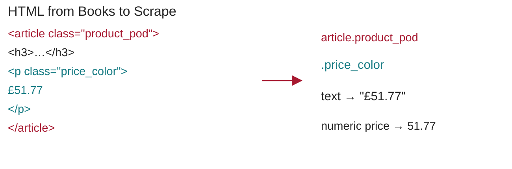

Tags and attributes help us select the values we need.

::: {.notes}
101–104 minutes. Show the live Books to Scrape page beside the matching markup fragment. Explain tag, attribute and text before code. article.product_pod selects each book; .price_color selects its price paragraph. Nesting describes context. An absent match is a condition to inspect. BeautifulSoup parses; requests retrieves. Scrapy and Selenium are tool signposts in reference, not additional coding exercises.
:::

## Extract values from HTML {#scrape-code}

<div class="flow compact"><span>Source</span><b>→</b><span>Documentation</span><b>→</b><span>Retrieve + save</span><b>→</b><span class="current">Process</span><b>→</b><span>Use</span></div>

```python
from bs4 import BeautifulSoup

page = requests.get('https://books.toscrape.com/', timeout=20)
page.raise_for_status()
page.encoding = 'utf-8'
soup = BeautifulSoup(page.text, 'html.parser')

prices = soup.select('article.product_pod .price_color')
print([price.get_text(strip=True) for price in prices[:3]])
```

<pre class="output">['£51.77', '£53.74', '£50.10']</pre>

[Open the live website](https://books.toscrape.com/){target="_blank"}

`raise_for_status()` stops on an HTTP error such as **404** or **500**.<br>
A successful **200** response continues to the next line.

::: {.notes}
104–110 minutes. raise_for_status() checks the HTTP status and raises requests.HTTPError for a 4xx or 5xx response. It returns normally for 200; it does not itself print anything or check the page's contents. This prevents us continuing to parse an error page as book data. It does not detect every possible problem: a 200 page can still contain unexpected HTML or an empty match. live/scrape_demo.py fetches the public site, prints the selected element and first three prices, then saves a title/price table. First inspect prices[0], then extract text. Set UTF-8 explicitly for the pound sign. Change the selector to .missing and inspect the empty result. Prices and ratings are artificial practice data. --saved explicitly reads the captured page if needed. Requests reference: https://requests.readthedocs.io/en/latest/user/quickstart/#response-status-codes .
:::

## Process and use the data {#finish}

<div class="flow compact"><span>Source</span><b>→</b><span>Documentation</span><b>→</b><span>Retrieve + save</span><b>→</b><span class="current">Process</span><b>→</b><span class="current">Use</span></div>

```{=html}
<div class="analysis-recap">
<div><h3>NumPy arrays</h3><div class="recap-media"></div><p>Slice and transform<br>numerical data.</p></div>
<div><h3>pandas DataFrames</h3><div class="recap-media"><table><thead><tr><th>site</th><th>hour</th><th>cars</th></tr></thead><tbody><tr><td>A38</td><td>12</td><td>182</td></tr><tr><td>A38</td><td>14</td><td>233</td></tr></tbody></table></div><p>Inspect, clean and select.<br>Group and combine tables.</p></div>
<div><h3>Matplotlib graphs</h3><div class="recap-media"></div><p>Explore patterns.<br>Communicate results.</p></div>
</div>
```

Later lectures will explore how to use Python for data analysis.

::: {.notes}
110–116 minutes. Connect the acquisition story back to familiar objects: numeric arrays and their slices, labelled DataFrames and their operations, Matplotlib figures and chart choices. Libraries overlap: pandas can plot and NumPy underlies many operations. The table shows selected raw example rows, not all data or grouped hourly counts. The plot groups directions within each observed hour, as explained earlier. Future lectures extend the analysis: EDA, missing values, appropriate summaries/plots and outliers. Keep source period, units and provenance with results. Ask where to inspect a wrong value and where to check for missing records.
:::

## Questions {#questions}

```{=html}
<div class="exit-quiz" aria-label="Four questions, each followed by its answer">
<p class="exit-intro fragment fade-out" data-fragment-index="0">Explain your answer before revealing it.</p>
<div class="exit-frame fragment fade-in-then-out" data-fragment-index="0" data-question="1" data-answer="false"><h3>Question 1</h3><p class="exit-question">Why does a width-three window over six values produce four complete windows?</p></div>
<div class="exit-frame fragment fade-in-then-out" data-fragment-index="1" data-question="1" data-answer="true"><h3>Question 1</h3><p class="exit-question">Why does a width-three window over six values produce four complete windows?</p><p class="exit-answer">The valid start indices are 0, 1, 2 and 3.<br>Number of complete windows = 6 − 3 + 1 = 4.</p></div>
<div class="exit-frame fragment fade-in-then-out" data-fragment-index="2" data-question="2" data-answer="false"><h3>Question 2</h3><p class="exit-question">What is wrong with averaging count-point IDs?</p></div>
<div class="exit-frame fragment fade-in-then-out" data-fragment-index="3" data-question="2" data-answer="true"><h3>Question 2</h3><p class="exit-question">What is wrong with averaging count-point IDs?</p><p class="exit-answer">IDs are nominal labels. Their mean has no useful interpretation as a site or a measured quantity.</p></div>
<div class="exit-frame fragment fade-in-then-out" data-fragment-index="4" data-question="3" data-answer="false"><h3>Question 3</h3><p class="exit-question">How does a <code>Response</code> differ from <code>payload['data']</code>?</p></div>
<div class="exit-frame fragment fade-in-then-out" data-fragment-index="5" data-question="3" data-answer="true"><h3>Question 3</h3><p class="exit-question">How does a <code>Response</code> differ from <code>payload['data']</code>?</p><p class="exit-answer">A <code>Response</code> contains the HTTP status, headers and body.<br>In our API example, <code>payload['data']</code> is a list of records from the parsed JSON body.</p></div>
<div class="exit-frame fragment fade-in-then-out" data-fragment-index="6" data-question="4" data-answer="false"><h3>Question 4</h3><p class="exit-question">What would you check before scraping a webpage?</p></div>
<div class="exit-frame fragment fade-in-then-out" data-fragment-index="7" data-question="4" data-answer="true"><h3>Question 4</h3><p class="exit-question">What would you check before scraping a webpage?</p><p class="exit-answer">Check for a documented download or API, the fields you need, access rules, terms and rate limits. Then inspect the HTML to find the data.</p></div>
</div>
```

::: {.notes}
116–120 minutes. Normal slide Next reveals question 1, then its answer, then question 2 and its answer, and so on. Only the current question is displayed. Pause for a prediction or explanation before each answer; Previous reverses the sequence. Answers: the last valid window start is 3, so starts 0–3 give 6−3+1=4 windows; IDs are nominal labels; Response contains HTTP status/headers/body while payload['data'] is a parsed list in this API schema; check documented download/API, required fields and access/terms/rate limits, then inspect HTML. For question 3, response.json() parses the body into payload before indexing its 'data' field. Later lectures: EDA, appropriate plots/summaries and dealing with outliers. End the main route here. Following slides are reference material, not additional timed content.
:::

## Reference material {#reference .section-slide}

Worked examples and documentation

## Reference: names and data buffers {#ref-memory .reference-slide}

| Object | Storage and behaviour |
|---|---|
| String | Immutable text; methods such as `upper()` return a string |
| List | Mutable sequence of references to Python objects |
| Numeric NumPy array | Shape and dtype describe a typed data buffer |
| Basic array slice | Usually a separate array object sharing the original buffer |
| Array copy | Independent data buffer |

```python
original = np.array([10, 20, 30])
view = original[1:]
view[0] = 99        # original is now [10, 99, 30]
copy = original.copy()
copy[0] = 0        # original remains [10, 99, 30]
print(original)
print(copy)
```

::: {.notes}
NumPy object arrays are an exception to the fixed-width numeric-values simplification: their elements hold references to Python objects. Basic versus advanced indexing matters for copying. Official guide: https://numpy.org/doc/stable/user/basics.copies.html . Allocation details are conceptual, not a promise about physical addresses or fixed byte counts across Python implementations.
:::

## Reference: windows and inspection {#ref-window .reference-slide}

```python
values = np.array([5, 2, 4, 6, 3, 1])
width = 2
averages = []
for start in range(len(values) - width + 1):
    stop = start + width
    window = values[start:stop]
    average = window.mean()
    averages.append(float(average))
    print(start, stop, window, average, averages)
```

Width 2: `[3.5, 3.0, 5.0, 4.5, 2.0]`

Width 3: `[3.667, 4.0, 4.333, 3.333]` (rounded)

::: {.notes}
Source exercise: supplied Tutorial 7A – Numpy, Exercise 6. Restrict width to 1 through len(values). Optional library bridge after understanding: np.lib.stride_tricks.sliding_window_view(values, width).mean(axis=-1). NumPy sliding_window_view documentation: https://numpy.org/doc/stable/reference/generated/numpy.lib.stride_tricks.sliding_window_view.html . Be clear that this returns overlapping views; do not mutate them as part of this demonstration.
:::

## Reference: DataFrame operations {#ref-pandas .reference-slide}

```python
# Inspect missing entries before deciding what they mean.
print(traffic.isna().sum())

# Group and combine directions within each observed hour.
site_hour = traffic.groupby(
    ['count_point_id', 'count_date', 'hour'], as_index=False
)[['bicycles', 'cars']].sum()

# Filter rows; select named columns.
selected = site_hour.loc[site_hour['bicycles'] >= 30,
                         ['count_point_id', 'bicycles']]
print(selected.head())
```

`groupby` defines groups; a summary such as `sum` produces the result.

::: {.notes}
Do not fill missing values with zero by default. sum skips missing values by default; use an explicit min_count policy if applying this to incomplete groups. The bundled count columns have no missing values. pandas indexing guide: https://pandas.pydata.org/docs/user_guide/indexing.html . GroupBy guide: https://pandas.pydata.org/docs/user_guide/groupby.html . Tutorial 7B uses mtcars, reading a CSV, statistics and subsets by transmission.
:::

## Reference: plotting methods {#ref-plots .reference-slide}

| Question | Matplotlib method |
|---|---|
| How does a quantity change with x? | `ax.plot(x, y)` |
| How are two quantities related? | `ax.scatter(x, y)` |
| What is the distribution? | `ax.hist(values, bins=15)` |
| How do categories compare? | `ax.bar(labels, values)` |
| Which categories rank highest? | `ax.barh(labels, values)` |
| What are the shares of a defined total? | `ax.pie(values, labels=labels)` |
| What does an image array contain? | `ax.imshow(RGB)` |

`fig, ax = plt.subplots()` creates a Figure and an Axes. Label units.

::: {.notes}
Matplotlib plot types: https://matplotlib.org/stable/plot_types/index.html . Do not confuse a histogram's bins with categorical bars. Pie and stacked plots require a meaningful common total; bars often make close comparisons easier. The gallery pie is explicitly only the four shown categories. Matplotlib legend/colourbar labels are needed when using colour or size to encode quantities.
:::

## Reference: classification answers {#ref-classification .reference-slide}

| Example from the original deck | Classification |
|---|---|
| Shoe brand; letter grade; jersey number | Qualitative |
| Number correct on an exam | Quantitative, discrete |
| Number of cows | Quantitative, discrete |
| Walking duration; volume of milk | Quantitative, continuous |
| Jersey number | Nominal |
| Food ranking: poor / fair / good | Ordinal |
| Calendar year; Celsius temperature | Interval |
| Elapsed marathon duration | Ratio |

Three hours is twice the duration of 1.5 hours.

## Reference: binning and representative values {#ref-bins .reference-slide}

Sorted values: `10, 15, 25, 34, 44, 48, 55, 59, 64, 69, 88, 94`

| Equal-count group | Mean | Median | Observed endpoints |
|---|---:|---:|---|
| 10, 15, 25 | 16.67 | 15 | 10, 25 |
| 34, 44, 48 | 42 | 44 | 34, 48 |
| 55, 59, 64 | 59.33 | 59 | 55, 64 |
| 69, 88, 94 | 83.67 | 88 | 69, 94 |

Replace values with the mean, median or nearest endpoint to smooth within a bin.

For `[10, 15, 25]`, nearest-endpoint replacement gives `[10, 10, 25]`.

::: {.notes}
Corrects the original medians and clarifies equal-count grouping. A tie between endpoints needs a defined policy. Assigning categories and replacing measurements are distinct operations. pd.cut(x, bins=3) makes equal-width intervals; pd.qcut(x, q=3) makes quantile-based groups, subject to ties. Documentation: https://pandas.pydata.org/docs/reference/api/pandas.cut.html and https://pandas.pydata.org/docs/reference/api/pandas.qcut.html . Binning does not automatically guarantee file-size reduction.
:::

## Reference: extracting fields from content {#ref-unstructured .reference-slide}

| Task or tool | Role |
|---|---|
| Text mining / NLP | Extract language features or entities |
| Information retrieval | Find and rank relevant content |
| MongoDB | Document database |
| Neo4j | Graph database |
| HBase | Wide-column database |
| Hadoop | Distributed storage/processing ecosystem |

An email can combine structured headers with free-text content.

::: {.notes}
These are signposts preserving the original unstructured-data slide. No installation/demo implied. Official sources: https://www.mongodb.com/docs/ ; https://neo4j.com/docs/ ; https://hbase.apache.org/ ; https://hadoop.apache.org/ . Different tools serve different roles; they do not make unstructured meaning automatically interpretable.
:::

## Reference: formats and parsers {#ref-formats .reference-slide}

| Representation | Read with |
|---|---|
| CSV file or stream | `pd.read_csv(...)` or Python `csv` |
| JSON response body | `response.json()` |
| JSON text / file | `json.loads(text)` / `json.load(file)` |
| XML | An XML parser, e.g. `xml.etree.ElementTree` |
| HTML | An HTML parser, e.g. BeautifulSoup |
| XHTML | HTML expressed using XML syntax |
| Shapefile / RVT | Domain-specific geospatial / building-model tools |

Document the schema, units and version of a custom format.

::: {.notes}
JSON https://docs.python.org/3/library/json.html ; CSV https://docs.python.org/3/library/csv.html ; XML https://docs.python.org/3/library/xml.etree.elementtree.html . Formats are separate from transport and from measurement scale. Use established parsers. CSV parsers handle quoting and embedded delimiters, so splitting every line on commas is inadequate.
:::

## Reference: REST and failures {#ref-rest .reference-slide}

REST describes architectural constraints: client/server separation, stateless interactions, caching, a uniform interface and layers; code-on-demand is optional.

| Situation | What to inspect |
|---|---|
| Timeout or connection failure | Network/service availability; catch request exceptions |
| Non-success HTTP status | Status and error body; `raise_for_status()` |
| Unexpected content or schema | Content type, body preview, keys and types |
| Only some records returned | Pagination and documented totals |
| Too many requests | Published limits; retry guidance |

::: {.notes}
Fielding, chapter 5: https://ics.uci.edu/~fielding/pubs/dissertation/rest_arch_style.htm . HTTP methods: https://developer.mozilla.org/en-US/docs/Web/HTTP/Reference/Methods . Requests quickstart https://requests.readthedocs.io/en/latest/user/quickstart/ . REST is not a synonym for arbitrary HTTP+JSON. Do not blindly retry POST: repeated submission may duplicate an action unless endpoint semantics/idempotency mechanisms prevent it.
:::

## Reference: scrape, extract and store {#ref-scraping .reference-slide}

```python
# Inspect links and resolve relative destinations when needed.
from urllib.parse import urljoin
for anchor in soup.find_all('a')[:3]:
    href = anchor.get('href')
    if href:
        print(urljoin(page.url, href))

values = [float(p.get_text(strip=True).removeprefix('£'))
          for p in prices]
pd.DataFrame({'price_gbp': values}).to_csv(
    'output/scraped-prices.csv', index=False)
```

BeautifulSoup parses documents. Scrapy organises crawls. Selenium automates a browser.

::: {.notes}
https://www.crummy.com/software/BeautifulSoup/bs4/doc/ ; https://docs.scrapy.org/ ; https://www.selenium.dev/documentation/ . Need a parser specified (html.parser here). JavaScript-rendered data may be absent in downloaded initial HTML. Check terms, permissions, robots guidance and rate limits. The live example uses https://books.toscrape.com/ ; the captured HTML is available as an explicitly selected fallback. Prices and ratings are synthetic practice data.
:::

## Reference: sources and reading {#ref-sources .reference-slide}

- DfT road traffic data: [downloads and guidance](https://roadtraffic.dft.gov.uk/downloads)
- [Requests quickstart](https://requests.readthedocs.io/en/latest/user/quickstart/)
- [BeautifulSoup documentation](https://www.crummy.com/software/BeautifulSoup/bs4/doc/)
- [Python for Data Analysis: data loading](https://wesmckinney.com/book/accessing-data)
- [REST architectural constraints](https://ics.uci.edu/~fielding/pubs/dissertation/rest_arch_style.htm)

Saved traffic response: **31 October 2026**. Observations: **2023**.

Next session: exploratory data analysis, appropriate summaries and plots, outliers.

::: {.notes}
Original reading slide named Python for Data Analysis chapter 6 and Web Scraping with Python. Use the linked data-loading chapter rather than assuming the same chapter number across editions. Original Web Scraping with Python reference: https://learning.oreilly.com/library/view/web-scraping-with/9781491985564/ . DfT public-sector information under Open Government Licence v3.0, https://www.nationalarchives.gov.uk/doc/open-government-licence/version/3/ . Retain attribution and source limitations. data/source-notes.md records provenance and interpretation. All new diagrams are editable teaching diagrams; chart data are the bundled saved records. The duck and memory activity are reused from Week 7.
:::
