## Week 8: Data types and sources {#title .title-slide}

Software Development: Programming and Algorithms

Delivered by: Dr Joseph Aylett-Bullock


## Last week {#recap}

```{=html}
<div class="comparison"><div><p>NumPy arrays</p></div><div>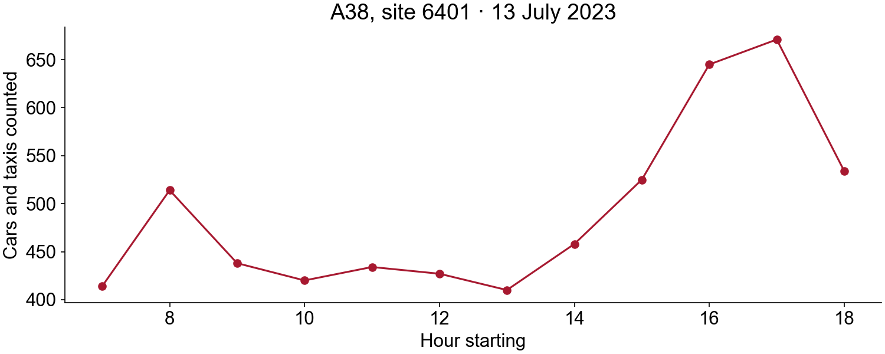<p>pandas tables and Matplotlib figures</p></div></div>
```

## Names, objects and memory {#memory}


```{=html}
<div class="animation static-animation" aria-label="Slide-controlled string, list and array memory diagrams"><div class="anim-stage"><h3 class="memory-kind">Arrays</h3><div class="memory-layout"><pre class="trace-code"><span class="done">values = np.array([10, 20, 30])</span><span class="done">alias = values</span><span class="active">alias[1] = 99</span></pre><svg viewBox="0 0 1050 350" role="img" aria-label="Names referring to arrays"><defs><marker id="memory-pointer" markerWidth="8" markerHeight="8" refX="7" refY="4" orient="auto"><path d="M0,0 L8,4 L0,8" fill="#a71930"></path></marker></defs><rect x="10" y="40" width="175" height="55" fill="white" stroke="#a71930" stroke-width="2"></rect><text x="22" y="76" font-size="28">values</text><rect x="450" y="40" width="570" height="55" fill="white" stroke="#a71930" stroke-width="2"></rect><text x="462" y="76" font-size="28">ndarray: [10 99 30]</text><path d="M185,67 L445,67" fill="none" stroke="#a71930" stroke-width="3" marker-end="url(#memory-pointer)"></path><rect x="10" y="150" width="175" height="55" fill="white" stroke="#a71930" stroke-width="2"></rect><text x="22" y="186" font-size="28">alias</text><path d="M185,177 L445,67" fill="none" stroke="#a71930" stroke-width="3" marker-end="url(#memory-pointer)"></path></svg></div></div><div class="anim-status" role="status" aria-live="polite">Assignment changes its data. Both names see 99.</div></div>
```


## One-dimensional arrays as columns {#array-columns}

A 1D array can supply one column of a table.

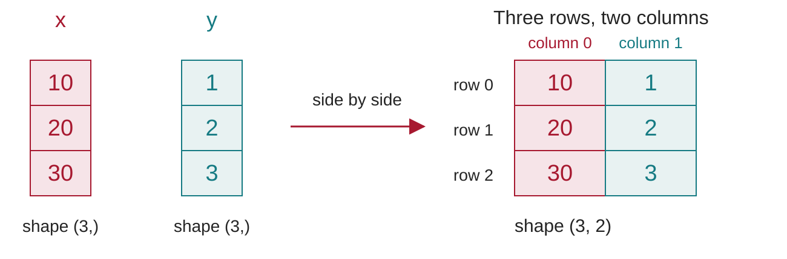

A 1D array has shape `(3,)`

## Arrange arrays as columns or rows {#array-stacking}

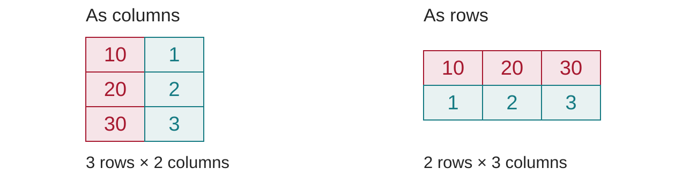

<div class="code-example" data-example="1">

<div class="code-source">

```python
x = np.array([10, 20, 30])
y = np.array([1, 2, 3])

print(np.column_stack((x, y)))  # three rows, two columns
print(np.vstack((x, y)))        # two rows, three columns
```

</div>

```{=html}
<div class="run-result" data-example="1"><pre class="print-output">[[10  1]
 [20  2]
 [30  3]]
</pre><pre class="print-output">[[10 20 30]
 [ 1  2  3]]
</pre></div>
```

</div>

## Array axes {#axes}

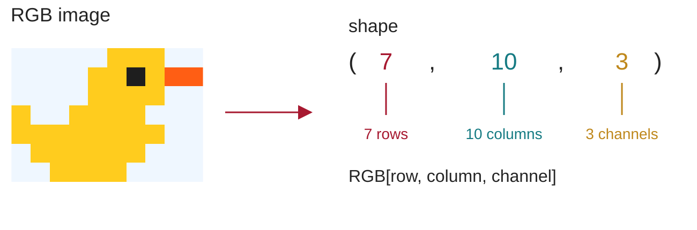

`RGB[:, :, 0]` selects the first colour channel at every pixel.

## Two-dimensional slicing {#slice}

```{=html}
<div class="slice-quiz"><div>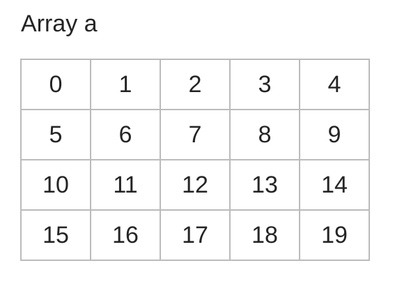</div><div><p><code>a[1:3, 1:4]</code></p><p>Which values are selected?<br>What is the result's shape?</p></div></div>
```

## Slicing in NumPy {#slice-code}

```python
import numpy as np

a = np.arange(20).reshape(4, 5)
print(a[1:3, 1:4])
print(a[1].shape)
print(a[1:2].shape)
```

An integer index removes an axis. A length-one slice keeps it.

## Matrix multiplication {#matrix}


```{=html}
<div class="animation static-animation" aria-label="Step through row-by-column matrix multiplication"><div class="anim-stage"><svg viewBox="0 0 1250 310" role="img" aria-label="Row 1 of A multiplied by column 1 of B"><g font-family="Arial"><text x="205" y="40" font-size="30">A</text><text x="595" y="40" font-size="30">B</text><text x="985" y="40" font-size="30">A @ B</text><rect x="120" y="75" width="95" height="92" fill="white" stroke="#bbb"></rect><text x="167" y="133" text-anchor="middle" fill="#242424" font-size="43">1</text><rect x="215" y="75" width="95" height="92" fill="white" stroke="#bbb"></rect><text x="262" y="133" text-anchor="middle" fill="#242424" font-size="43">2</text><rect x="120" y="167" width="95" height="92" fill="#f6e4e8" stroke="#a71930"></rect><text x="167" y="225" text-anchor="middle" fill="#a71930" font-size="43">3</text><rect x="215" y="167" width="95" height="92" fill="#f6e4e8" stroke="#a71930"></rect><text x="262" y="225" text-anchor="middle" fill="#a71930" font-size="43">4</text><rect x="510" y="75" width="95" height="92" fill="white" stroke="#bbb"></rect><text x="557" y="133" text-anchor="middle" fill="#242424" font-size="43">2</text><rect x="605" y="75" width="95" height="92" fill="#f6e4e8" stroke="#a71930"></rect><text x="652" y="133" text-anchor="middle" fill="#a71930" font-size="43">1</text><rect x="510" y="167" width="95" height="92" fill="white" stroke="#bbb"></rect><text x="557" y="225" text-anchor="middle" fill="#242424" font-size="43">0</text><rect x="605" y="167" width="95" height="92" fill="#f6e4e8" stroke="#a71930"></rect><text x="652" y="225" text-anchor="middle" fill="#a71930" font-size="43">3</text><rect x="900" y="75" width="95" height="92" fill="white" stroke="#bbb"></rect><text x="947" y="133" text-anchor="middle" fill="#242424" font-size="43">2</text><rect x="995" y="75" width="95" height="92" fill="white" stroke="#bbb"></rect><text x="1042" y="133" text-anchor="middle" fill="#242424" font-size="43">7</text><rect x="900" y="167" width="95" height="92" fill="white" stroke="#bbb"></rect><text x="947" y="225" text-anchor="middle" fill="#242424" font-size="43">6</text><rect x="995" y="167" width="95" height="92" fill="#f6e4e8" stroke="#a71930"></rect><text x="1042" y="225" text-anchor="middle" fill="#a71930" font-size="43">15</text><text x="398" y="187" font-size="50">×</text><text x="790" y="187" font-size="50">=</text></g></svg><div class="anim-math">3 × 1 + 4 × 3 = 15</div></div><div class="anim-status" role="status" aria-live="polite">Store 15 at output position [1, 1].</div></div>
```


## Two multiplication operators {#matrix-code}

<div class="code-example" data-example="3">

<div class="code-source">

```python
A = np.array([[1, 2], [3, 4]])
B = np.array([[2, 1], [0, 3]])

print(A * B)
print(A @ B)
```

</div>

```{=html}
<div class="run-result" data-example="3"><pre class="print-output">[[ 2  2]
 [ 0 12]]
</pre><pre class="print-output">[[ 2  7]
 [ 6 15]]
</pre></div>
```

</div>

`*` multiplies corresponding values. `@` takes row–column products.

## Tutorial 7A: Exercise 6 {#window-question}

**Compute averages using a sliding window over an array.**

Take the input `[5, 2, 4, 6, 3, 1]`. A sliding window of size 2 is applied. The current sum of the pair `[5, 2]` is 7. Continue iterating through the entire array, sliding the window by 1 for the next iteration.

What are the averages? Try different window sizes.

## A sliding window {#window}

A window of two values moves one position at a time.

<div class="window-array"><span>5</span><span>2</span><span>4</span><span>6</span><span>3</span><span>1</span></div><p>Width = 2. Predict the window and mean at each position.</p>

## Going through the motions {#window-trace}

`values = np.array([5, 2, 4, 6, 3, 1])` · `width = 2` · `averages = []`

<div class="window-array"><span>5</span><span>2</span><span>4</span><span>6</span><span>3</span><span>1</span></div><p>Width = 2. Predict the window and mean at each position.</p><pre class="trace-code">for start in range(5):
    stop = start + width
    window = values[start:stop]
    average = window.mean()
    averages.append(float(average))</pre><p>After an iteration: <code>start = ?</code>, <code>stop = ?</code>, <code>window = ?</code>, <code>average = ?</code></p>

## DataFrames

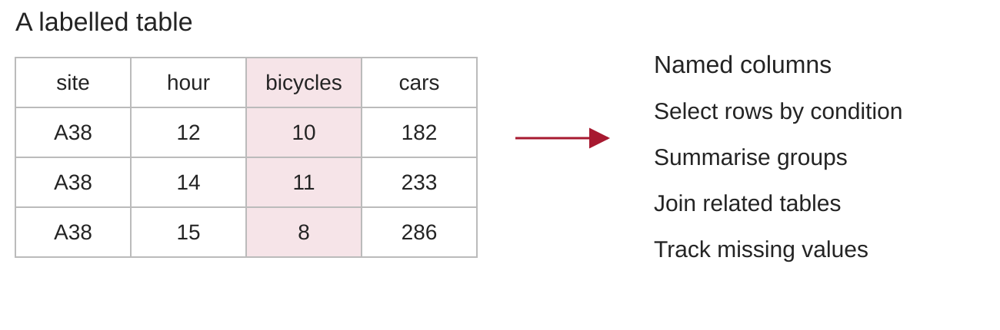

Column names describe the fields. Each column has a data type.

## Select rows and columns {#dataframe-code}

<div class="code-example" data-example="4">

<div class="code-source">

```python
import pandas as pd

traffic = pd.read_csv('data/bristol_traffic_2023.csv')

print(traffic.iloc[0:3, 0:2])      # positions; stop excluded
print(traffic.loc[0:2, ['cars']]) # labels; stop included here

busy = traffic.loc[traffic['cars'] > 300,
                   ['count_point_id', 'hour', 'cars']]
print(busy.head())
```

</div>

```{=html}
<div class="run-result" data-example="4"><div class="table-output"><table class="dataframe">
  <thead>
    <tr style="text-align: right;">
      <th></th>
      <th>count_point_id</th>
      <th>count_date</th>
    </tr>
  </thead>
  <tbody>
    <tr>
      <th>0</th>
      <td>6401</td>
      <td>2023-07-13</td>
    </tr>
    <tr>
      <th>1</th>
      <td>6401</td>
      <td>2023-07-13</td>
    </tr>
    <tr>
      <th>2</th>
      <td>6401</td>
      <td>2023-07-13</td>
    </tr>
  </tbody>
</table></div><div class="table-output"><table class="dataframe">
  <thead>
    <tr style="text-align: right;">
      <th></th>
      <th>cars</th>
    </tr>
  </thead>
  <tbody>
    <tr>
      <th>0</th>
      <td>273</td>
    </tr>
    <tr>
      <th>1</th>
      <td>141</td>
    </tr>
    <tr>
      <th>2</th>
      <td>308</td>
    </tr>
  </tbody>
</table></div><div class="table-output"><table class="dataframe">
  <thead>
    <tr style="text-align: right;">
      <th></th>
      <th>count_point_id</th>
      <th>hour</th>
      <th>cars</th>
    </tr>
  </thead>
  <tbody>
    <tr>
      <th>2</th>
      <td>6401</td>
      <td>8</td>
      <td>308</td>
    </tr>
    <tr>
      <th>19</th>
      <td>6401</td>
      <td>16</td>
      <td>363</td>
    </tr>
    <tr>
      <th>20</th>
      <td>6401</td>
      <td>17</td>
      <td>314</td>
    </tr>
    <tr>
      <th>21</th>
      <td>6401</td>
      <td>17</td>
      <td>357</td>
    </tr>
    <tr>
      <th>24</th>
      <td>8599</td>
      <td>7</td>
      <td>591</td>
    </tr>
  </tbody>
</table></div></div>
```

</div>

`busy` contains the rows that satisfy the condition.

## Which chart? {#charts}

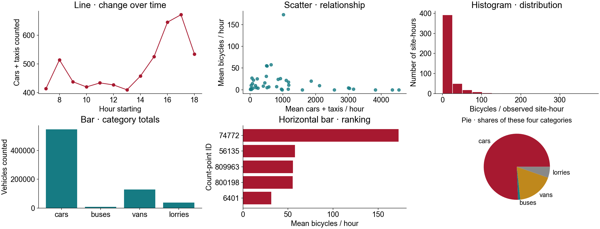


## Build a plot {#plot-code}

<div class="code-example" data-example="5">

<div class="code-source">

```python
import matplotlib.pyplot as plt

fig, ax = plt.subplots()
ax.plot(day['hour'], day['cars'], 'o-')
ax.set_xlabel('Hour starting')
ax.set_ylabel('Cars and taxis counted')
plt.show()
```

</div>

```{=html}
<div class="run-result" data-example="5">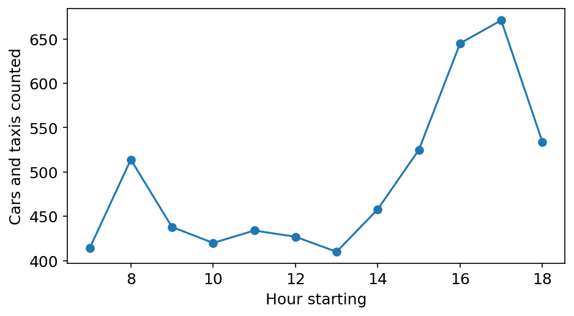</div>
```

</div>

`Figure`: whole canvas. `Axes`: plotting area.

## Structured and unstructured data {#structure}

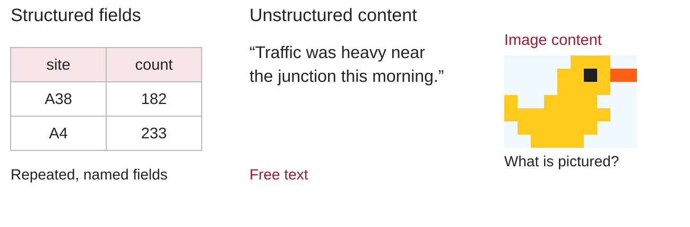

The pixels form a NumPy array. Recognising the duck extracts meaning from the image.

## Semi-structured data {#semi}

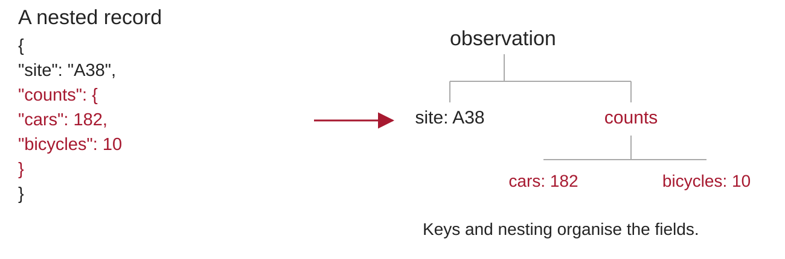

## Quantitative or qualitative? {#qualitative}

<div class="sort-columns"><div><h3>Quantitative</h3><p class="definition">Counts or measurements: how many or how much.</p></div><div><h3>Qualitative</h3><p class="definition">Categories or descriptions: what kind.</p></div></div><p>Which column does each example belong in?</p><ul><li>Road name</li><li>Vehicle count</li><li>NO₂ concentration</li><li>Count-point ID: 6401</li></ul>

## Discrete or continuous? {#discrete}

<div class="sort-columns"><div><h3>Discrete</h3><p class="definition">Values occur in distinct steps.</p></div><div><h3>Continuous</h3><p class="definition">The underlying quantity varies over a continuum.</p></div></div><p>Which column does each example belong in?</p><ul><li>Vehicle count</li><li>Journey duration</li><li>Shoe size</li><li>NO₂ concentration</li></ul>

## Discretisation {#binning}


```{=html}
<div class="binning-pair"><h3>Equal-width bins</h3><div class="animation static-animation" aria-label="Measurements are assigned to bins using equal widths or equal counts"><div class="anim-stage"><svg viewBox="0 0 1250 340" role="img" aria-label="Measurements placed into three bins"><g font-family="Arial"><line x1="70" x2="1170" y1="190" y2="190" stroke="#444" stroke-width="2"></line><text x="70" y="225" text-anchor="middle" font-size="26">10</text><text x="345" y="225" text-anchor="middle" font-size="26">20</text><text x="620" y="225" text-anchor="middle" font-size="26">30</text><text x="895" y="225" text-anchor="middle" font-size="26">40</text><text x="1170" y="225" text-anchor="middle" font-size="26">50</text><rect x="70" y="65" width="366.65749999999997" height="115" fill="#a71930" fill-opacity=".07"></rect><line x1="70" x2="70" y1="60" y2="195" stroke="#a71930" stroke-width="2"></line><text x="253.32874999999999" y="45" text-anchor="middle" font-size="25">Bin 1</text><rect x="436.65749999999997" y="65" width="366.685" height="115" fill="#167b83" fill-opacity=".07"></rect><line x1="436.65749999999997" x2="436.65749999999997" y1="60" y2="195" stroke="#167b83" stroke-width="2"></line><text x="620" y="45" text-anchor="middle" font-size="25">Bin 2</text><rect x="803.3425" y="65" width="366.6575" height="115" fill="#bf881c" fill-opacity=".07"></rect><line x1="803.3425" x2="803.3425" y1="60" y2="195" stroke="#bf881c" stroke-width="2"></line><text x="986.6712500000001" y="45" text-anchor="middle" font-size="25">Bin 3</text><circle data-group="0" cx="75.49999999999999" cy="125" r="9" fill="#a71930"></circle><circle data-group="0" cx="138.75" cy="147" r="9" fill="#a71930"></circle><circle data-group="0" cx="155.25" cy="125" r="9" fill="#a71930"></circle><circle data-group="0" cx="229.50000000000003" cy="147" r="9" fill="#a71930"></circle><circle data-group="0" cx="298.25" cy="125" r="9" fill="#a71930"></circle><circle data-group="0" cx="416.50000000000006" cy="147" r="9" fill="#a71930"></circle><circle data-group="1" cx="493.49999999999994" cy="125" r="9" fill="#167b83"></circle><circle data-group="1" cx="559.5" cy="147" r="9" fill="#167b83"></circle><circle data-group="1" cx="650.2500000000001" cy="125" r="9" fill="#167b83"></circle><circle data-group="2" cx="809.75" cy="147" r="9" fill="#bf881c"></circle><circle data-group="2" cx="991.25" cy="125" r="9" fill="#bf881c"></circle><circle data-group="2" cx="1148" cy="147" r="9" fill="#bf881c"></circle><text x="620" y="285" text-anchor="middle" font-size="25">Illustrative NO₂ measurements (µg/m³)</text></g></svg></div><div class="anim-status" role="status" aria-live="polite">Assign each measurement to a bin. The bins have different counts.</div></div><h3>Equal-count bins</h3><div class="animation static-animation" aria-label="Measurements are assigned to bins using equal widths or equal counts"><div class="anim-stage"><svg viewBox="0 0 1250 340" role="img" aria-label="Measurements placed into three bins"><g font-family="Arial"><line x1="70" x2="1170" y1="190" y2="190" stroke="#444" stroke-width="2"></line><text x="70" y="225" text-anchor="middle" font-size="26">10</text><text x="345" y="225" text-anchor="middle" font-size="26">20</text><text x="620" y="225" text-anchor="middle" font-size="26">30</text><text x="895" y="225" text-anchor="middle" font-size="26">40</text><text x="1170" y="225" text-anchor="middle" font-size="26">50</text><rect x="70" y="65" width="193.875" height="115" fill="#a71930" fill-opacity=".07"></rect><line x1="70" x2="70" y1="60" y2="195" stroke="#a71930" stroke-width="2"></line><text x="166.9375" y="45" text-anchor="middle" font-size="25">4 observations</text><rect x="263.875" y="65" width="341" height="115" fill="#167b83" fill-opacity=".07"></rect><line x1="263.875" x2="263.875" y1="60" y2="195" stroke="#167b83" stroke-width="2"></line><text x="434.375" y="45" text-anchor="middle" font-size="25">4 observations</text><rect x="604.875" y="65" width="565.125" height="115" fill="#bf881c" fill-opacity=".07"></rect><line x1="604.875" x2="604.875" y1="60" y2="195" stroke="#bf881c" stroke-width="2"></line><text x="887.4375" y="45" text-anchor="middle" font-size="25">4 observations</text><circle data-group="0" cx="75.49999999999999" cy="125" r="9" fill="#a71930"></circle><circle data-group="0" cx="138.75" cy="147" r="9" fill="#a71930"></circle><circle data-group="0" cx="155.25" cy="125" r="9" fill="#a71930"></circle><circle data-group="0" cx="229.50000000000003" cy="147" r="9" fill="#a71930"></circle><circle data-group="1" cx="298.25" cy="125" r="9" fill="#167b83"></circle><circle data-group="1" cx="416.50000000000006" cy="147" r="9" fill="#167b83"></circle><circle data-group="1" cx="493.49999999999994" cy="125" r="9" fill="#167b83"></circle><circle data-group="1" cx="559.5" cy="147" r="9" fill="#167b83"></circle><circle data-group="2" cx="650.2500000000001" cy="125" r="9" fill="#bf881c"></circle><circle data-group="2" cx="809.75" cy="147" r="9" fill="#bf881c"></circle><circle data-group="2" cx="991.25" cy="125" r="9" fill="#bf881c"></circle><circle data-group="2" cx="1148" cy="147" r="9" fill="#bf881c"></circle><text x="620" y="285" text-anchor="middle" font-size="25">Illustrative NO₂ measurements (µg/m³)</text></g></svg></div><div class="anim-status" role="status" aria-live="polite">Equal-count bins move the boundaries: four observations per group.</div></div></div>
```


## Scales of measurement {#scales}

| Scale | Example | What is meaningful? |
|---|---|---|
| **Nominal** | Count-point ID | Equality; category counts |
| **Ordinal** | Poor / fair / good | Order; gaps are unspecified |
| **Interval** | Calendar year | Differences; ratios are not meaningful |
| **Ratio** | Vehicle count; elapsed duration | Differences and ratios; meaningful zero |

Is averaging the numbers in this column useful?

## Data acquisition {#break .process-pause}

<div class="flow"><span>Source</span><b>→</b><span>Documentation</span><b>→</b><span>Retrieve + save</span><b>→</b><span>Process</span><b>→</b><span>Use</span></div>

## Reading a file {#files}

:::: {.columns}
::: {.column width="56%"}
<div class="code-example" data-example="6">

<div class="code-source">

```python
import pandas as pd
from PIL import Image

traffic = pd.read_csv(
    'data/bristol_traffic_2023.csv')
RGB = np.array(
    Image.open('assets/duck.png')
         .convert('RGB'))
print(RGB.shape)
```

</div>

```{=html}
<div class="run-result" data-example="6"><pre class="print-output">(7, 10, 3)
</pre></div>
```

</div>
:::
::: {.column width="42%"}

:::
::::

A CSV becomes a table. An image becomes an array.

## Data sources {#sources}

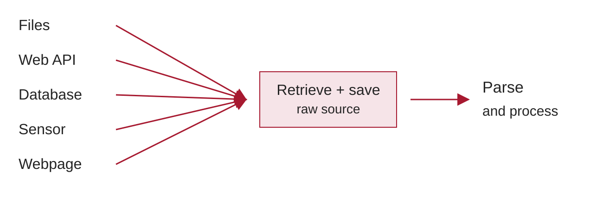

Choose an appropriate source for the questions you're trying to answer

## Getting the Bristol traffic data {#workflow}

```{=html}
<div class="workflow-aligned">
<div><h3>Source</h3><div class="workflow-example"><p>DfT traffic data</p><p>2023 surveys<br>Bristol</p></div></div>
<div><h3>Documentation</h3><div class="workflow-example"><p>site, date,<br>hour, direction</p></div></div>
<div><h3>Retrieve + save</h3><div class="workflow-example"><p>Raw response</p><pre>{"data": [ … ]}</pre><p>Keep the original JSON.</p></div></div>
<div><h3>Process</h3><div class="workflow-example"><p>pandas DataFrame</p><pre>hour,cars
…,…</pre><p>Select and check fields.</p></div></div>
<div><h3>Use</h3><div class="workflow-example"><p>Matplotlib</p></div></div>
</div>
```

## Read the documentation {#documentation}

<div class="flow compact"><span>Source</span><b>→</b><span class="current">Documentation</span><b>→</b><span>Retrieve + save</span><b>→</b><span>Process</span><b>→</b><span>Use</span></div>

| Check | In our traffic example |
|---|---|
| What does one record represent? | A site, date, hour and direction |
| Which fields and units? | Vehicle counts; coordinates in degrees |
| Which place and period? | Bristol, 2023; sampled survey days |
| How do we request a subset? | Filters and page size |
| How do we know we have everything? | Pagination metadata |
| What can we do with it? | Check access, licence and attribution |

## Anatomy of a web API {#api}

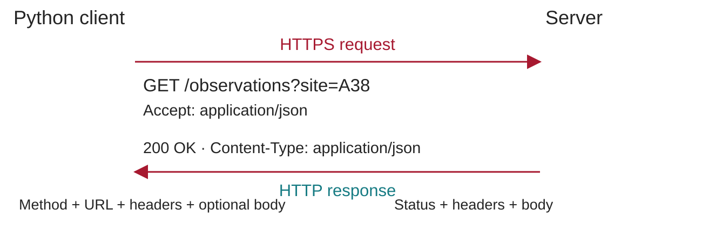

An API defines how to request an operation and interpret its result.

## GET and POST {#http}


```{=html}
<p><strong>GET</strong> retrieves the two existing observations. The stored rows stay unchanged.</p><p><strong>POST</strong> submits a new observation: site A38, cars 286. The server adds row 3 before returning 201 Created.</p><div class="animation static-animation" aria-label="Animate GET retrieval and POST creation between a Python client and a teaching server"><div class="anim-stage"><h3 class="http-method">POST</h3><div class="http-stage"><div class="http-endpoint"><h3>Python client</h3><p>Submit a new observation.</p><p>Response received</p><div class="http-body">id = 3<br>cars = 286</div></div><div class="http-middle"><div class="wire"></div><div class="http-packet response settled">← 201 Created<br>Location: /observations/3</div><div class="http-subtitle"></div></div><div class="http-endpoint"><h3>Server</h3><p>Stored observations</p><table class="server-table" aria-label="Stored observations on the server"><thead><tr><th scope="col">id</th><th scope="col">site</th><th scope="col">cars</th></tr></thead><tbody><tr class="http-record" data-record-id="1"><td>1</td><td>A38</td><td>182</td></tr><tr class="http-record" data-record-id="2"><td>2</td><td>A38</td><td>233</td></tr><tr class="http-record new-record" data-record-id="3"><td>3</td><td>A38</td><td>286</td></tr></tbody></table></div></div></div><div class="anim-status" role="status" aria-live="polite">Python receives a Response object. Parsing the body is a separate step.</div></div>
```


## REST APIs {#rest}

```{=html}
<div class="url-anatomy" aria-label="The URL is divided into scheme, host, resource path and query"><div><code>https://</code><span>scheme</span></div><div><code>example.org</code><span>host</span></div><div><code>/observations</code><span>resource path</span></div><div><code>?site=A38</code><span>query</span></div></div>
```

A resource has a URL. Each request supplies the context the server needs.

| Method | Typical purpose |
|---|---|
| GET | Retrieve a representation |
| POST | Submit data; commonly create a resource |
| PUT / PATCH | Replace / partially modify a resource |
| DELETE | Remove a resource |

## Three records, four representations {#formats}

```{=html}
<div class="formats">
<div><h3>CSV</h3><pre>site,cars
A38,<em>182</em>
A4,233
M32,286</pre></div>
<div><h3>JSON</h3><pre>[
  {"site": "A38", "cars": <em>182</em>},
  {"site": "A4", "cars": 233},
  {"site": "M32", "cars": 286}
]</pre></div>
<div><h3>XML</h3><pre>&lt;observations&gt;
  &lt;record site="A38" cars="<em>182</em>" /&gt;
  &lt;record site="A4" cars="233" /&gt;
  &lt;record site="M32" cars="286" /&gt;
&lt;/observations&gt;</pre></div>
<div><h3>HTML</h3><pre>&lt;table&gt;
  &lt;tr&gt;&lt;td&gt;A38&lt;/td&gt;&lt;td&gt;<em>182</em>&lt;/td&gt;&lt;/tr&gt;
  &lt;tr&gt;&lt;td&gt;A4&lt;/td&gt;&lt;td&gt;233&lt;/td&gt;&lt;/tr&gt;
  &lt;tr&gt;&lt;td&gt;M32&lt;/td&gt;&lt;td&gt;286&lt;/td&gt;&lt;/tr&gt;
&lt;/table&gt;</pre></div>
</div>
```

## The full request URL {#request-method-0}

<div class="code-example"><div class="code-source">

```python
import requests
import json

url = ('https://roadtraffic.dft.gov.uk/api/raw-counts'
       '?filter[local_authority_id]=144&filter[year]=2023'
       '&page[size]=2&fields=road_name,cars_and_taxis')
response = requests.get(url, timeout=20)
response.raise_for_status()
print(json.dumps(response.json()['data'], indent=2))
```

</div>

```{=html}
<div class="run-result"><pre class="print-output">[
  {
    &quot;road_name&quot;: &quot;A38&quot;,
    &quot;cars_and_taxis&quot;: 182
  },
  {
    &quot;road_name&quot;: &quot;A38&quot;,
    &quot;cars_and_taxis&quot;: 233
  }
]
</pre><p class="source-note">Saved DfT preview · 9 November 2026</p></div>
```

</div>

## Build the URL with an f-string {#request-method-1}

<div class="code-example"><div class="code-source">

```python
base = 'https://roadtraffic.dft.gov.uk/api/raw-counts'
authority, year = 144, 2023
url = (f'{base}?filter[local_authority_id]={authority}'
       f'&filter[year]={year}&page[size]=2'
       '&fields=road_name,cars_and_taxis')
response = requests.get(url, timeout=20)
response.raise_for_status()
print(json.dumps(response.json()['data'], indent=2))
```

</div>

```{=html}
<div class="run-result"><pre class="print-output">[
  {
    &quot;road_name&quot;: &quot;A38&quot;,
    &quot;cars_and_taxis&quot;: 182
  },
  {
    &quot;road_name&quot;: &quot;A38&quot;,
    &quot;cars_and_taxis&quot;: 233
  }
]
</pre><p class="source-note">Saved DfT preview · 9 November 2026</p></div>
```

</div>

## Build the query with params {#request-method-2}

<div class="code-example"><div class="code-source">

```python
base = 'https://roadtraffic.dft.gov.uk/api/raw-counts'
params = {'filter[local_authority_id]': 144,
          'filter[year]': 2023, 'page[size]': 2,
          'fields': 'road_name,cars_and_taxis'}
response = requests.get(base, params=params, timeout=20)
response.raise_for_status()
print(json.dumps(response.json()['data'], indent=2))
```

</div>

```{=html}
<div class="run-result"><pre class="print-output">[
  {
    &quot;road_name&quot;: &quot;A38&quot;,
    &quot;cars_and_taxis&quot;: 182
  },
  {
    &quot;road_name&quot;: &quot;A38&quot;,
    &quot;cars_and_taxis&quot;: 233
  }
]
</pre><p class="source-note">Saved DfT preview · 9 November 2026</p></div>
```

</div>

## Inspect and save the response {#save-code}

<div class="code-example" data-example="10">

<div class="code-source">

```python
print(response.headers.get('Content-Type'))
print(response.text[:200])
```

</div>

```{=html}
<div class="run-result" data-example="10"><pre class="print-output">application/json
</pre><pre class="print-output">{&quot;current_page&quot;:1,&quot;data&quot;:[{&quot;road_name&quot;:&quot;A38&quot;,&quot;cars_and_taxis&quot;:182},{&quot;road_name&quot;:&quot;A38&quot;,&quot;cars_and_taxis&quot;:233}],&quot;first_page_url&quot;:&quot;https:\/\/roadtraffic.dft.gov.uk\/api\/raw-counts?filter%5Blocal_authorit
</pre></div>
```

</div>

:::: {.columns}
::: {.column width="49%"}
### With `open`

<div class="code-example" data-example="11">

<div class="code-source">

```python
with open('output/traffic-response.json',
          'w', encoding='utf-8') as file:
    file.write(response.text)
```

</div>

```{=html}
<div class="run-result" data-example="11"></div>
```

</div>
:::
::: {.column width="49%"}
### With `pathlib.Path`

<div class="code-example" data-example="12">

<div class="code-source">

```python
from pathlib import Path

Path('output/traffic-response.json').write_text(
    response.text, encoding='utf-8')
```

</div>

```{=html}
<div class="run-result" data-example="12"></div>
```

</div>
:::
::::

Save the original response before changing its contents.

## Parse the response {#parse-concept}

<div class="flow compact"><span>Source</span><b>→</b><span>Documentation</span><b>→</b><span>Retrieve + save</span><b>→</b><span class="current">Process</span><b>→</b><span>Use</span></div>

JSON is a text format. `response.json()` parses that text into Python objects.

We call the parsed response body **`payload`**. It is an ordinary variable name.

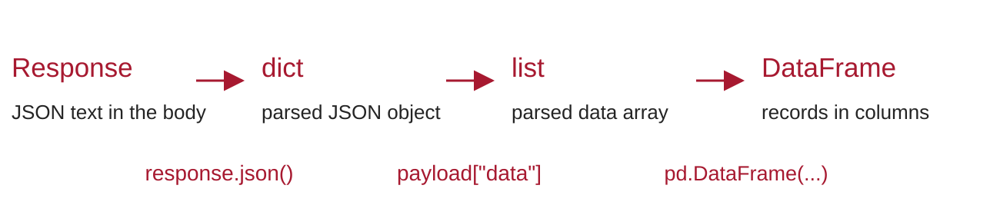

A JSON **object** becomes a Python **dict**. A JSON **array** becomes a **list**.

## Inspect the parsed objects {#parse-code}

<div class="code-example" data-example="13">

<div class="code-source">

```python
payload = response.json()
print(list(payload)[:4])

records = payload['data']
print(records)
print(len(records))

df = pd.DataFrame(records)
print(df)
```

</div>

```{=html}
<div class="run-result" data-example="13"><pre class="print-output">[&#x27;current_page&#x27;, &#x27;data&#x27;, &#x27;first_page_url&#x27;, &#x27;from&#x27;]
</pre><pre class="print-output">[{&#x27;road_name&#x27;: &#x27;A38&#x27;, &#x27;cars_and_taxis&#x27;: 182}, {&#x27;road_name&#x27;: &#x27;A38&#x27;, &#x27;cars_and_taxis&#x27;: 233}]
</pre><pre class="print-output">2
</pre><div class="table-output"><table class="dataframe">
  <thead>
    <tr style="text-align: right;">
      <th></th>
      <th>road_name</th>
      <th>cars_and_taxis</th>
    </tr>
  </thead>
  <tbody>
    <tr>
      <th>0</th>
      <td>A38</td>
      <td>182</td>
    </tr>
    <tr>
      <th>1</th>
      <td>A38</td>
      <td>233</td>
    </tr>
  </tbody>
</table></div></div>
```

</div>

## Check for more pages {#pagination}

1. **Read the documentation:** look for `page`, `limit`, `offset` or `cursor` parameters.
2. **Inspect the response:** pagination may appear in JSON metadata or an HTTP `Link` header.

<div class="code-example" data-example="14">

<div class="code-source">

```python
print(payload.keys())
print(payload.get('next_page_url'))
print(response.links.get('next'))
```

</div>

```{=html}
<div class="run-result" data-example="14"><pre class="print-output">dict_keys([&#x27;current_page&#x27;, &#x27;data&#x27;, &#x27;first_page_url&#x27;, &#x27;from&#x27;, &#x27;last_page&#x27;, &#x27;last_page_url&#x27;, &#x27;links&#x27;, &#x27;next_page_url&#x27;, &#x27;path&#x27;, &#x27;per_page&#x27;, &#x27;prev_page_url&#x27;, &#x27;to&#x27;, &#x27;total&#x27;])
</pre><pre class="print-output">https://roadtraffic.dft.gov.uk/api/raw-counts?filter%5Blocal_authority_id%5D=144&amp;filter%5Byear%5D=2023&amp;page%5Bsize%5D=2&amp;fields=road_name%2Ccars_and_taxis&amp;page%5Bnumber%5D=2
</pre><pre class="print-output">None
</pre></div>
```

</div>

Follow the documented next-page link or cursor until there are no more pages.

::: {.fragment}
Our two-record preview has more pages. The complete saved query contains<br>
**936 records** and fits on one page when `page[size] = 10000`.
:::

## Following pagination links {#pagination-demo}


```{=html}
<div class="animation static-animation" aria-label="A paginated teaching response reveals six records across three pages"><div class="anim-stage"><svg viewBox="0 0 1250 300" role="img" aria-label="Three response pages, each containing two records"><g font-family="Arial"><rect x="70" y="25" width="290" height="210" fill="white" stroke="#a71930" stroke-width="2"></rect><text x="215" y="75" text-anchor="middle" font-size="32">Page 1</text><text x="105" y="135" font-size="28">record 1</text><text x="105" y="185" font-size="28">record 2</text><text x="415" y="115" text-anchor="middle" font-size="34" fill="#a71930">→</text><text x="415" y="155" text-anchor="middle" font-size="22">next</text><rect x="470" y="25" width="290" height="210" fill="white" stroke="#a71930" stroke-width="2"></rect><text x="615" y="75" text-anchor="middle" font-size="32">Page 2</text><text x="505" y="135" font-size="28">record 3</text><text x="505" y="185" font-size="28">record 4</text><text x="815" y="115" text-anchor="middle" font-size="34" fill="#a71930">→</text><text x="815" y="155" text-anchor="middle" font-size="22">next</text><rect x="870" y="25" width="290" height="210" fill="white" stroke="#a71930" stroke-width="2"></rect><text x="1015" y="75" text-anchor="middle" font-size="32">Page 3</text><text x="905" y="135" font-size="28">record 5</text><text x="905" y="185" font-size="28">record 6</text><text x="625" y="285" text-anchor="middle" font-size="24">Illustrative paginated response</text></g></svg><div class="pagination-values"><div><code>next_page_url = None</code></div><div>Collected records: <strong>[1, 2, 3, 4, 5, 6]</strong></div></div></div><div class="anim-status" role="status" aria-live="polite">All six records are collected. A single page held only two.</div></div>
```


## Process the records {#process-code}

<div class="code-example" data-example="15">

<div class="code-source">

```python
counts = df[['road_name', 'cars_and_taxis']].copy()
counts = counts.rename(columns={'cars_and_taxis': 'cars'})

print(counts.dtypes)
print(counts.isna().sum())
counts.to_csv('output/traffic-counts.csv', index=False)
```

</div>

```{=html}
<div class="run-result" data-example="15"><pre class="print-output">road_name    object
cars          int64
dtype: object
</pre><pre class="print-output">road_name    0
cars         0
dtype: int64
</pre></div>
```

</div>

Check fields, types, units and missing values before summarising.

## Data on a webpage {#scrape}

<div class="flow compact"><span>Source</span><b>→</b><span class="current">Documentation</span><b>→</b><span>Retrieve + save</span><b>→</b><span>Process</span><b>→</b><span>Use</span></div>

```{=html}
<div class="scrape-overview"><div class="comparison"><div><h3>A download or API is available</h3><p>Use its documented fields and access method.</p></div><div><h3>The required values are in HTML</h3><p>Inspect the document and extract the relevant elements.</p></div></div></div>
```

Check access conditions and request rates before retrieving pages.

## HTML elements {#html}

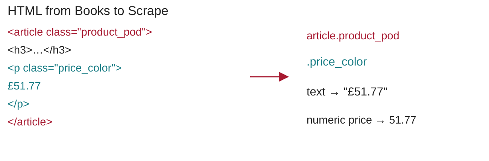

Tags and attributes help us select the values we need.

## Extract values from HTML {#scrape-code}

<div class="flow compact"><span>Source</span><b>→</b><span>Documentation</span><b>→</b><span>Retrieve + save</span><b>→</b><span class="current">Process</span><b>→</b><span>Use</span></div>

<div class="code-example" data-example="16">

<div class="code-source">

```python
from bs4 import BeautifulSoup

page = requests.get('https://books.toscrape.com/', timeout=20)
page.raise_for_status()
page.encoding = 'utf-8'
soup = BeautifulSoup(page.text, 'html.parser')

prices = soup.select('article.product_pod .price_color')
print([price.get_text(strip=True) for price in prices[:3]])
```

</div>

```{=html}
<div class="run-result" data-example="16"><pre class="print-output">[&#x27;£51.77&#x27;, &#x27;£53.74&#x27;, &#x27;£50.10&#x27;]
</pre><p class="source-note">Saved practice page · 8 November 2026</p></div>
```

</div>

[Open the live website](https://books.toscrape.com/){target="_blank"}

`raise_for_status()` stops on an HTTP error such as **404** or **500**.<br>
A successful **200** response continues to the next line.

## Process and use the data {#finish}

<div class="flow compact"><span>Source</span><b>→</b><span>Documentation</span><b>→</b><span>Retrieve + save</span><b>→</b><span class="current">Process</span><b>→</b><span class="current">Use</span></div>

```{=html}
<div class="analysis-recap">
<div><h3>NumPy arrays</h3><div class="recap-media"></div><p>Slice and transform<br>numerical data.</p></div>
<div><h3>pandas DataFrames</h3><div class="recap-media"><table><thead><tr><th>site</th><th>hour</th><th>cars</th></tr></thead><tbody><tr><td>A38</td><td>12</td><td>182</td></tr><tr><td>A38</td><td>14</td><td>233</td></tr></tbody></table></div><p>Inspect, clean and select.<br>Group and combine tables.</p></div>
<div><h3>Matplotlib graphs</h3><div class="recap-media"></div><p>Explore patterns.<br>Communicate results.</p></div>
</div>
```

Later lectures will explore how to use Python for data analysis.

## Questions {#questions}

```{=html}
<ol class="student-questions"><li>Why does a width-three window over six values produce four complete windows?</li><li>What is wrong with averaging count-point IDs?</li><li>How does a <code>Response</code> differ from <code>payload['data']</code>?</li><li>What would you check before scraping a webpage?</li></ol>
```

## Reference material {#reference .section-slide}

Worked examples and documentation

## Reference: names and data buffers {#ref-memory .reference-slide}

| Object | Storage and behaviour |
|---|---|
| String | Immutable text; methods such as `upper()` return a string |
| List | Mutable sequence of references to Python objects |
| Numeric NumPy array | Shape and dtype describe a typed data buffer |
| Basic array slice | Usually a separate array object sharing the original buffer |
| Array copy | Independent data buffer |

<div class="code-example" data-example="17">

<div class="code-source">

```python
original = np.array([10, 20, 30])
view = original[1:]
view[0] = 99        # original is now [10, 99, 30]
copy = original.copy()
copy[0] = 0        # original remains [10, 99, 30]
print(original)
print(copy)
```

</div>

```{=html}
<div class="run-result" data-example="17"><pre class="print-output">[10 99 30]
</pre><pre class="print-output">[ 0 99 30]
</pre></div>
```

</div>

## Reference: windows and inspection {#ref-window .reference-slide}

```python
values = np.array([5, 2, 4, 6, 3, 1])
width = 2
averages = []
for start in range(len(values) - width + 1):
    stop = start + width
    window = values[start:stop]
    average = window.mean()
    averages.append(float(average))
    print(start, stop, window, average, averages)
```


## Reference: DataFrame operations {#ref-pandas .reference-slide}

<div class="code-example" data-example="19">

<div class="code-source">

```python
# Inspect missing entries before deciding what they mean.
print(traffic.isna().sum())

# Group and combine directions within each observed hour.
site_hour = traffic.groupby(
    ['count_point_id', 'count_date', 'hour'], as_index=False
)[['bicycles', 'cars']].sum()

# Filter rows; select named columns.
selected = site_hour.loc[site_hour['bicycles'] >= 30,
                         ['count_point_id', 'bicycles']]
print(selected.head())
```

</div>

```{=html}
<div class="run-result" data-example="19"><pre class="print-output">count_point_id    0
count_date        0
hour              0
                 ..
vans              0
lorries           0
motor_vehicles    0
Length: 10, dtype: int64
</pre><div class="table-output"><table class="dataframe">
  <thead>
    <tr style="text-align: right;">
      <th></th>
      <th>count_point_id</th>
      <th>bicycles</th>
    </tr>
  </thead>
  <tbody>
    <tr>
      <th>0</th>
      <td>6401</td>
      <td>51</td>
    </tr>
    <tr>
      <th>1</th>
      <td>6401</td>
      <td>54</td>
    </tr>
    <tr>
      <th>9</th>
      <td>6401</td>
      <td>41</td>
    </tr>
    <tr>
      <th>10</th>
      <td>6401</td>
      <td>57</td>
    </tr>
    <tr>
      <th>11</th>
      <td>6401</td>
      <td>47</td>
    </tr>
  </tbody>
</table></div></div>
```

</div>

`groupby` defines groups; a summary such as `sum` produces the result.

## Reference: plotting methods {#ref-plots .reference-slide}

| Question | Matplotlib method |
|---|---|
| How does a quantity change with x? | `ax.plot(x, y)` |
| How are two quantities related? | `ax.scatter(x, y)` |
| What is the distribution? | `ax.hist(values, bins=15)` |
| How do categories compare? | `ax.bar(labels, values)` |
| Which categories rank highest? | `ax.barh(labels, values)` |
| What are the shares of a defined total? | `ax.pie(values, labels=labels)` |
| What does an image array contain? | `ax.imshow(RGB)` |

`fig, ax = plt.subplots()` creates a Figure and an Axes. Label units.

## Reference: classification practice {#ref-classification .reference-slide}

| Example | Your classification |
|---|---|
| Shoe brand; letter grade; jersey number | |
| Number correct on an exam | |
| Number of cows | |
| Walking duration; volume of milk | |
| Jersey number | |
| Food ranking: poor / fair / good | |
| Calendar year; Celsius temperature | |
| Elapsed marathon duration | |

## Reference: binning and representative values {#ref-bins .reference-slide}

Sorted values: `10, 15, 25, 34, 44, 48, 55, 59, 64, 69, 88, 94`

| Equal-count group | Mean | Median | Observed endpoints |
|---|---:|---:|---|
| 10, 15, 25 | 16.67 | 15 | 10, 25 |
| 34, 44, 48 | 42 | 44 | 34, 48 |
| 55, 59, 64 | 59.33 | 59 | 55, 64 |
| 69, 88, 94 | 83.67 | 88 | 69, 94 |

Replace values with the mean, median or nearest endpoint to smooth within a bin.

For `[10, 15, 25]`, nearest-endpoint replacement gives `[10, 10, 25]`.

## Reference: extracting fields from content {#ref-unstructured .reference-slide}

| Task or tool | Role |
|---|---|
| Text mining / NLP | Extract language features or entities |
| Information retrieval | Find and rank relevant content |
| MongoDB | Document database |
| Neo4j | Graph database |
| HBase | Wide-column database |
| Hadoop | Distributed storage/processing ecosystem |

An email can combine structured headers with free-text content.

## Reference: formats and parsers {#ref-formats .reference-slide}

| Representation | Read with |
|---|---|
| CSV file or stream | `pd.read_csv(...)` or Python `csv` |
| JSON response body | `response.json()` |
| JSON text / file | `json.loads(text)` / `json.load(file)` |
| XML | An XML parser, e.g. `xml.etree.ElementTree` |
| HTML | An HTML parser, e.g. BeautifulSoup |
| XHTML | HTML expressed using XML syntax |
| Shapefile / RVT | Domain-specific geospatial / building-model tools |

Document the schema, units and version of a custom format.

## Reference: REST and failures {#ref-rest .reference-slide}

REST describes architectural constraints: client/server separation, stateless interactions, caching, a uniform interface and layers; code-on-demand is optional.

| Situation | What to inspect |
|---|---|
| Timeout or connection failure | Network/service availability; catch request exceptions |
| Non-success HTTP status | Status and error body; `raise_for_status()` |
| Unexpected content or schema | Content type, body preview, keys and types |
| Only some records returned | Pagination and documented totals |
| Too many requests | Published limits; retry guidance |

## Reference: scrape, extract and store {#ref-scraping .reference-slide}

<div class="code-example" data-example="20">

<div class="code-source">

```python
# Inspect links and resolve relative destinations when needed.
from urllib.parse import urljoin
for anchor in soup.find_all('a')[:3]:
    href = anchor.get('href')
    if href:
        print(urljoin(page.url, href))

values = [float(p.get_text(strip=True).removeprefix('£'))
          for p in prices]
pd.DataFrame({'price_gbp': values}).to_csv(
    'output/scraped-prices.csv', index=False)
```

</div>

```{=html}
<div class="run-result" data-example="20"><pre class="print-output">https://books.toscrape.com/index.html
</pre><pre class="print-output">https://books.toscrape.com/index.html
</pre><pre class="print-output">https://books.toscrape.com/catalogue/category/books_1/index.html
</pre></div>
```

</div>

BeautifulSoup parses documents. Scrapy organises crawls. Selenium automates a browser.

## Reference: sources and reading {#ref-sources .reference-slide}

- DfT road traffic data: [downloads and guidance](https://roadtraffic.dft.gov.uk/downloads)
- [Requests quickstart](https://requests.readthedocs.io/en/latest/user/quickstart/)
- [BeautifulSoup documentation](https://www.crummy.com/software/BeautifulSoup/bs4/doc/)
- [Python for Data Analysis: data loading](https://wesmckinney.com/book/accessing-data)
- [REST architectural constraints](https://ics.uci.edu/~fielding/pubs/dissertation/rest_arch_style.htm)

Saved traffic response: **31 October 2026**. Observations: **2023**.

Next session: exploratory data analysis, appropriate summaries and plots, outliers.

