## Week 9: Exploratory data analysis {#title .title-slide}

<p class="subtitle">Software Development: Programming and Algorithms</p>

Delivered by: Dr Joseph Aylett-Bullock


::: {.notes}
0:00. Start the five-minute recap immediately. Two-hour route: 0–5 recap; 5–7 loop; 7–13 orientation; 13–24 categorical; 24–36 numeric; 36–47 flags; 47–55 groups; 55–65 break; 65–83 relationships; 83–103 scaling; 103–110 breadth; 110–117 clinic; 117–120 exit. Several slides are short states in one explanation. Keep activities within these timings.
:::

## Last week: data analysis workflow {#recap-flow}

```{=html}
<div class="flow">
 <div class="flow-stage current"><strong>Choose a source</strong><p>Sensors, webpages</p><span class="week">Bristol traffic data</span></div>
 <div class="flow-stage current"><strong>Read documentation</strong><p>Fields, units, dates, licence, filters, pagination</p><span class="week">What does one record mean?</span></div>
 <div class="flow-stage current"><strong>Retrieve and save</strong><p>Request the data (downloads, APIs, webpages). Check status. Preserve the original.</p><span class="week">Response and saved JSON</span></div>
 <div class="flow-stage current"><strong>Parse, check, process</strong><p>JSON → records → DataFrame. Check and group.</p><span class="week">A site/date/hour table</span></div>
 <div class="flow-stage current"><strong>Use the data</strong><p>Explore, visualise, communicate, model</p>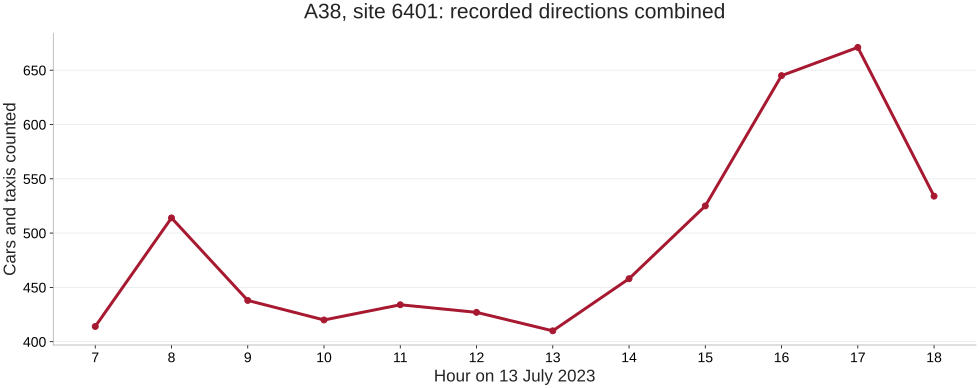</div>
</div>
```

::: {.notes}
0–3 min including title. Reconstruct Week 8 verbally. Ask before revealing pagination answer. GET returns a Response; parsing gives Python objects. Keep source capture and processed data separate. Source: Week 8 workflow, API and pagination slides. The saved traffic response had one page, but that is a property to check.
:::


## Exploratory data analysis {#eda-loop}

```{=html}
<svg class="eda-cycle" viewBox="0 0 1500 620" role="img" aria-label="A continuous loop: data and meaning, question, summaries and plots, investigate, make a justified change, then return to data and meaning">
<defs><marker id="cycle-tip" viewBox="0 0 10 10" refX="9" refY="5" markerWidth="9" markerHeight="9" orient="auto-start-reverse"><path d="M0 0 L10 5 L0 10Z" fill="#188980"/></marker></defs>
<g fill="none" stroke="#188980" stroke-width="5" marker-end="url(#cycle-tip)"><path d="M430 110H580"/><path d="M860 110H1080"/><path d="M1330 160C1480 200 1430 445 1250 445"/><path d="M990 445H590"/><path d="M280 445C80 440 45 205 190 160"/></g>
<g fill="#242424" font-family="Arial" font-size="35" font-weight="bold" text-anchor="middle"><text x="235" y="120">Data and meaning</text><text x="720" y="120">Question</text><text x="1250" y="100"><tspan x="1250">Summaries</tspan><tspan x="1250" dy="45">and plots</tspan></text><text x="1130" y="455">Investigate</text><text x="435" y="430"><tspan x="435">Make a justified</tspan><tspan x="435" dy="45">change</tspan></text></g><text x="760" y="290" fill="#a71930" font-family="Arial" font-size="36" text-anchor="middle">Then look again</text>
</svg>
```

::: {.notes}
7–8 min. EDA is an early and iterative part of analysis. A plot can change the question, grouping or transformation. We are exploring evidence, not proving causality or performing formal hypothesis tests today. Original slides 3, 5, 7; Seltman, Experimental Design and Analysis, Chapter 4: https://www.stat.cmu.edu/~hseltman/309/Book/chapter4.pdf
:::

## What graph? {#poster-overview}

```{=html}
<div><div class="poster-shell" data-initial="full" data-print-view="headings"><span class="fragment scene-cue" data-view="headings"></span><span class="fragment scene-cue" data-view="roots"></span></div></div>
<p class="source">From Data to Viz — <a href="https://www.data-to-viz.com/">Yan Holtz and Conor Healy</a>.</p>
```

## Data type and meaning {#data-types}

| Field | What does it represent? | Measurement type |
|---|---|---|
| Count-point ID: `6401` | A label identifying a site | Nominal category |
| Direction: `N` | A category | Nominal |
| Cars and taxis | A count | Quantitative, discrete, ratio |
| Annual NO₂ concentration | A measurement | Quantitative, continuous, ratio |
| Low / medium / high | An ordered grouping | Ordinal; thresholds need defining |

## Types of exploration {#analysis-types}

```{=html}
<div class="analysis-grid"><div></div><div class="head">Numerical or tabular</div><div class="head">Graphical</div><div class="head">One variable</div><div>Frequencies, centre, spread</div><div>Distribution, composition</div><div class="head">Two variables</div><div>Cross-tabulation, group summaries, correlation</div><div>Comparisons, relationships</div><div class="head">Several variables</div><div>Grouped summaries, matrices</div><div>Colour, size, facets, maps, networks</div></div>
```

**Univariate:** one variable. **Bivariate:** two. **Multivariate:** several together.


## Graphs can help us explore {#chart-questions}

| Question | Possible starting views |
|---|---|
| How do counts vary? | Dots, histogram, boxplot |
| Which group has higher typical counts? | Group distributions, summary dots |
| How does the observed day change? | Points connected in time, line plot |
| Where were counts measured? | Point map |

<p class="quiz-prompt">Which view would you choose to look for unusual values? What might it hide?</p>

<!-- QUIZ-ANSWER-START -->
<div class="fragment quiz-answer">No one right answer. A histogram shows shape but bins observations. A boxplot flags extremes but hides detail. Individual points retain detail but can overlap.</div>
<!-- QUIZ-ANSWER-END -->

::: {.notes}
13–15 min. Take two suggestions and ask for the question each serves. The poster offers starting points, not a unique answer. This is the short opening vote; do not let it consume the later slow investigation time.
:::

## Categorical variables {#poster-categorical}

```{=html}
<div><div class="poster-shell" data-initial="full" data-print-view="onecat"><span class="fragment scene-cue" data-view="categorical"></span><span class="fragment scene-cue" data-view="onecat"></span></div><p class="poster-caption"></p></div>
<p class="source">Poster: <a href="https://www.data-to-viz.com/">Yan Holtz and Conor Healy, From Data to Viz</a></p>
```

## Frequencies and proportions {#category-code}

What directions occur in the **survey records**?

<div class="code-layout"><div>

<!-- EXECUTE:categories -->
```python
import pandas as pd

traffic = pd.read_csv('data/bristol_traffic_2023.csv')
traffic['direction'] = (traffic['direction']
    .astype('string').str.strip().str.upper()
    .fillna('Missing'))
counts = traffic['direction'].value_counts(dropna=False)
summary = pd.DataFrame({
    'records': counts,
    'proportion': counts / len(traffic),
    'percent': 100 * counts / len(traffic)
})
print(summary.round(3))
```

</div><div class="fragment code-result">



</div></div>

::: {.notes}
Read the saved CSV, select the direction field, standardise whitespace/case, give missing directions an explicit category, then count and divide by the number of records. This does not drop observations or count vehicles. The supplied file has no missing directions. Show the output after students predict its columns. The code is self-contained and is executed in both builds.
:::

## Comparing categories or parts of a whole {#category-views}

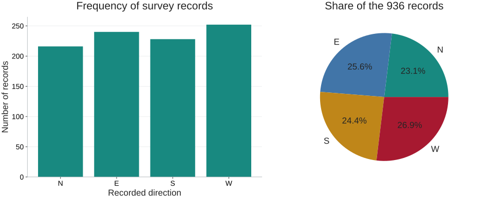


::: {.notes}
17–18 min. The same categories support different questions. Do not teach “categorical means pie”. Here compass order has a meaningful interpretation, so we keep it. For a pure ranking question sort bars by magnitude. The source PDF card 13 allows pies for very simple scenarios.
:::

## Which one shows a bigger difference? {#baseline}

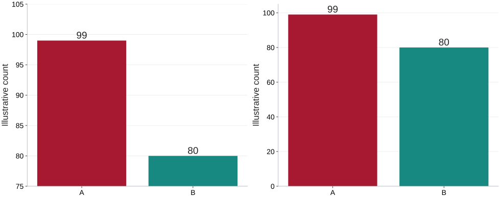


<p class="fragment takeaway">Always show axis baselines.</p>

::: {.notes}
Compare the bar lengths before discussing the labels. Both panels contain 99 and 80. Reveal the bottom sentence. Explain it as: make the baseline and scale visible; bars should normally start at zero because their length encodes magnitude. It is not a rule that every line or scatterplot axis must start at zero. The following real examples take about three minutes in total.
:::

## What does this baseline do? {#steel-baseline}

<div class="steel-layout"><div>
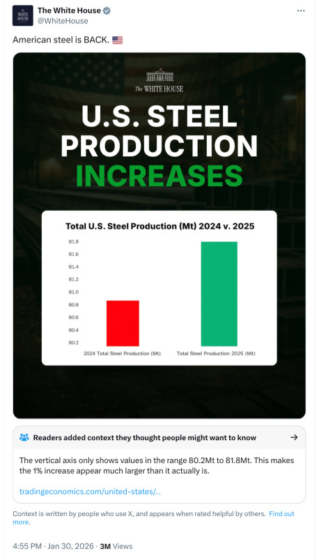
</div><div>
<div class="steel-detail"></div>
<p class="small">How would the impression change if the bars started at zero?</p>
</div></div>
<p class="source"><a href="https://media.zenfs.com/en/aol_meidastouch_articles_772/20c5250ec0e2f16d6325190ad3689277">Supplied screenshot: steel-production post and reader context</a>.</p>

::: {.notes}
A short baseline discussion. The screenshot includes a reader context note, so use it as a worked example rather than a withheld quiz. The plotted range is 80.2–81.8 Mt. Focus on visible axis truncation; do not claim independently verified steel totals, infer intent, or equate production changes with the success of a policy. A zero-baseline replot would preserve the ordering but greatly reduce the apparent ratio of bar lengths. This is a political social-media graphic, not a television-news broadcast.
:::

## Election leaflets: what is being compared? {#election-bars}

<div class="two-col media-example"><div>
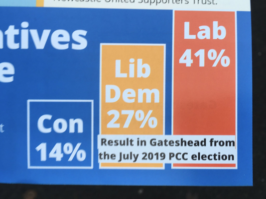
<p class="caption">Gateshead Liberal Democrats, 2019</p>
</div><div>

<p class="caption">Suffolk Coastal Labour, 2019</p>
</div></div>
<p class="takeaway">Check the election, the missing categories and the meaning of bar length.</p>
<p class="source">Original leaflets reproduced in <a href="https://fullfact.org/politics/lowering-the-bar/">Full Fact, “Lowering the bar”, 28 November 2019</a>.</p>

::: {.notes}
Keep this to 90 seconds. Lib Dem example: selected a police and crime commissioner election rather than the parliamentary election, and omitted an independent candidate on 17.9%. Labour example: the apparent Labour/Conservative bar ratio was about 0.8 although actual 2017 vote shares were 30.5% and 58.1% (ratio about 0.525); a striped ambition arrow extended above the Conservative bar. These are two different distortions: selective context and distorted visual lengths. Avoid generalising about every chart from either party. The source is Full Fact's documented 2019 examples. Optional correct comparison: assets/suffolk-correct.svg.
:::

## When the positions contradict the numbers {#news-axis}

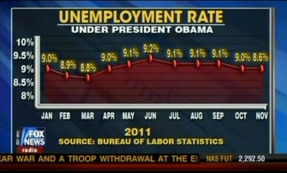
<p class="takeaway">Compare March’s 8.8%, October’s 9.0% and November’s 8.6%.</p>
<p class="source">Fox News, 12 December 2011; reproduced by <a href="https://flowingdata.com/2011/12/12/fox-news-still-makes-awesome-charts/">Nathan Yau, FlowingData</a>.</p>

::: {.notes}
Thirty-second visual check. November's label is lower numerically but its point is at roughly the same height as October and higher than March. This is an inconsistent mapping of values to vertical position, not merely a non-zero baseline. Do not describe this particular graph as a reversed axis. Correctly plotting the labelled values gives a fall from 9.0% to 8.6%. Source documented by FlowingData and Media Matters. No claim about why the graphic was produced.
:::

## Two categorical variables {#cross-tab}

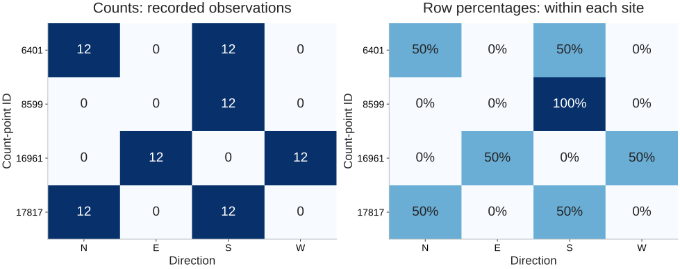

<p class="takeaway">Counts and row percentages answer different questions.</p>

::: {.notes}
19–21 min. Original cross-tabulation learning outcome. Each cell counts survey records for a site and direction. Row denominator = records at that site. Different recorded directions can reflect road/site design, not missing observations. A heatmap is a view of a contingency table. Ordinal rows/columns should keep meaningful order; reorder nominal labels only when it aids comparison.
:::

## Other views of the same table {#cross-bars}

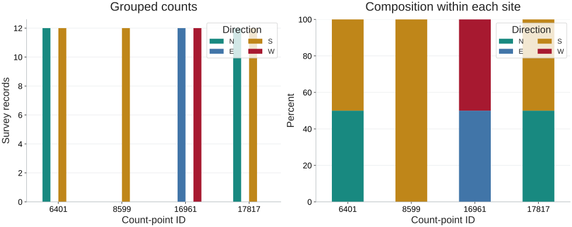

<p class="takeaway">Grouped bars help compare counts. Stacked bars emphasise composition.</p>


::: {.notes}
21–23 min. Students identify one question for each view. Interior stacked segments lack a common baseline. Explain grouping/reshaping into an analysis table; do not confuse normalising rows into percentages with scaling a numerical feature for modelling.
:::

## Numerical variables {#poster-numeric}

```{=html}
<div><div class="poster-shell" data-initial="full" data-print-view="onenum"><span class="fragment scene-cue" data-view="numeric"></span><span class="fragment scene-cue" data-view="onenum"></span></div><p class="poster-caption"></p></div>
<p class="source">Poster: <a href="https://www.data-to-viz.com/">Yan Holtz and Conor Healy, From Data to Viz</a></p>
```

::: {.notes}
23 min. Whole poster → numeric tree → one numeric variable. Recognise histogram, density and boxplot as different summaries. Introduce numerical summaries alongside graphical views.
:::

## What does a typical count look like? {#numeric-distribution}

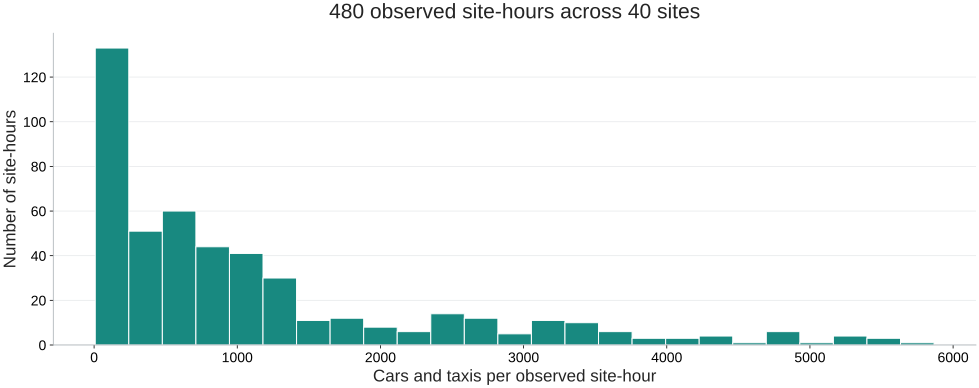

Centre, spread, shape, modes and unusual values.

::: {.notes}
23–25 min. Read axes and observation unit first: 480 site-hours across 40 sites, directions combined where recorded. This is an observed sample distribution, not automatically the population distribution of all Bristol traffic. Large sites may form the right tail for entirely real reasons.
:::

## Centre and spread {#summary-code}

<div class="code-layout"><div>

<!-- EXECUTE:summary -->
```python
cars = hourly['cars']
print(cars.describe().round(1))
print('Median:', cars.median())
print('Range:', cars.max() - cars.min())
print('Sample variance:',
      round(cars.var(ddof=1), 1))
```

</div><div class="fragment code-result">



</div></div>

Mean / median / mode describe centre. Range / variance / SD / IQR describe spread.

::: {.notes}
25–28 min. Mean = sum / n; median = ordered middle; mode = most frequent value, possibly several. describe gives sample SD, min, quartiles and max. Variance is squared spread; SD returns to original units. Explain sample denominator n−1 briefly; reference slide has formulas. IQR is Q3−Q1, the spread of the middle 50%. Mean/SD and median/IQR answer related but different questions.
:::

## The impact of one point {#moving-point}

```{=html}
<div class="step-scene" data-print-step="2"><div class="scene-frame active">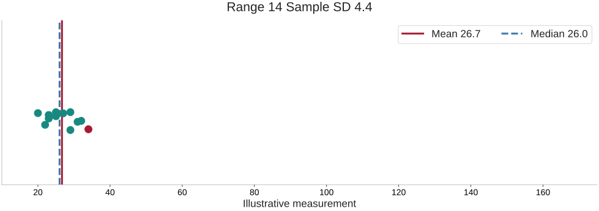</div><div class="scene-frame">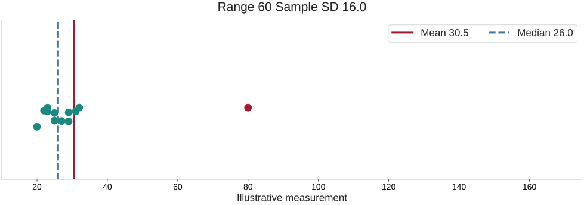</div><div class="scene-frame">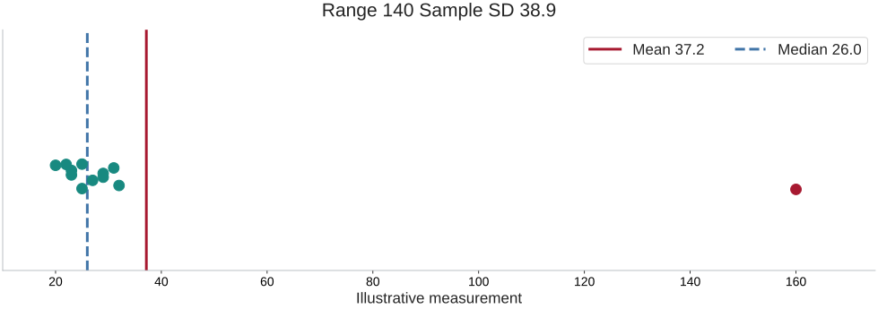</div><span class="fragment scene-cue"></span><span class="fragment scene-cue"></span></div>
```

::: {.notes}
28–31 min. Before each click invite predictions, then explain the displayed worked example. The explicit assessment quizzes are separate. Mean and SD respond strongly; the median is robust here. This introduces outliers in the graphs, not as a later disconnected topic. Mean/median ordering is not a universal theorem about every distribution.
:::

## Distribution shape {#shape}

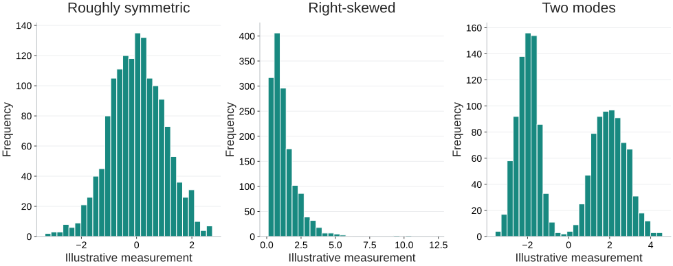

The same centre and spread can conceal different shapes.

::: {.notes}
31–33 min. Symmetry; right tail/positive skew; mention left tail/negative skew as the mirror direction. Modes may be multiple. Mode of a continuous distribution is usually inferred from a density/histogram and depends on estimation choices. Normal is one symmetric shape, not a synonym for all symmetric data. These distributions are synthetic examples.
:::

## Histogram bins {#bins}

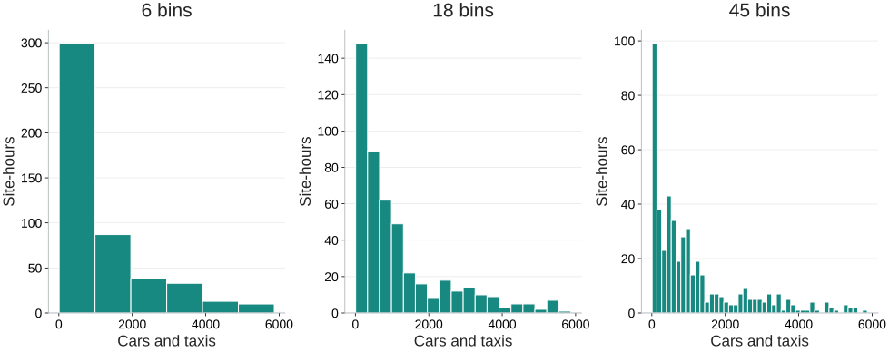

<p class="takeaway">Check whether a finding holds up at different bin choices</p>

::: {.notes}
33–35 min. Ask where a cluster appears/disappears. No observations changed. Too coarse hides shape; too fine shows noise. Density plots introduce a bandwidth choice. All histograms here use equal-width bins; unequal-width histograms need density/area interpretation rather than treating raw bar heights as comparable frequency.
:::

## Discretisation changes the representation {#discretisation}

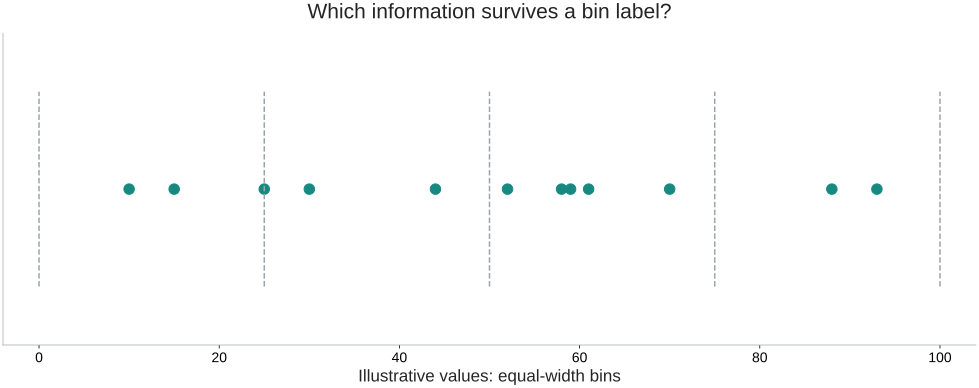

A bin can become a label: **low / medium / high**.

Equal-width bins and equal-count bins answer different needs. Replacing values by bin means, medians or boundaries loses information too.

::: {.notes}
35–38 min. Reconnect to Week 8. Display binning can be changed without modifying raw data. Storing only a category loses precise measurements. Recall pandas cut versus qcut; bin representative methods only brief recall. Defined domain thresholds differ from arbitrary bins. Avoid calling invented cutoffs official congestion thresholds. Two-minute pairs: name one useful simplification and one cost.
:::

## Building a boxplot {#boxplot}

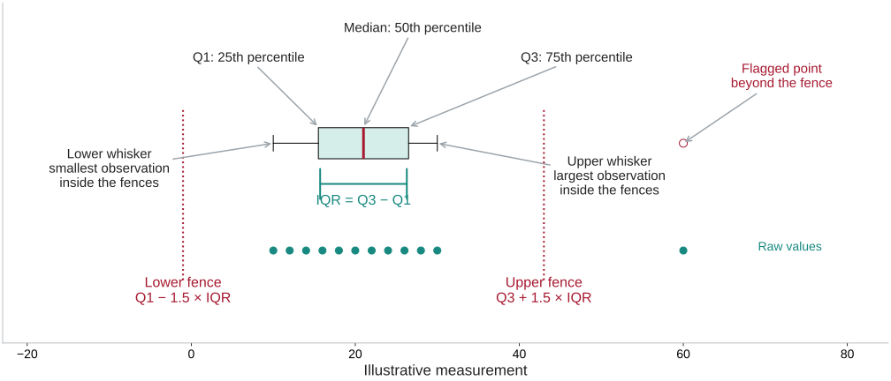

The box shows Q1 to Q3. The line shows the median. Points beyond the whiskers are candidates for investigation.

::: {.notes}
38–41 min. Build verbally from sorted values: quartiles, IQR, fences and observed whisker endpoints. Five-number summary is min/Q1/median/Q3/max, but the Tukey whiskers used here are not necessarily min/max. Fences at Q1−1.5IQR and Q3+1.5IQR. Different software quartile conventions can affect tiny datasets. Original slides 19, 53–54. Source guidance: https://www.data-to-viz.com/caveat/boxplot.html
:::

## The 3σ rule has an assumption {#three-sigma}

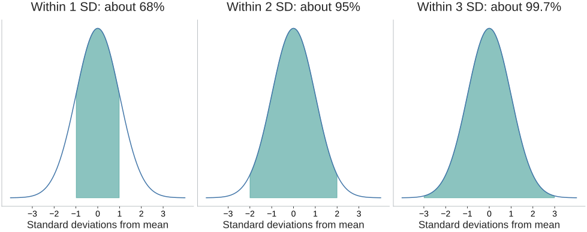

These percentages describe a **normal distribution**.

::: {.notes}
41–43 min. About 68%, 95%, 99.7% of a normal population lies within 1/2/3 population SD of its mean. A sample mean ± 3 SD flag is a heuristic, not a universal outlier test. A skewed distribution can have legitimate long tails. Mean and SD may themselves be affected by extremes. Original 50–51 sample arithmetic retained in references. NIST outlier guidance: https://www.itl.nist.gov/div898/handbook/eda/section3/eda35h.htm
:::

## Identifying outliers {#outlier-methods}

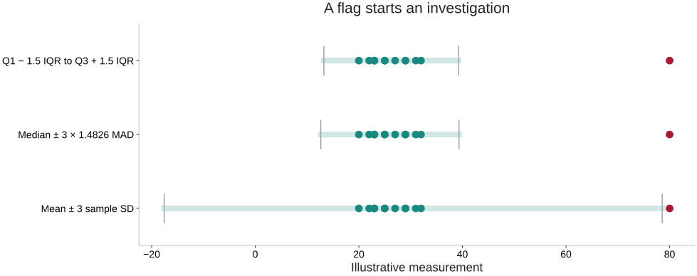

<div class="method-formulas">

**IQR**: $IQR=Q_3-Q_1$; flag $x<Q_1-1.5IQR$ or $x>Q_3+1.5IQR$.

**3 SD**: flag $|x-\overline{x}|>3s$, where $s=\sqrt{\dfrac{\sum_i(x_i-\overline{x})^2}{n-1}}$.

**Hampel**: $m=\operatorname{median}(x)$, $MAD=\operatorname{median}_i|x_i-m|$; flag $|x-m|>3(1.4826)MAD$.

</div>

::: {.notes}
IQR: resistant to a few extreme values, interpretable through the boxplot and no normality requirement for computing it. But 1.5 is a convention, skewed tails can be legitimate, and quartile conventions/small samples affect flags.

3 sample SD: simple, familiar and connected to the normal-reference 99.7% rule. But mean and SD are sensitive to extremes (masking), and skew or heavy tails invalidate a universal false-alarm interpretation. The 99.7% statement uses population parameters under a normal model, not a guarantee for sample thresholds.

Hampel: centres on the median and uses the median absolute deviation; robust against a minority of extreme values. The factor 1.4826 makes MAD normal-consistent as a scale estimate; it does not make the observations normal. Limits: zero MAD in repeated/discrete data; small samples; asymmetry; reduced efficiency for clean normal samples.

All three flag candidates for investigation. Multiple extremes may mask one another, and genuine unusual values should not be deleted automatically. In this illustration all three flag the red value. Define the median, then absolute deviations, then their median before using the final inequality.
:::

## An outlier needs context {#outlier-decision}

<p class="quiz-prompt">A survey count lies beyond a boxplot whisker. What should happen next?</p>

1. Delete it immediately.
2. Check the source, units, grouping and circumstances.
3. Replace it with the mean automatically.

<!-- QUIZ-ANSWER-START -->
<div class="fragment quiz-answer">Start with 2. Correct a verified error where possible. Keep real unusual observations. Exclusion or imputation needs a reason and a recorded method.</div>
<!-- QUIZ-ANSWER-END -->

<p class="small">A faulty sensor and a real rare event can produce similar-looking points.</p>

::: {.notes}
46–48 min. Include errors and scientifically interesting or operationally important events such as fraud. Preserve raw values; annotate decisions; compare sensitivity to questionable points. Imputation adds assumptions and can suppress variability. Do not remove a genuine extreme merely to make a model look better. Univariate anomaly = one variable's distribution; multivariate follows after break.
:::

## A numerical variable across groups {#poster-groups}

```{=html}
<div><div class="poster-shell" data-initial="full" data-print-view="groups"><span class="fragment scene-cue" data-view="mixed"></span><span class="fragment scene-cue" data-view="groups"></span></div><p class="poster-caption"></p></div>
<p class="source">Poster: <a href="https://www.data-to-viz.com/">Yan Holtz and Conor Healy, From Data to Viz</a></p>
```

::: {.notes}
48 min. Zoom whole → mixed → grouped numerical. The categorical field defines groups; the numeric field varies within each. The same numeric measurements may have different distributions depending on grouping.
:::

## Group means can hide the distribution {#groups}

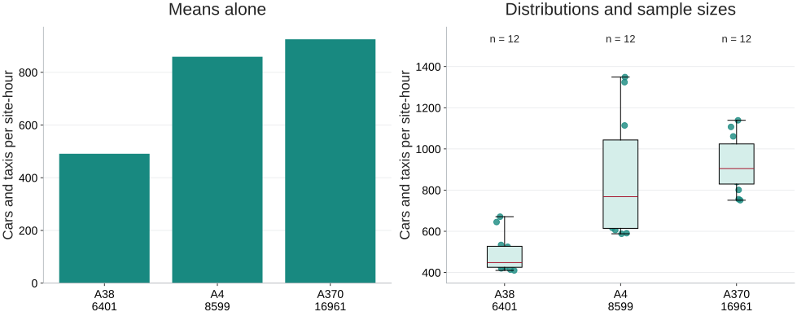

<p class="takeaway">Show the distribution and n when they affect the comparison.</p>


::: {.notes}
48–52 min. Ask what we learn on the right that is invisible on the left. n counts observed site-hours, not independent random samples from every possible day. Sites may have different survey dates. Error bars need explicit definitions (SD, SE or confidence interval); they do not show the full distribution. An outlier pooled across all sites may be ordinary for one site.
:::

## Violin and swarm plots {#violin-swarm}

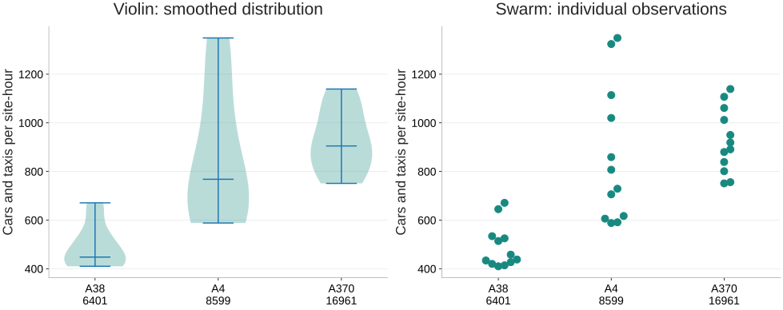

<p class="quiz-prompt">Which view would you choose for these small groups, and why?</p>

<!-- QUIZ-ANSWER-START -->
<div class="fragment quiz-answer">Individual points make the small samples visible. A violin helps inspect shape, but its smoothing can suggest detail the data do not support.</div>
<!-- QUIZ-ANSWER-END -->

::: {.notes}
A violin plot is a smoothed estimate of a numerical distribution, drawn as mirrored density curves around a central line. At a given y-value, a wider section means greater estimated density there. Read it as a histogram smoothed and reflected, not as the outlines of observed points. The smoothing bandwidth controls how much detail appears; too little can create spurious bumps and too much can hide modes. The violin may extend into sparsely supported regions. The centre marker here shows the median; inspect the plotting convention rather than assuming every violin displays quartiles. Width/area normalisation varies between implementations, so width does not automatically mean a larger sample. With only 12 site-hours per group, show the points too.

Swarm offsets are only a way to separate nearby observations. They are not another measured variable. Give pairs a minute to compare the two views. Take the planned ten-minute break after this slide; the user removed the separate break slide, so do not reinsert it.
:::

## Two numerical variables {#poster-relationships}

```{=html}
<div><div class="poster-shell" data-initial="full" data-print-view="twonum"><span class="fragment scene-cue" data-view="numeric"></span><span class="fragment scene-cue" data-view="twonum"></span></div><p class="poster-caption"></p></div>
<p class="source">Poster: <a href="https://www.data-to-viz.com/">Yan Holtz and Conor Healy, From Data to Viz</a></p>
```

::: {.notes}
65–66 min. Notice ordered/unordered and few/many points in the tree. Scatter, connected scatter, density and marginal distributions answer different questions. The tree is a starting set, not an instruction to draw every option.
:::

## Cars and bicycles together {#scatter}

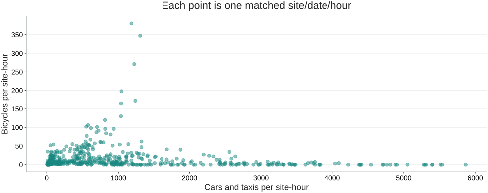

Describe the shape, direction, clusters and unusual observations before calculating a summary.

::: {.notes}
66–69 min. One point = matched cars and bicycles from same site/date/hour. Raw records were grouped by those keys. Do not correlate unrelated rows joined only by position. Have students describe the cloud without causal language. Different sites and times can contribute common influences; this is exploratory, not a causal study.
:::

## Overlapping points hide observations {#overplotting}

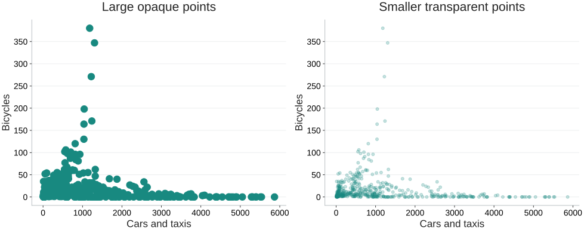

Smaller markers, transparency, facets, or density/hexbin views can help.


::: {.notes}
69–70 min. Same observations, different readability. More transparent points do not correct sampling bias. Point size should be explained when it encodes a value. Aspect ratio can alter visual impression of slope; numeric r does not change when you stretch the plotting window.
:::

## Direction and strength {#correlation-quiz}

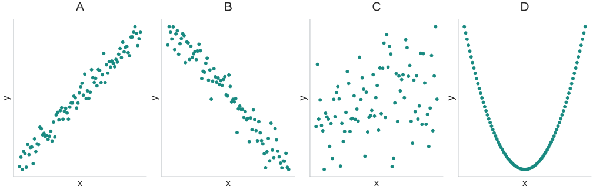

<p class="quiz-prompt">For A–D, describe the pattern. Which might have Pearson r near zero?</p>

<!-- QUIZ-ANSWER-START -->
<div class="fragment quiz-answer">A: strong positive. B: strong negative. C: weaker positive. D: clear curved relationship, but Pearson r is near zero.</div>
<!-- QUIZ-ANSWER-END -->

::: {.notes}
70–73 min. Two-minute prediction and brief reveal. Pearson r measures linear association and ranges −1 to +1. Sign gives direction; magnitude describes linear strength. Avoid universal “strong” cutoffs. D is symmetric y=x²: zero correlation does not imply independence. The handout retains unlabeled patterns and question, not answer text.
:::

## Pearson correlation {#correlation-code}

<div class="code-layout"><div>

<!-- EXECUTE:correlation -->
```python
paired = hourly[['cars', 'bicycles']]
print(paired.corr().round(3))
```

<p class="formula small-formula"><math xmlns="http://www.w3.org/1998/Math/MathML" display="block" aria-label="Pearson correlation: sum of paired deviations divided by the square root of the product of the sums of squared deviations"><mi>r</mi><mo>=</mo><mfrac><mrow><mo>∑</mo><mrow><mo>(</mo><msub><mi>x</mi><mi>i</mi></msub><mo>−</mo><mover accent="false"><mi>x</mi><mo>¯</mo></mover><mo>)</mo></mrow><mrow><mo>(</mo><msub><mi>y</mi><mi>i</mi></msub><mo>−</mo><mover accent="false"><mi>y</mi><mo>¯</mo></mover><mo>)</mo></mrow></mrow><msqrt><mrow><mo>∑</mo><msup><mrow><mo>(</mo><msub><mi>x</mi><mi>i</mi></msub><mo>−</mo><mover accent="false"><mi>x</mi><mo>¯</mo></mover><mo>)</mo></mrow><mn>2</mn></msup><mo>∑</mo><msup><mrow><mo>(</mo><msub><mi>y</mi><mi>i</mi></msub><mo>−</mo><mover accent="false"><mi>y</mi><mo>¯</mo></mover><mo>)</mo></mrow><mn>2</mn></msup></mrow></msqrt></mfrac></math></p>

</div><div class="fragment code-result">



</div></div>

<p class="takeaway">Compare deviations from each variable's mean. Always inspect the scatterplot too.</p>

::: {.notes}
73–75 min. Same matched site-hours. Walk through sign of paired deviations rather than full arithmetic. r undefined if one variable is constant. Sample r is descriptive; no claim of independent observations or significance here. Original formula retained. SciPy: https://docs.scipy.org/doc/scipy/reference/generated/scipy.stats.pearsonr.html
:::

## A strong correlation is not the whole story {#anscombe}

<p class="takeaway">Four datasets. Pearson r ≈ 0.816. Fitted line: y ≈ 3 + 0.5x.</p>
<div class="fragment">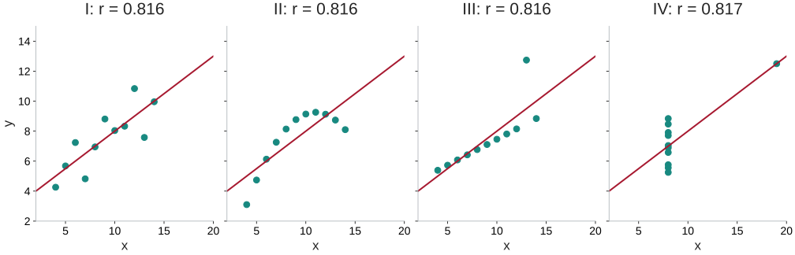</div>
<p class="source">F. J. Anscombe (1973), <a href="https://doi.org/10.1080/00031305.1973.10478966">Graphs in Statistical Analysis</a>.</p>

::: {.notes}
Allow 45 seconds. Show the shared correlation and fitted line first; ask what students expect, then reveal all four plots. The fourth example obtains its association from one high-leverage point; a strong r alone does not validate the line as a useful model. These are constructed teaching datasets, not evidence that a published scientific finding was fabricated. Lead into the funny dinosaur example.
:::

## Same statistics. A different animal. {#datasaurus}

<p class="takeaway">Nearly the same means, SDs and correlation. What could the plots look like?</p>
<div class="fragment">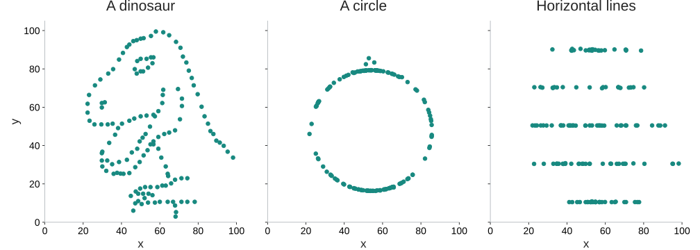</div>
<p class="small">These examples have Pearson r ≈ −0.06, not a strong correlation.</p>
<p class="source">Alberto Cairo’s Datasaurus; <a href="https://www.research.autodesk.com/publications/same-stats-different-graphs/">Matejka &amp; Fitzmaurice (CHI 2017), Same Stats, Different Graphs</a>.</p>

::: {.notes}
About 45 seconds. The remembered animal is a dinosaur rather than a duck. A scatterplot already reveals it; connecting unrelated rows is unnecessary. The published data have means about 54.26 and 47.83 and sample SDs about 16.76 and 26.94; their r values are near -0.06. Small numerical differences depend on rounding/convention. The authors deliberately generated different shapes while keeping summaries nearly fixed. This is about insufficiency of summaries, whereas the preceding Anscombe example covers strong correlation and leverage. Both are worked demonstrations, so their plots remain in the student handout.
:::

## Curves and groups change the interpretation {#correlation-limits}

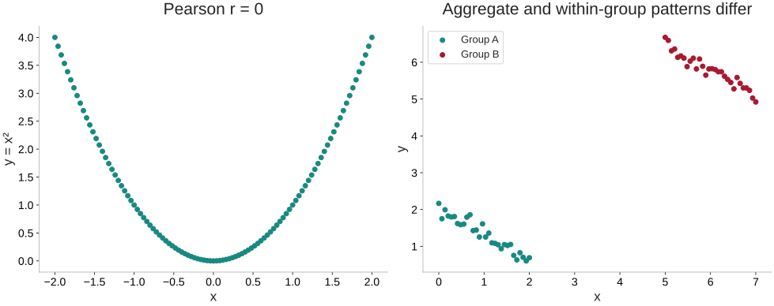

::: {.notes}
75–77 min. Left: r=0 does not mean no relationship or independence. Right: within each group y tends down as x rises, but combining groups creates an upward pattern. These are designed examples, not claimed findings in Bristol traffic. Ask what additional grouping would be worth checking in our traffic data.
:::

## Correlation and causation {#causation}

```{=html}
<div class="causes"><div class="common">Sunny weather<br><span class="small">A possible common influence</span></div><div class="effect">↙<br>Ice-cream sales</div><div class="effect">↘<br>Sunglasses sales</div></div>
```

A relationship between two measurements does not establish that changing one causes the other.

<p class="small">Illustrative explanation. In the traffic data, site characteristics and time of day are candidate common influences.</p>

::: {.notes}
77–79 min. A causal effect is a change in an outcome due to intervening on a cause, not every observed change occurring together. This is a hypothetical diagram, not a citation of a study. Original ice-cream/homicide example replaced because no verifiable study was supplied. Other explanations include reverse causation, common causes, selection and chance; don't need a causal inference lecture.
:::

## Ordinary alone, unusual together {#multivariate-outlier}

```{=html}
<div class="panel-reveal">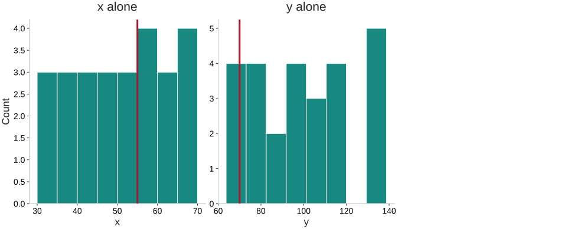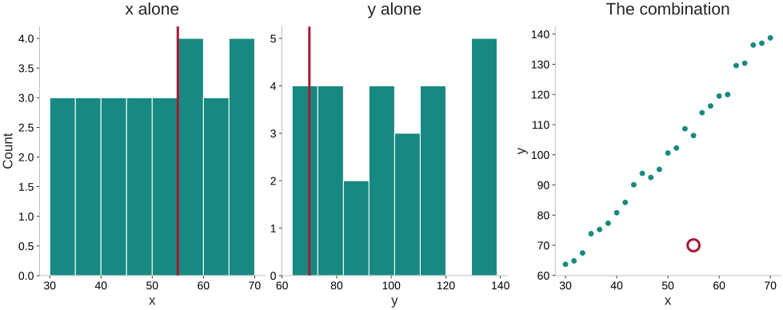</div>
```
<p class="takeaway">A multivariate outlier concerns a combination of variables.</p>

::: {.notes}
79–82 min. Red value is ordinary within each marginal range but off the relationship in the joint view. Ask what a pair of independent univariate rules could miss. This is illustrative, not a fitted anomaly detector. Context can include group and time as well as multiple numerical features. Unusual points can affect correlation and model estimates. Full automatic multivariate detection is beyond today.
:::

## A relationship is a reason to investigate {#relationship-check}

<p class="quiz-prompt">Suppose cars and bicycles are positively correlated in another sample. Which conclusion is justified?</p>

1. More cars cause more cycling.
2. The two counts show positive linear association in this sample.
3. Removing unusual points will establish causation.

<!-- QUIZ-ANSWER-START -->
<div class="fragment quiz-answer">Option 2: check the scatterplot, grouping, observation units and sampling. Neither correlation nor deleting points establishes causality.</div>
<!-- QUIZ-ANSWER-END -->

::: {.notes}
82–83 min. Quick checkpoint before slower scaling sequence. Source original correlation/causation and outlier objectives consolidated.
:::

## What should the comparison mean? {#scaling-question}

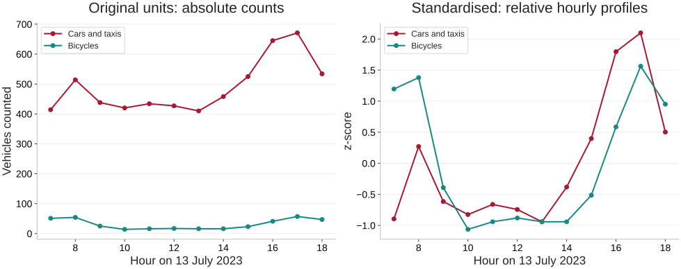

Absolute volumes and relative hourly patterns are different questions.


::: {.notes}
83–86 min. Start with a reason for changing scales. Cars have much larger counts; using original units is correct for absolute volume. For a profile question, centre/scale may be useful but removes magnitude meaning. Do not invent an association using independently tuned dual axes. Small aligned panels in original units are also a good alternative. Standardisation parameters here are computed separately per variable over this survey day, ddof=0.
:::

## Distance depends on scale {#distance}

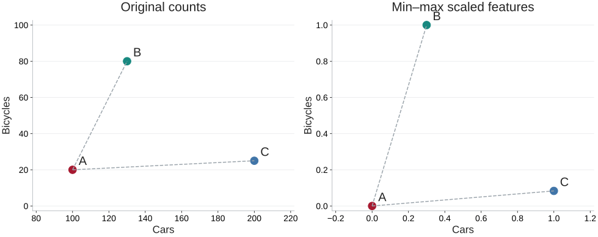

<p class="quiz-prompt">Which point is closest to A? Is the answer unchanged after scaling?</p>

<!-- QUIZ-ANSWER-START -->
<div class="fragment quiz-answer">In original units B is closer. With these min–max scaled features C is slightly closer. Scaling changes each feature's contribution to distance.</div>
<!-- QUIZ-ANSWER-END -->

::: {.notes}
86–89 min. Illustrative points A=(100,20), B=(130,80), C=(200,25). Raw distances AB≈67.1, AC≈100.1; scaled AB≈1.044, AC≈1.003. Display uses equal aspect so geometry matches distance. Cars/bicycles counts have same nominal unit but different ranges; different measurement units can have the same issue. Useful motivation for nearest-neighbour and other scale-sensitive methods; no ML algorithm tutorial needed.
:::

## Min–max normalisation {#minmax}

<p class="formula">$x' = \dfrac{x-\min(x)}{\max(x)-\min(x)}$</p>

| Original value | Position in [100, 300] | Scaled value |
|---:|---:|---:|
| 100 | Minimum | 0 |
| 200 | Halfway | 0.5 |
| 300 | Maximum | 1 |

<p class="takeaway">For another interval [a, b], use $a + (b-a)x'$.</p>

::: {.notes}
89–92 min. Trace subtract then divide with one observation. [−1,1] is a common alternative: a=−1,b=1. Fitted min/max map observed training extremes to the endpoints; new observations can fall outside [0,1]. Constant feature needs handling because denominator zero. This form of normalisation is feature rescaling, not normality or percentages.
:::

## Standardisation {#standardisation}

<p class="formula">$z = \dfrac{x-\text{mean}}{\text{standard deviation}}$</p>

<div class="two-col"><div>

**z = 0:** at the reference mean.

**z = 2:** two reference SDs above the mean.

**z = −1:** one reference SD below it.

</div><div>

The transformed reference data have mean 0 and SD 1.

Their distribution can still be skewed or multimodal.

</div></div>

::: {.notes}
92–95 min. Same idea of deviations used for 3σ, now as a transformation. Explain original units cancel. Consistent SD convention needed. No normality guarantee, no guarantee of model improvements for all methods. Scaling can improve numerical conditioning/optimisation for relevant algorithms. Training/held-out separation next reference note. Source: https://scikit-learn.org/stable/modules/preprocessing.html
:::

## Calculating both transformations {#scaling-code}

<div class="code-layout"><div>

<!-- EXECUTE:scaling -->
```python
x = np.array([100., 200., 300.])
minmax = (x - x.min()) / np.ptp(x)
z = (x - x.mean()) / x.std(ddof=0)
print('Original:', x)
print('Min–max:', minmax)
print('z-scores:', np.round(z, 3))
print('z mean / SD:',
      round(z.mean(), 3),
      round(z.std(ddof=0), 3))
```

</div><div class="fragment code-result">



</div></div>

<p class="small">This worked example uses population SD (`ddof=0`) consistently.</p>

::: {.notes}
95–97 min. Run/trace this worked example. ddof=0 matches usual feature-scaling implementations; pandas std defaults to sample ddof=1. Use same reference parameters for all observations being compared. In ML fit on training data only and reuse on held-out/new observations. Never rescale each held-out point separately.
:::

## The same observations on different scales {#scaling-views}

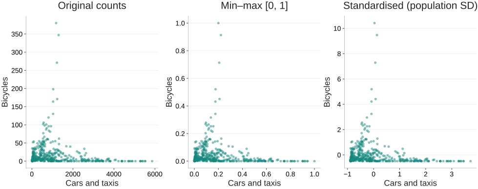

<p class="takeaway">Axis labels and units change. Scaling alone does not remove unusual points or create normality.</p>

::: {.notes}
97–98 min. Autoscaled panels retain the relative shape; inspect axis numbers. Positive affine rescaling of either variable also leaves Pearson r unchanged. Joint Euclidean geometry with comparable axis units can change, as our distance example showed. Distinguish a display range change from transforming feature values.
:::

## Extreme values affect the scale {#scaling-extremes}

```{=html}
<div class="panel-reveal">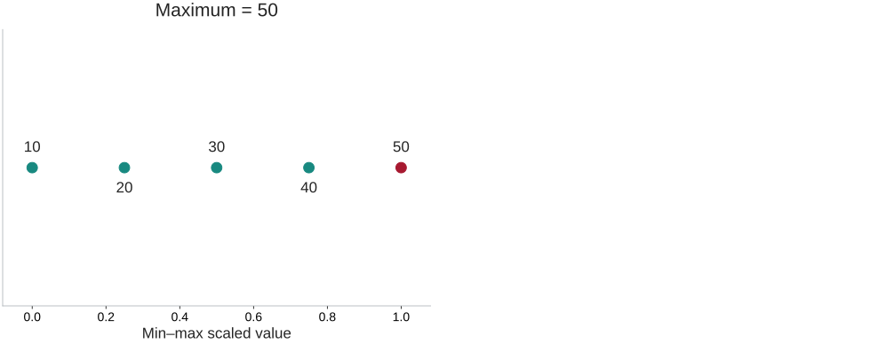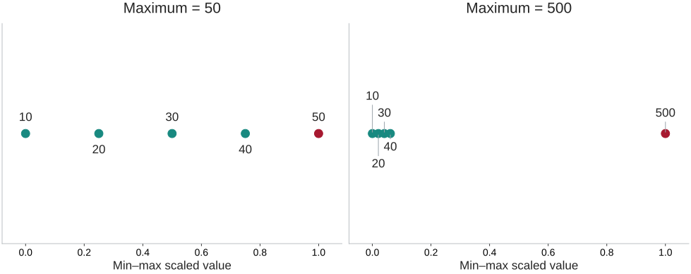</div>
```
<p class="takeaway">An extreme maximum compresses the other values. Mean/SD scaling is sensitive too.</p>

::: {.notes}
98–100 min. Ask pairs why positions changed despite first four observations remaining identical. Two minutes including debrief. Scaling is not an outlier treatment by itself. Median/IQR-based robust scaling is a short signpost. Log transforms/axes can help inspect skew but require explicit treatment of zero; don't add another method lesson. If no valid reason to transform, retain original units.
:::

## Decimal scaling and different meanings of normalise {#decimal-scaling}

**Decimal scaling:** choose a power of ten so the maximum absolute scaled value is below 1.

<p class="formula">$[120,\ 450,\ 900] / 1000 = [0.12,\ 0.45,\ 0.9]$</p>

| Operation | What changes? |
|---|---|
| Divide counts by a total | Composition / proportions |
| Divide by population or exposure | A rate for a stated denominator |
| Rescale a numerical feature | Range or measurement scale |

::: {.notes}
100–102 min. Decimal scaling explicitly named in original. Formula x'=x/10^j with smallest suitable nonnegative integer j; do not claim fills [0,1] or compare with standardisation. Values may be negative. Ten-second optional callback: duck RGB /255 uses a known physical storage range, not observed min/max. Distinguish map rates and proportions from feature scaling.
:::

## Choosing a transformation {#transformation-quiz}

<p class="quiz-prompt">You need to compare absolute vehicle volumes between sites. Must you standardise each site first?</p>

<!-- QUIZ-ANSWER-START -->
<div class="fragment quiz-answer">No. Standardising each site removes its absolute level and changes the question. Keep comparable original units, and check differences in survey timing and coverage.</div>
<!-- QUIZ-ANSWER-END -->

::: {.notes}
102–103 min. Show how interpretation drives data manipulation. Not every model needs scaling and not every plot benefits. Carry forward the explicit question and observation unit.
:::

## Several variables {#poster-many}

```{=html}
<div><div class="poster-shell" data-initial="full" data-print-view="many"><span class="fragment scene-cue" data-view="numeric"></span><span class="fragment scene-cue" data-view="many"></span></div><p class="poster-caption"></p></div>
<p class="source">Poster: <a href="https://www.data-to-viz.com/">Yan Holtz and Conor Healy, From Data to Viz</a></p>
```

::: {.notes}
103 min. Very brief return to larger tree. Correlation matrices, heatmaps, parallel coordinates and dimensionality reduction appear as further possibilities; don't attempt to teach them all now. Adding many encodings is not automatically better than facets.
:::

## Colour, size and facets {#more-variables}

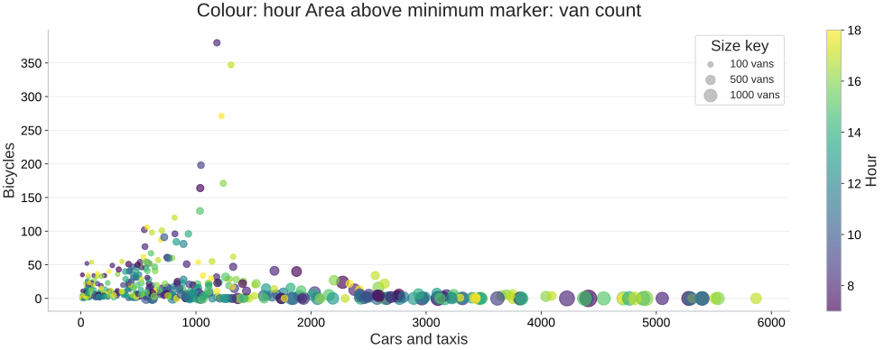


::: {.notes}
103–105 min. Decode x,y,colour,size one at a time. Marker area above a minimum size is proportional to vans; explain the baseline in legend/title. Quantitative colour uses a sequential scale; categories need distinct colours; avoid rainbow and colour-only distinctions. Smaller multiples can be clearer than more encodings. Original Gapminder example retained next as a quick reference to time.
:::

## Separate the comparisons {#more-variables-clear}

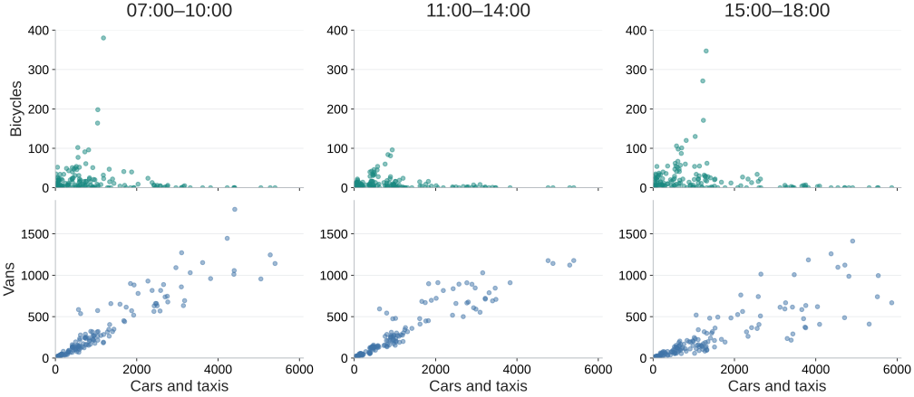
<p class="takeaway">Same observations and variables. Time in columns; vehicle type in rows.</p>

::: {.notes}
Retain the preceding bubble chart as the before view. This version retains all 480 observations and all four variables: cars on x, bicycles/vans on y, hour as three declared bands. No points are removed and no group averages replace them. Position is easier to compare than bubble area, and time bands remove the colour-decoding task. All panels share the cars scale; each row shares its own y-scale. The trade-off is that exact hour is binned into 07–10, 11–14 and 15–18 rather than individually encoded. These are observed survey hours across sites/dates, not continuous monitoring of one day.
:::

## Time, location and connections {#poster-structures}

```{=html}
<div><div class="poster-shell" data-initial="full" data-print-view="full"><span class="fragment scene-cue" data-view="time"></span><span class="fragment scene-cue" data-view="maps"></span><span class="fragment scene-cue" data-view="network"></span></div><p class="poster-caption"></p></div>
<p class="source">Poster: <a href="https://www.data-to-viz.com/">Yan Holtz and Conor Healy, From Data to Viz</a></p>
```

::: {.notes}
105–106 min. Three brief camera moves. Time supplies order, maps supply location, networks need relationships/edges. Preserve meaningful time spacing and gaps; don't connect unrelated sites. Too many lines can be replaced by facets/highlights. Holtz cards 09, 53 and 54. This is a breadth signpost, not three new long lessons.
:::

## More dimensions in motion {#gapminder}

<div class="two-col"><div>

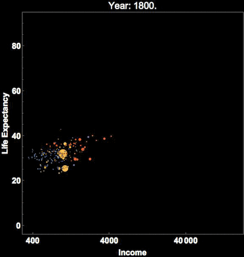

</div><div>

**Position:** income and life expectancy.

**Area:** population.

**Colour:** region.

**Time:** changes across years.

[Gapminder World Health Chart](https://www.gapminder.org/fw/world-health-chart/)

</div></div>

<p class="source">Hans Rosling / Gapminder. Example retained from the original Week 9 slides.</p>

::: {.notes}
106–107 min. Spend at most a minute decoding this example. It is a reused source visual, not new calculated evidence. Keep local animation/still available so no network visit is needed. Consider whether facets or selected years would be easier to compare. No need to maximise dimensions just because we can.
:::

## Geography or ranking? {#geography}

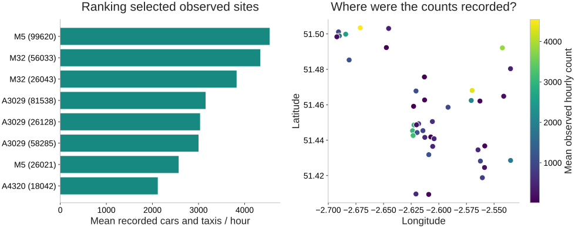


::: {.notes}
107–108 min. A point map shows measured locations; no interpolation or unobserved-road inference. Different survey dates/coverage limit comparisons. For choropleths think counts versus appropriate population/exposure rates, but don't normalise point concentrations blindly. Missing data must be distinct from low values. Annual NO2 map is kept as separate reference, not joined to hourly traffic. Our map is a coordinate scatter, not a supplied basemap.
:::

## Connections need edges {#network}

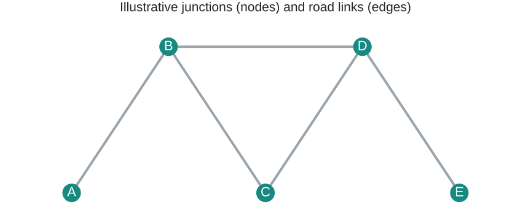

<p class="network-edges">Edges: A–B, B–C, C–D, D–E, B–D</p>

A connection diagram shows links. A flow diagram can encode quantities moving along links.

::: {.notes}
108–110 min. Explicit illustrative network, not inferred from our count-point CSV. Coordinates identify positions but do not define road connectivity or origin–destination traffic. Source original connection/network lesson retained. Sankey widths need meaningful conserved/defined flow quantities. Nodes and edges are a different data structure from one list of numeric measurements.
:::

## Chart clinic {#clinic}

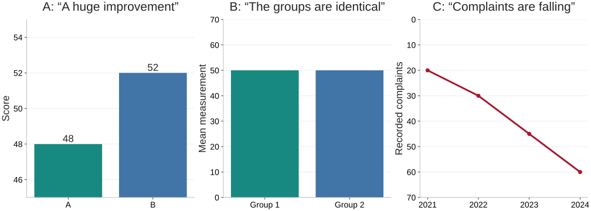

<p class="quiz-prompt">For each graph: what impression does it give, what is missing or misleading, and how would you redraw it?</p>
<p class="small">Illustrative data. Work in pairs; take one minute per graph.</p>

::: {.notes}
110–117 min. Give pairs one minute per graph, then discuss. A: values 48 and 52 but baseline45 magnifies the bar-length ratio; use zero baseline and describe the 4-unit difference or 8.3% relative increase. B: equal means do not establish identical distributions or sample sizes; request raw values, n and a distribution plot. C: counts rise20→60 but the y-axis runs downwards while the headline says falling; restore conventional direction and match title to the numbers. Note that reversing an axis is not universally invalid (depth, rank), but this direction/headline combination misleads. These are classroom constructions and not claims about any real institution. Keep these debrief answers only in notes, removed from student output.
:::

## Quiz {#exit}

<div class="exit-sequence">
<div class="exit-item"><p class="fragment exit-question" data-fragment-index="0"><strong>1.</strong> Give two plausible plots for one numerical variable. What does each hide?</p>
<!-- QUIZ-ANSWER-START -->
<p class="fragment quiz-answer" data-fragment-index="1">A histogram shows shape but bins values. A boxplot summarises centre/spread but hides fine detail. Individual points preserve detail but can overlap.</p>
<!-- QUIZ-ANSWER-END -->
</div>
<div class="exit-item"><p class="fragment exit-question" data-fragment-index="2"><strong>2.</strong> Does a boxplot flag justify deleting an observation?</p>
<!-- QUIZ-ANSWER-START -->
<p class="fragment quiz-answer" data-fragment-index="3">No. Investigate the source, units and context. Correct verified errors and record justified decisions.</p>
<!-- QUIZ-ANSWER-END -->
</div>
<div class="exit-item"><p class="fragment exit-question" data-fragment-index="4"><strong>3.</strong> What does z = 2 mean? Does standardisation create a normal distribution?</p>
<!-- QUIZ-ANSWER-START -->
<p class="fragment quiz-answer" data-fragment-index="5">Two reference SDs above the mean. Standardisation changes centre and scale; it does not guarantee normality.</p>
<!-- QUIZ-ANSWER-END -->
</div>
<div class="exit-item"><p class="fragment exit-question" data-fragment-index="6"><strong>4.</strong> What can Pearson correlation tell us, and what can it not establish?</p>
<!-- QUIZ-ANSWER-START -->
<p class="fragment quiz-answer" data-fragment-index="7">It describes linear association. It cannot establish causation, and a value near zero does not rule out a curved relationship.</p>
<!-- QUIZ-ANSWER-END -->
</div>
</div>

::: {.notes}
117–120 min. Fast responses and reveal. Return to data meaning and the EDA loop. End teaching route here; reference slides are available for later use.
:::

## Reference material {#references .reference-slide}

Definitions, calculations and sources for independent study.

The practice questions in the advance handout retain their prompts.

::: {.notes}
End of timed route. Do not continue through these as additional lecture content.
:::

## Reference: centre and spread {#ref-statistics .reference-slide}

| Quantity | Definition / interpretation |
|---|---|
| Mean | $\bar{x}=\sum x_i/n$ |
| Median / mode | Ordered middle / most frequent value(s) |
| Range | Maximum − minimum |
| Sample variance | $s^2=\sum(x_i-\bar{x})^2/(n-1)$ |
| Sample SD | $s=\sqrt{s^2}$, in original units |
| IQR | Q3 − Q1, spread of the middle 50% |

A population-style calculation uses denominator n. State the convention. Numerical summaries should be read with a graph.

## Reference: the original spread exercise {#ref-spread .reference-slide}

A: `27 23 25 22 23 20 20 25 29 29`

B: `12 31 31 16 28 47 9 5 40 47`

| Set | Mean | Population SD | Sample SD |
|---|---:|---:|---:|
| A | 24.3 | 3.1321 | 3.3015 |
| B | 26.6 | 14.6779 | 15.4718 |

Neither set contains a value beyond its own mean ± 3 SD. Large spread alone does not guarantee a 3σ flag.

<p class="source">Worked reference from original Week 9 slide 50. This is not one of the lecture's withheld quizzes.</p>

## Reference: flags and safeguards {#ref-flags .reference-slide}

| Method | Flagging convention used here |
|---|---|
| IQR | Below Q1 − 1.5 IQR or above Q3 + 1.5 IQR |
| 3σ heuristic | More than 3 sample SD from the sample mean |
| Hampel | $|x-\mathrm{median}(x)| > 3\times1.4826\times\mathrm{MAD}$ |

MAD = median of $|x-\mathrm{median}(x)|$.

A zero MAD or SD requires separate handling. Small samples, skew and multiple extreme values can make simple rules misleading. A flag is a request to inspect, not proof of an error.

<p class="source"><a href="https://www.itl.nist.gov/div898/handbook/eda/section3/eda35h.htm">NIST: detection of outliers</a>; <a href="https://docs.scipy.org/doc/scipy/reference/generated/scipy.stats.median_abs_deviation.html">SciPy: median absolute deviation</a>.</p>

## Reference: transformations {#ref-transformations .reference-slide}

| Method | Formula |
|---|---|
| Min–max to [a,b] | $a+\dfrac{x-\min(x)}{\max(x)-\min(x)}(b-a)$ |
| Standardisation | $(x-\mu)/\sigma$ using stated reference parameters |
| Decimal scaling | $x/10^j$, choose j so maximum absolute value is below 1 |

Constant features need special handling. Scaling may improve conditioning for relevant models; it is not required by every model.

For predictive modelling, learn parameters on training data and apply those same parameters to held-out/new data.

<p class="source"><a href="https://scikit-learn.org/stable/modules/preprocessing.html">scikit-learn preprocessing guide</a>. “Normalisation” has several meanings: always name the operation.</p>

## Reference: grouping in pandas {#ref-group-code .reference-slide}

<div class="code-layout"><div>

<!-- EXECUTE:grouping -->
```python
site_hour = traffic.groupby(
    ['count_point_id', 'count_date', 'hour'],
    as_index=False
)[['cars', 'bicycles']].sum()
print(site_hour[['hour', 'cars', 'bicycles']]
      .head(3).to_string(index=False))
print('Observed site-hours:', len(site_hour))
```

</div><div class="code-result">



</div></div>

The same grouping keys define which measurements belong together.

## Reference: a separate air-quality layer {#ref-no2 .reference-slide}

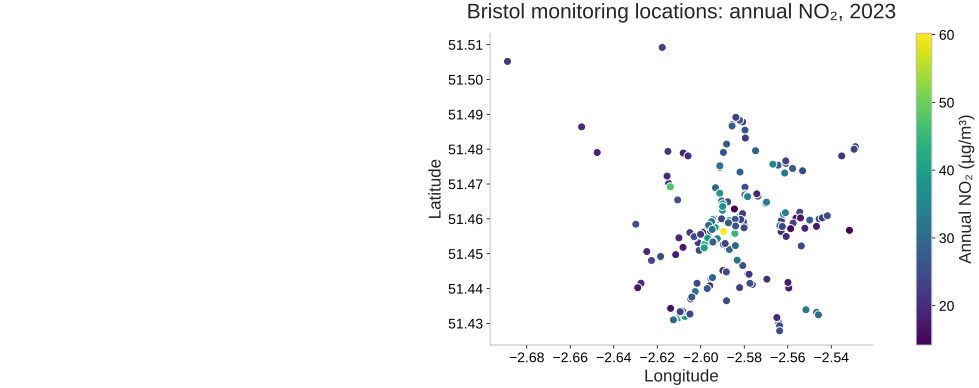

Annual NO₂ and hourly traffic counts have different temporal and spatial units. A defensible joint analysis requires an explicit matching design.

<p class="source">Bristol NO₂ measurements, 2023, reused from Weeks 7–8. Provenance in data/source-notes.md.</p>

## Reference: categorical and ordinal data {#ref-categorical .reference-slide}

Income bands such as “below £30,001”, “£30,001–40,000”, “£40,001–50,000” and “£50,001 or above” are ordered categories.

Codes 1, 2, 3 and 4 represent those categories; they are not the actual incomes.

A film's genre and age rating form two categorical variables. Cross-tabulations count combinations; percentages need a stated row, column or overall denominator.

Keep ordinal categories in meaningful order. A bar chart of group means instead summarises a numeric variable within categories.

## Reference: chart caveats {#ref-cards .reference-slide}

```{=html}
<div class="card-pair">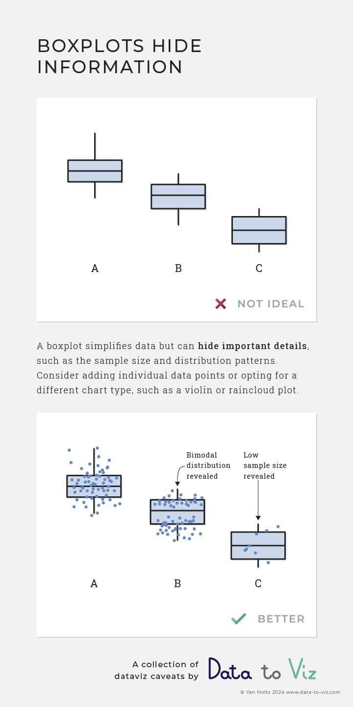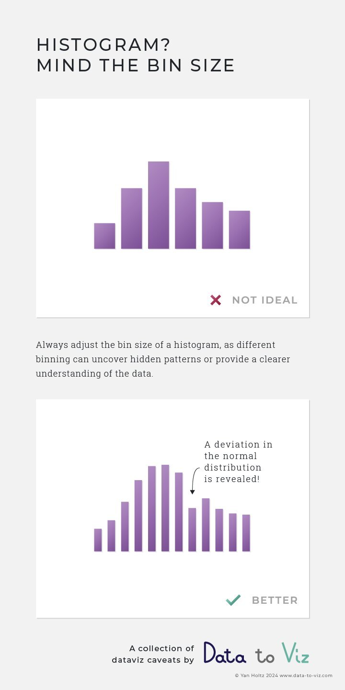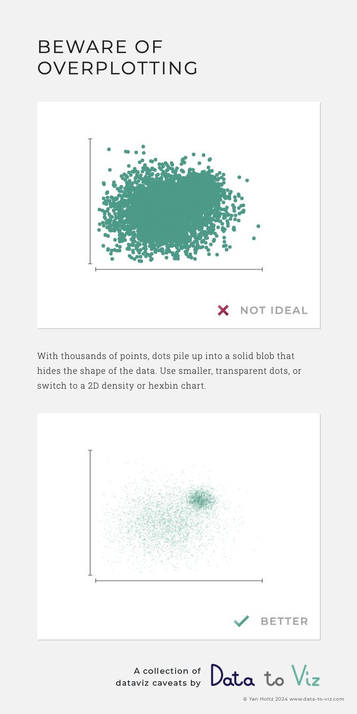</div>
<p class="source">Original flashcards: Yan Holtz, <a href="https://www.data-to-viz.com/caveats.html">61 Dataviz Caveats, Data to Viz</a>. See the linked gallery for readable originals.</p>
```

## Sources and further reading {#ref-sources .reference-slide}

<ul class="sources-list">
<li><a href="https://www.data-to-viz.com/">From Data to Viz</a> — poster by Yan Holtz and Conor Healy; flashcards: <a href="https://www.data-to-viz.com/caveats.html">61 Dataviz Caveats</a> by Yan Holtz.</li>
<li>Howard J. Seltman, <a href="https://www.stat.cmu.edu/~hseltman/309/Book/chapter4.pdf">Experimental Design and Analysis, Chapter 4</a>.</li>
<li>Department for Transport, <a href="https://roadtraffic.dft.gov.uk/downloads">road traffic downloads</a>. Saved Bristol 2023 survey data from Weeks 7–8; cars includes taxis.</li>
<li><a href="https://www.gapminder.org/fw/world-health-chart/">Gapminder / Hans Rosling</a>, multivariate world-health visualisation.</li>
<li><a href="https://docs.scipy.org/doc/scipy/reference/generated/scipy.stats.pearsonr.html">SciPy Pearson correlation</a>; <a href="https://www.itl.nist.gov/div898/handbook/eda/section3/eda35h.htm">NIST outlier guidance</a>; <a href="https://scikit-learn.org/stable/modules/preprocessing.html">scikit-learn preprocessing</a>.</li>
<li>Real chart examples: Full Fact (2019), Fox News via FlowingData (2011), and the supplied steel-production screenshot.</li>
<li>Anscombe (1973); Cairo, Matejka and Fitzmaurice (2017), Datasaurus.</li>
</ul>

<p class="small">Illustrative examples are labelled. Source data and teaching transformations are documented alongside the deck.</p>
